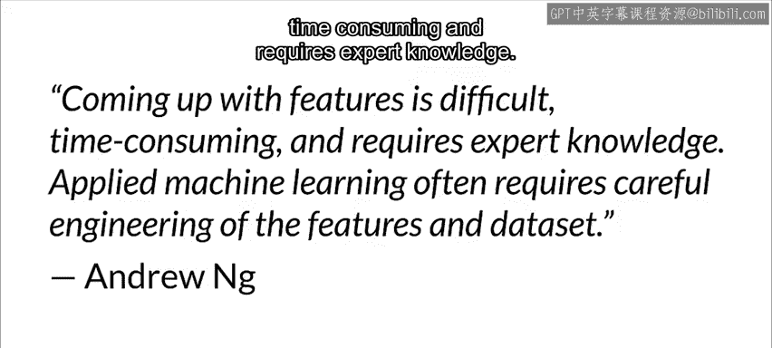
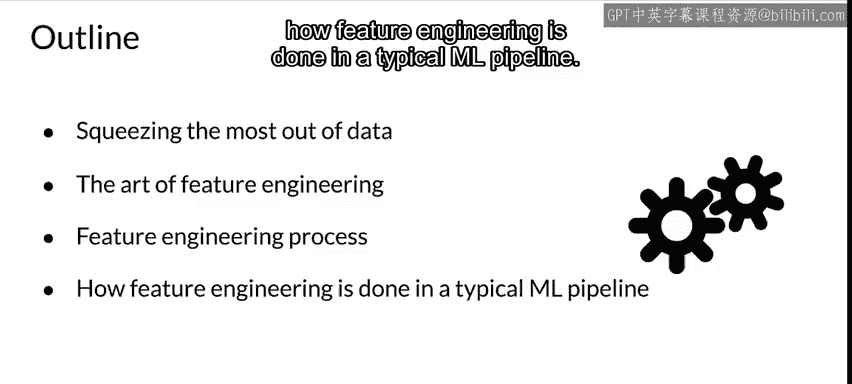
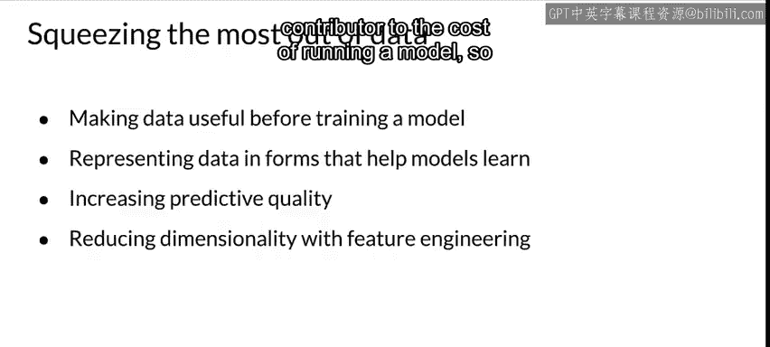
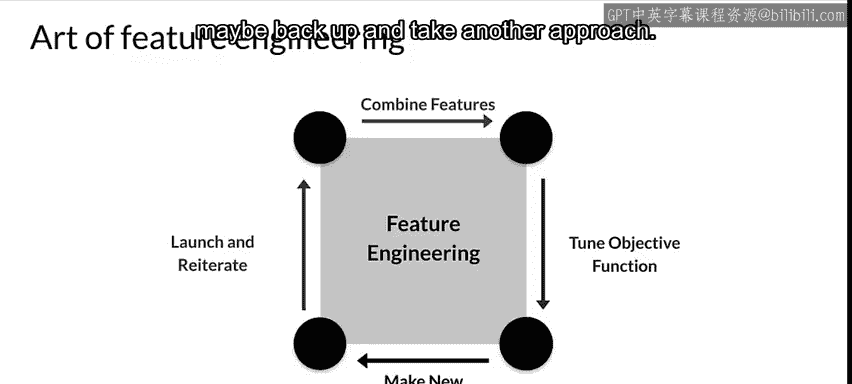
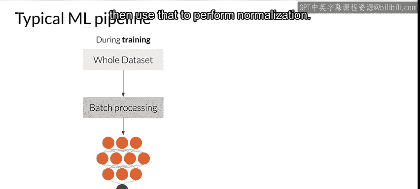
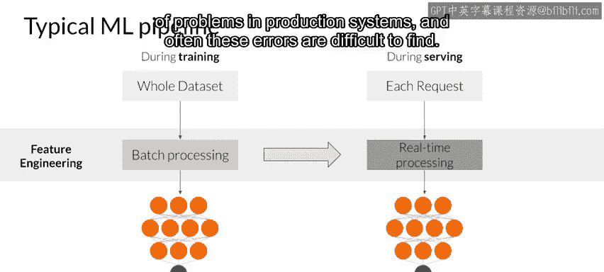
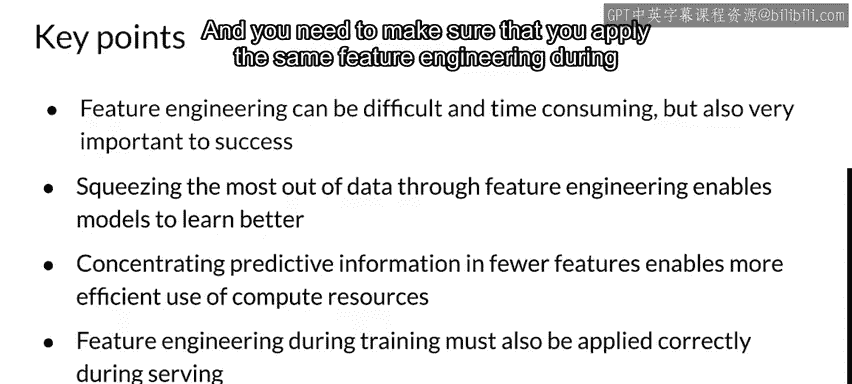

# 吴恩达《机器学习工程师的生产实践（MLOps）Machine Learning Engineering for Production》中英字幕 - P53：12_预处理简介.zh_en - GPT中英字幕课程资源 - BV1pi4y167g5

Hello and welcome to Fe Engineing， Trans and selection。

Now some of this material may seem like its review。

 especially from earlier courses or if you've worked in an academic or research setting。

 but here we're going to be focusing on production issues。

 one of which means being able to do all of this at scale in a reproducible and consistent way。

 so let's get started。Welcome to feature engineering， transformation and selection。

We'll start with an introduction to pre processing。

This is a quote from Andrew Ing。Coming up with features is difficult。

 time consuming and requires expert knowledge。 Applied machine learning often requires careful engineering of the features and data set。

So now let's take a look at what we're going to be talking about first we're going to look at how to get the most out of our data。

Then we'll take a look at the art and it really it is an art of feature engineering。

We'll look at the feature engineering process itself。

And how feature engineering is done in a typical ML pipeline。

So let's start with how we're going to squeeze data or squeeze information really out of our data。

So ML models usually require some data prepro to improve training。

You should probably by now have been training enough models that this is very familiar to you what may not be quite so familiar are some of the issues that are involved in production environment。

 so that's where we'll focus。The way that data is represented can really have a big influence on how a model is able to learn from it。

For example， models tend to converge much faster and more reliably when numerical data has been normalized。

So techniques for selecting and transforming the input data are key to increase the predictive quality of the models。

 and dimensionality reduction is recommended whenever possible so that the most relevant information is preserved while both the representation and prediction ability are enhanced。

And the required compute resources are reduced。Remember， in production of Mel。

 compute resources are a key contributor to the cost of running a model。

So let's kind of take a conceptual look at feature engineering here。

 the art of feature engineering tries to improve your model's ability to learn while reducing if if possible。

 the compute resources it requires， it does this by transforming and projecting。

 eliminating and or combining the features in your raw data to form a new version of your data set。

So typically across the ML pipeline， you incorporate the original features。

 often transformed or projected to a new space。And or combinations of your features。

The objectiveive function must be properly tuned to make sure your model is heading in the right direction and that it's consistent with your feature engineering。

You can also update your model by adding new features from the set of data that is available to you。

And like many things in ML， this tends to be an iterative process that gradually improves your results as you iterate。

 or you hope it does， you have to monitor that and if it's not improving。

 maybe back up and take another approach。

嗯。Feature engineering is usually applied in two fairly different ways。During training。

 you usually have the entire data set available to you。

 so you can use global properties of individual features in your feature engineering transformations。

For example， you can compute the standard deviation of a feature and then use that to perform normalization。

However， when you serve your train model， you must do the same feature engineering so that you give your model the same types of data that it was trained on For example。

 if you created a one hot vector for a categorical feature when you trained。

 you need to also create an equivalent one hott vector when you serve your model。However。

 during training and serving， you typically process each request individually。

 so it's important that you include global properties of your features。

 such as the standard deviation， if you used it during training and include that with the feature engineering that you do when serving。

Failing to do that right is a very common source of problems in production systems。

And often these errors are difficult to find。 so to review some key points。

As the quote from Andrewing demonstrates， feature engineering can be very difficult in time consuming。

 but it is also very important to success。You want to squeeze the most out of your data。

And you do that using feature engineering。By doing that， you enable your models to learn better。

You also want to make sure that you concentrate predictive information in your data into as few features as possible to make the best and least expensive use of your compute resources。

And you need to make sure that you apply the same feature engineering during serving as you applied during training。

