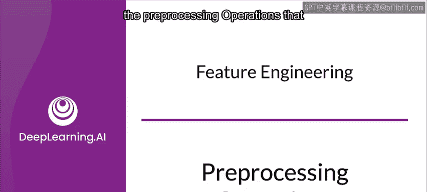
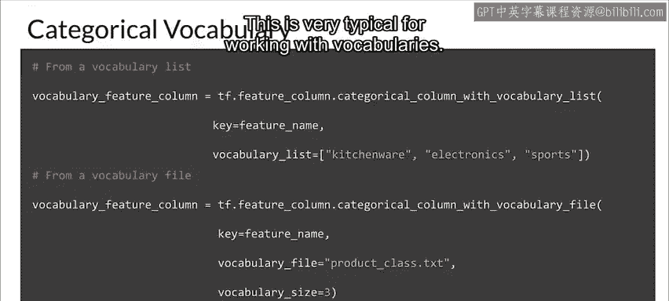
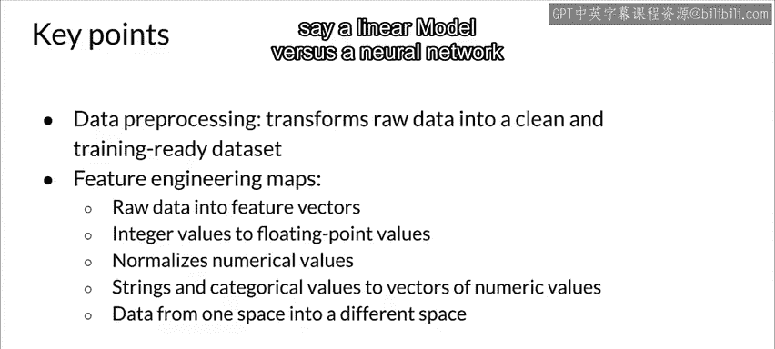

# 吴恩达《机器学习工程师的生产实践（MLOps）Machine Learning Engineering for Production》中英字幕 - P54：13_预处理操作.zh_en - GPT中英字幕课程资源 - BV1pi4y167g5

Now let's talk specifically about some of the pre processing operations that are used for feature engineering。

Let me tell you a story。Once when I was first starting out。

 I was in a hurry and I got the idea well I can just skip normalizing my data so I did that I trained my model and gosh。

 it wasn't converging。So I tried like adjusting hyperparameter and changing the layers of the model and looking for issues with the data。

 it took me a while to remember， oh yeah， I didn't normalize， maybe that had an impact。Well。

 I haven't made that particular mistake again， but you know， I've made other mistakes instead。

 let's help you dont。嗯。First， let's go over what we're going to be talking about。

 we're going to be going into the main pre processing operations。Obviously。

 this is not going to be an exhaustive list there's a lot of things you can do to data。

 but we'll cover some of the main ones anyway。It's going to start， of course。

 with mapping raw data into features。And then we're going to look at different kinds of features like numerical features and categorical features。

😊，And trying to understand how our knowledge of the data helps guide the way that we transform our features and engineer better features。

She。So here's some of the main prepro operation。One of the most important pre processing operations is data cleansing。

 which in broad terms， consists in eliminating or correcting erroneous data。

You often need to perform transformations on your data。

 so scaling or normalizing your numeric values， for example， since models。

 especially neural networks， are sensitive to the amplitude or range of numerical features data preprocessing helps machine learning build better predictive models。

Dimenssionalality reduction involves reducing the number of features by creating lower dimension and more robust data representations。

 and feature construction can be used to create new features by using several different techniques。

 which we'll talk about some of them。So this is an example of data that we have。

 we're looking at a house， this is data from a house。

 but this is only what we start with the raw data。So feature engineering because it's in performing an analysis。

Of the raw data and then creating a feature vector from it。For example。

 integer data can be mapped of floats and numerical data can be normalized and one hot vectors can be created from categorical values。

 feature engineering creates features from raw data and you're probably familiar with this。

So in this example， we're going to take a categorical feature called street name。

And we're going to one hot encode it as a way to make it better for a model to learn from。

So we're going to take that string feature， one hot encoded through feature engineering。

 and we get that feature of our feature vector through one hot end creating a vocabulary is another way to do that。

 so there's a couple of different ways Tensorflow provides two different functions for creating columns of categorical vocabulary and other frameworks do very similar things。

So categorical column with vocabulary list。Maps each string to an integer based on an explicit vocabulary list。

 feature name is a string which corresponds to the categorical feature and vocabulary list。

Is an ordered list that defines vocabulary feature a categorical column with vocabulary file。

 very similar， but from a file。Is used when you have too long a list and this function allows you to put the words in a separate file。

 So in this case， vocabulary list is defined as a file thatll allow you define the list of words。

 So this is very typical for working with vocabularies。

Yeah。But you also know some things about your data and part of that might be domain knowledge of the domain you're working in or just knowledge of。

 you know， how to work with different kinds of data。

So there's very different operations and preprocessing techniques that can help you increase the predictive information in say text data。

 so for text we have things like you know stemming and leitization and normalization techniques like TFIDF and Ngrams and embeddings and that really focuses on the semantic value of the words。

 and that's something we know as data scientists or machine learning engineers about working with data。

Images are similar， so there's things that we will know about how we can improve the predictive qualities of images。

 so things like clipping them， resizing them， cropping them。

 blurring them can often help using filters like canny filters or Sobel filters or other photometric distortions。

 all these things can really help us work with image data to improve its predictive quality。

So key points。Data preproces is a technique that's used to transform raw data into useful data for training the model。

And featureature engineering consists in mapping raw input data and creating a feature vector from it using different techniques with different kinds of data。

It can also include things like mapping data from one space。Into a different space， which。

 depending on the characteristics of the model， say a linear model versus a neural network。

 can have a big difference in how well the model can learn from it。

