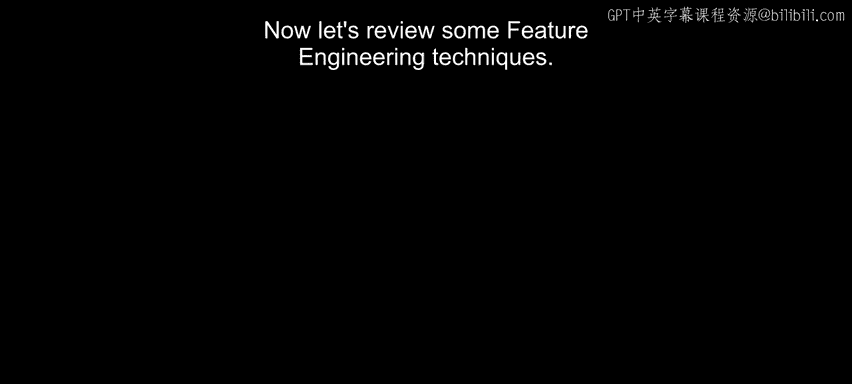
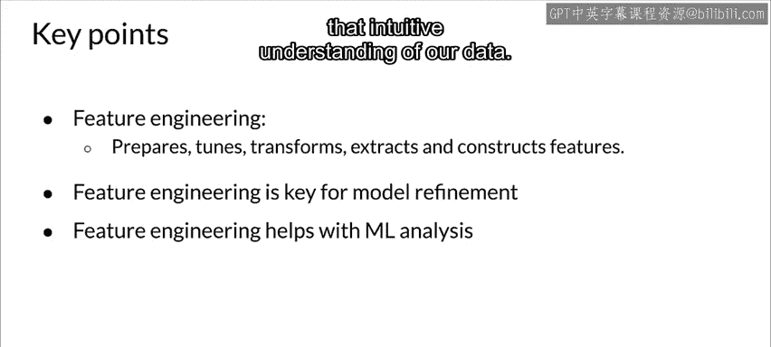

# 吴恩达《机器学习工程师的生产实践（MLOps）Machine Learning Engineering for Production》中英字幕 - P55：14_特征工程技术.zh_en - GPT中英字幕课程资源 - BV1pi4y167g5

Now let's review some feature engineering techniques。

So here's what we're going to talk about。There's basic feature scaling。

 usually especially with numerical data， what you're really doing is scaling the numerical features in different ways。

 We'll talk about some of the basics of these like normalization and standardization。

You can also do bucketizing or binning and we'll talk about that， that's a useful technique as well。

 and then some other techniques like dimensionality reduction for example， so let's get started。

Feature engineering takes a variety of forms like normalizing and scaling features and coding categorical values and so forth。

 so we have scaling and normalizing and standardizing we can also do grouping so that could be bucketizing or things like for text we could might do a bag of words and this is going to be very dependent on the particular algorithm that you're going to use so you have to understand the connection between the kinds of scaling or grouping that you do and the algorithms that you're going to be using with it。

So for scaling。As scalingen converts it a standard range and different techniques do it differently。

So for example， a grayscale image pixel intensity is typically expressed in the raw data as you know a number between 0 and 255。

 and then that's usually rescaled to negative 1 to1。So here's some Python， for example。

 for doing that。And the benefits of that are， you know it helps the neural network to converge faster or maybe converge at all in some cases。

 and you do it does weigh with a lot of the problems with not a number errors during training。

So for each feature， the model is really trying to learn the right weight and having them in the right numerical range helps a lot with that。

So for normalization， here's the standard formula for normalizing something it's also called min Max。

 so you're taking your x， you're subtracting the minimum value of that feature so you have to make a full pass over your data set to get that minimum value and then you subtract that then you divide by the maximum value minus the minimum value so again you're going to need to make a full pass to get those numbers and then it gives you a number that is between zero and1。

So normalization is usually good if you know that the distribution of your data is not Gaussian。

Doesn't always have to be true but typically you know that's a good assumption to start with a good rule of thumb if you're working with data that you know is not Gaussian or a normal distribution。

 then normalization is a good technique to start with。So normalization is widely used for scaling。

 you have a numerical feature that might start out like this where you know numbers are falling in that kind of a range。

 and you're going to transform that to the normalized version of that。

 which is bounded in a range between zero and1。So that's normalization and you're probably familiar with this。

 you know， although you may not have thought of some of the production implications like the fact that you need to make a full pass over your data set in order to get the numbers that you're going to need to perform normalization。

So the scales here are， again， between zero and1 and whatever the original was。Standardization。

 which is often using a Z score， is a different technique。

 so it's a way of scaling using a standard deviation。

So it's looking at the distribution itself and trying to scale relative to that。

So the example here is using you know， you have x and you're going to subtract the mean and divide by the standard deviation that gives you the disease score or the standardized value of x。

 which is somewhere between zero and the standard deviation。

So this is how that's expressed actually between some multiple of the standard deviation。

But it' centered around the mean of the data。So if the original look like this， again。

 a standardized value of that might look like this。 now notice that。This goes， it's centered on zero。

 so the mean is translated to zero， but you can have negative values and positive values that are beyond one。

 so it's a little bit less bounded transformation。Than a normalization is。 But。

 but there are some advantages to it。That your data is a normal distribution， then a standardization。

Technique is a good place to start， it's a good rule of thumb to start with for your numerical features。

 but I encourage you to try both standardization and normalization and compare the results。

Because sometimes it doesn't make much of a difference。

 sometimes it can make a substantial difference， it's it's good to try both。All right。

 moving on to bucketizing and binning。So we're going to take a look at an example where we have a house that was built in a particular year and we're going to bucketize that often you don't want to enter a number directly into a model instead you want to encode it as a category。

 by using it by grouping it a buckets so you notice how we've taken our number or year and we've created a one hot encoding of that that helps us learn from that number in a more really relevant way because the difference between 1960 and '61 isn't nearly as important as a difference between 1960 and 1970 in terms of the value that this feature contains。

So looking at how it gets bend into a one hot encoded vector。

You can see it's put into different buckets， so we can also look at that using facets。

 which is a nice visualization tool to help us look at that。And this really demonstrates。

 you know some of the value of bucketetizing and bidding。

 but it also is a good way to look at your data and try to understand it。

 which is an important part anytime you're working with data is making sure that you've。

You know you really have a good solid understanding of what's happening in your data and develop an intuitive sense for it so this kind of visualization can really help you do that。

So some other techniques， there's dimensionality reduction techniques， for example that。

You you can do so there's PCA which is going to project your data along the principal components in order to reduce the dimensionality of it。

 there's TNE which is is an important technique for embeddings often very useful uniform manifold approximation of projection is a it's a less wellknown technique but kind of interesting it has some interesting aspects we won't really go into that in detail and then feature cross crossing as well one of the things that you can use when you're working with embeddings is an embedding projector like the Terflow embedding projector that we're looking at here。

You can quickly get an idea of what your data looks like in a particular space， So that again。

 is helping you develop that intuitive sense of your data。 you can already see just looking at it。

 you can kind of get a feel for how it's clustered。

 you can see where different types of data land in that space。

 that understanding is very important to help you work with your data。

 This is really where some of the art of feature engineering comes into play where you as a developer。

 develop this understanding of your data。So it's an intuitive exploration。

Really important for high dimensional data， because， you know， we。

 we as humans can visualize maybe three dimensions。And then it gets really weird。

 you know even four is kind of hard and you know 20 is impossible so visualizing it and analyzing it is important and there's different techniques for doing that or for doing you know dimensionality reduction along that to help you understand that so PCA that you're probably familiar with principal component analysis and TNE and UMap that we just talked about a little bit and then there's other custom linear projections as well。

So that Tesorflowlow branding projector is available， it's free， you can go play with it。

 it's actually a lot of fun， but it's also a great tool to really help you understand your data。

There's the address for it。If you want to learn more。So key points for this particular section。

 feature engineering。It's going to prepare and tune and transform and extract and construct features where're going to work with features and change them from starting with our raw data through to the data that we're going to give to our model。

And feature engineering is very important for model refinement。

 it really it can make the difference between you successfully modeling something and not。

Feature engineering really helps with ML analysis and really developing that intuitive understanding of our data。

