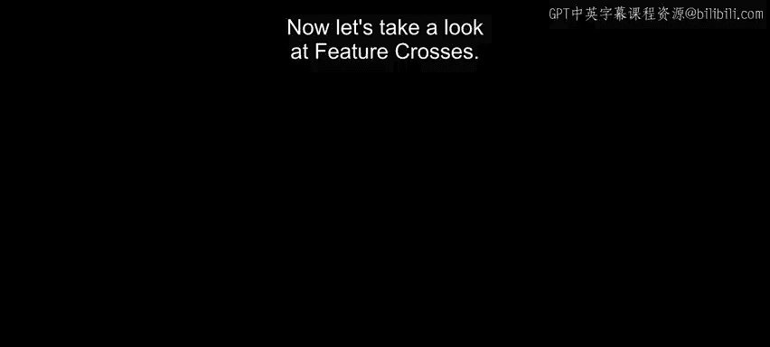
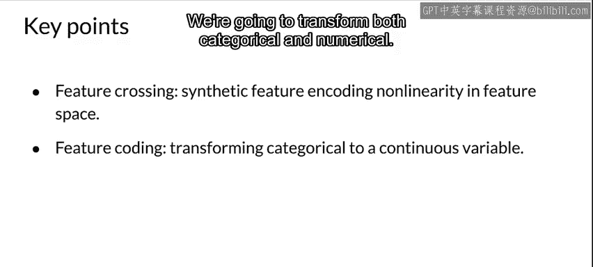
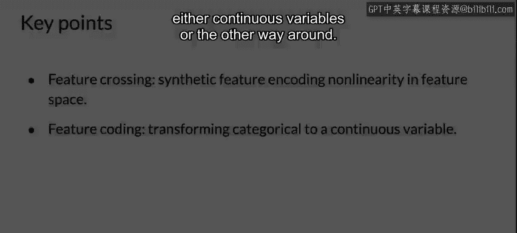

# 吴恩达《机器学习工程师的生产实践（MLOps）Machine Learning Engineering for Production》中英字幕 - P56：15_交叉特征.zh_en - GPT中英字幕课程资源 - BV1pi4y167g5

Now let's take a look at feature crosses， so feature crosses is the main thing that we're going to be talking about in this section。

 we're also going to take a quick look at encoding features。

So what are feature crosses， well， they combine multiple features together into a new feature that's fundamentally what a feature cross is。

It encodes non linearity in the in the feature space。

 or encodes the same information in fewer features。

So we can create many different kinds of feature crosses and it really depends on our data。

 so it requires a little bit of imagination to look for ways to try to do that。

 to combine the features that we have。So for example， if we have numerical features。

 we could multiply two features and produce one feature that is。

 you know an expression of those two features or X number of features if we could multiply them all together if they're numerical features and then end up with one feature instead of say five。

That's great， we can also take categorical features or even numerical features。

And combine them in ways that make sort of a semantic sense， so。

Taking the day of the week and the hour， if those are two different features that we have putting those together。

 we can express that as the hour of the week。 and we have the same information in one feature。

So to encode features， well， lets let's look at some examples。

 so suppose we have you know a data set that's looking at healthy trees and sick trees。

And we're going to use a scatter plot to try to understand our data and so we look at the scatter plot and we use some visualization tools and we ask ourselves。

 you know， can we draw a line to separate these two groups。

 these two clusters if we can use a line to create the decision boundary then we know that we can use a linear model and that's great。

So in this case looking at this， yeah we could use a line to do that separation so that's great the linear models are very efficient。

 we love that， but let's suppose the data looks like this not so easy anymore so this becomes a nonlinear problem so then the question is can we project this data into a linear space and use it with a linear model or do we have to use aline model to work with this data because if we try to draw just you know a linear classification boundary with the data as is it doesn't really work to great。

😊，And again， we can use visualization tools to help us understand this。

 so looking at our data really helps inform us and guide you know the choices that we make as developers about what kind of models we choose and what feature engineering we apply。

So key points here， feature crossing is a way to create synthetic features。

 often encoding nonlinearity in the feature space。We're going to transform。

 especially categorical features， well， actually both categorical and numerical。

 and we can do that into either continuous variables or the other way around。

