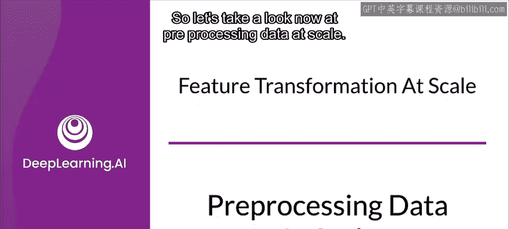
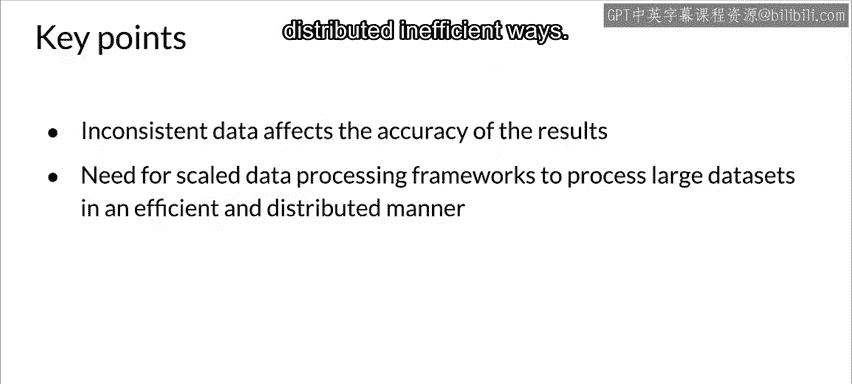

# 吴恩达《机器学习工程师的生产实践（MLOps）Machine Learning Engineering for Production》中英字幕 - P57：16_大规模预处理数据.zh_en - GPT中英字幕课程资源 - BV1pi4y167g5

We've probably all done feature engineering before。

 but it's one thing to do it in a notebook with maybe a few hundred megabytes of data and quite another thing to do it in a production environment with maybe a couple of terabytes of data in a repeatable。

 automated process。 Let's take a look now at how to do feature engineering at scale。

Okay， so it's one thing to do transformations and feature engineering on a one off basis。

 say in a notebook， but it's another thing to do it at scale in a production environment in a reproducible and repeatable and consistent way。

 so let's take a look now at preproces data at scale。

So first， let me tell you a story I once worked。As a data scientist in a production environment where we were deploying our workloads。

 our production workloads on Apache stormor and it was a nice nice platform it the performance was was pretty good on it。

 we as data scientists created our models in notebooks and then deployed them into Apache Stor。Well。

 it wasn't quite that simple， we were developing our notebooks in Python。

 and then when we deployed into storm， we had to translate all of the feature engineering that we did into Java。

Well， as you can imagine， that was not ideal。 And there were little weird problems that cropped up。

 often very difficult to find doing that， that transformation。

 This is not an ideal way to do production， machine learning。

So what is a much better technique is to use a pipeline。

 a unified framework where you can both train and deploy with consistent and reproducible results。

So we'll be learning about that in this course， let's take a look now at some of the issues of doing feature engineering at scale。

So here's what we're going to be talking about。Inconsistencies in feature engineering very important。

 pre processingces granularity， also an interesting issue working in a production environment。

Preproch is saying the training data is one thing and optimizing the instance level transformations for that is you something kind of different。

 but there's a number of challenges that you need to deal with。So to pre processces data at scale。

 we start with real world models and these could be terabytes of data。

So when you're doing this kind of kind of work， you want to start with a subset of your data。

Work out as many issues as you can， think about how that's going to scale up to the terabytes that you need to actually work with your whole data set。

Large scale data processing frameworks are different than what you're going to use。You know。

 on your laptop or in a notebook or what have you， so you need to start thinking about that from the beginning of the process。

 how this is going to be applied and the earlier you can start working with those frameworks。

The more you'll work out the issues early with smaller data sets and quicker turnaround time。

Consistent transformations between training and serving are incredibly important。

 If you do different transformations when you're serving your model than you did when you were training your model。

 you are going to have problems。 and often those problems are very hard to find。

So inconsistencies in feature engineering， the training and serving code paths。

When you are training your model you have code that you're using for training if you' are using different code like we were。

 we were using Python for training and Java for serving， that's a potential source of problems。

So and you could have different deployment scenarios。

 you might be deploying your model in different environments， you could be using the same model。

 say you know in a serving cluster and using it on an IoT device as well。

So there's different deployment targets and you need to think about those and what are the CPU resources or the compute resources that you have available on those targets？

So mobile for example， you know， very tight compute resources， servers， you have more luxury。

 but again， you know cost is a big factor and you know in a web browser。

 you know that could be deployed on different clients so you need to think about that as well you don't want to be too heavy。

Though there's risks in introducing training serving SUs。

What happens because of those different code paths between training and serving。

 if if you don't have exactly the same transformations happening between the two and the best way to do that is is use exactly the same code。

 then you have a potential problem。And that's going to lower the performance of your model。

 so your model may， you know， completely just air out or give wacky results。

 or it may be just slightly off in certain circumstances and display sensitivity around certain things。

Those things are much harder to detect。So there's a notion of the granularity at which you're doing pre processing。

So you need to think about this， you're going to do transformations at both the instance level。

And a full pass over your data。 and depending on the transformation that you're doing。

 you may be you know doing it in one or the other。 You can usually always do instance level。

 but full paths requires that you have the whole data set。 So for clipping， even even for clipping。

 you need to set clipping boundaries if you're not doing that。

 you know through some arbitrary setting of those boundaries if you're using the data set itself to determine how to clip then you're going to need to do a full pass。

 So min max for clipping is going to be important doing a multiplication at the instance level is fine。

 but scaling well， now I'm going to need probably the standard deviation and maybe the min and max。

Bucketizing similarly， or unless I know you know， ahead of time what buckets are going to be。

 I'm going to need to do a full pass to find what buckets make sense。

Expanding features I can probably do that at the instance level。

 so these two things are different at training time I have the whole data set so I can do a full pass。

 although it can be expensive to do that。At serving time。

 I get individual examples so I can only really do instance level。

 So anything I need to do that requires characteristics of the whole data set。

 I need to have that saved off so I can use it at serving time。So when do you transform？

You're going to preprocess your training data set。And there's pros and cons in how you do that first of all' you only run it once per training session。

 so that's cool and you're going to compute it on the entire data set but but only once you know for each training session。

The cons， well， you're going to have to reproduce all those transformations at serving or save off the information that you learned about the data like the standard deviation so that you can use that later while you're serving。

And there's， you know， slower iterations around this each each time you make a change。

 you got to make a full pass。Over the data set， so you can do this within the model。

Transforming within the model has some nice， you know nice features to it， there are cons as well。

First of all， it makes iteration somewhat easier because it's embedded as part of your model。

 and there's guarantees around the transformation that you're doing。

But the cons are it can be expensive to do those transforms。

 especially when you know your compute resources are limited。

 and think about when you do a transform within the model。

 you're going to do that same transform at serving time。

 so you may have say GPUs or TUs when you're training， you may not when you're serving。

So there's long model latency that's， you know， when you're serving your model。

 if you're doing a lot of transformation with it that can slow down the response time for your model and increase latency and you know you can have transformations per batch that skew that we talked about。

 if you haven't saved those constants that you need that could be an issue。

You can also transform per batch instead of for the entire data set。So you could， for example。

 normalize features by their average within the batch that， you know。

 only requires you to make a pass over each batch and not the full data set， which you know。

 when you're working with terabytes of data that can be a significant advantage in terms of processing and there's ways to normalize per batch as well so you could compute an average and use that in normalization per batch and then do it again for the next batch there will be differences batch to batch sometimes that's good in cases so for example。

 where you have changes over time in a time series that can be a good thing but you need to consider that So normalizing by the average per batch。

precompeting the average and using it during normalization， you can use it for multiple batches。

 for example， so this is you know different ways to try to think about how to work with your data especially when you have a large data set。

You need to think about optimizing the instance level transformations as well。

 because this is going to affect both the training efficiency and your serving efficiency。

So you're going to have accelerators that you need to consider。

 they may be sitting idle while your CPU is doing transforms。

 that's something that you want to try to avoid because accelerators tend to be expensive。

So as a solution， you can prefetch your transformations and use your accelerators more efficiently。

So by prefeting， you can prefetch with your CPU， feed your accelerator， your GPU or TU。

And try to paralyze that processing。So again。This all gets down to cost and how much it costs to train and the time required as well to train your model and how efficient it is。

So to summarize the challenges， we have to balance the predictive performance of our model and the requirements for it。

Making full pass transformations on the training data is one thing if we're going to do that。

 then we need to think about how that works when we serve our model as well and save those constants。

And we want to optimize the instance level transformations for better training efficiency。

 so things like prefeing can really help with that so key points inconsistent data affects the accuracy of the result。

So scalable data processing frameworks allows us to process large data sets in distributed and efficient ways。

 but we also need to think about how that gets applied in serving。

