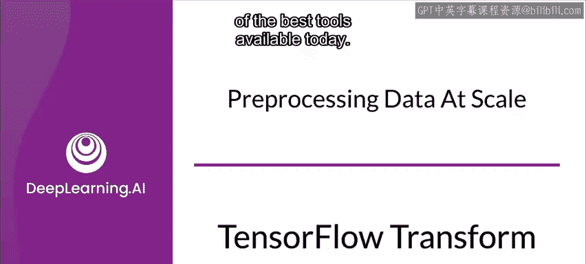
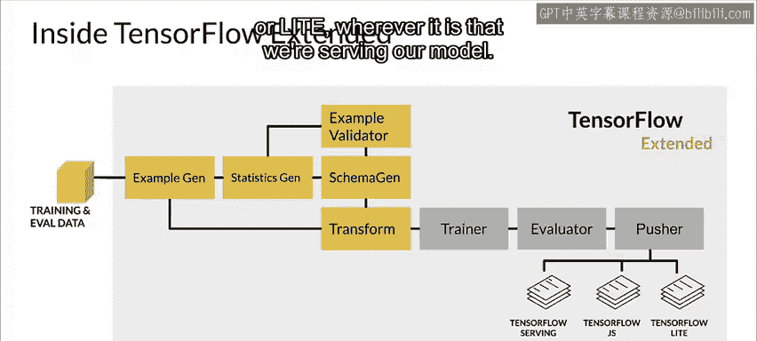
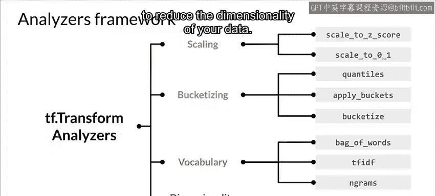
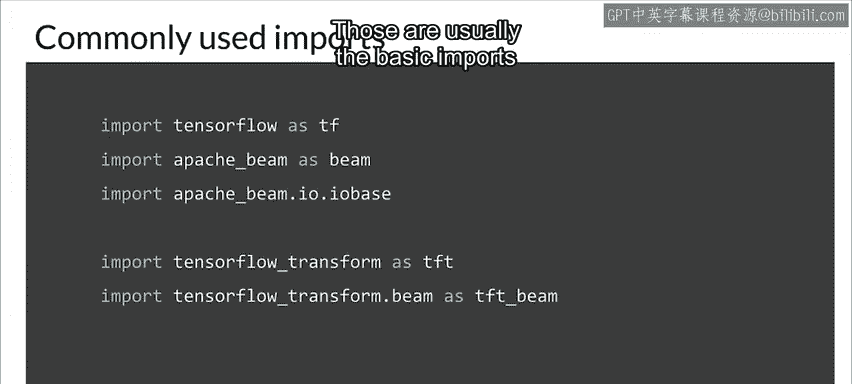

# 吴恩达《机器学习工程师的生产实践（MLOps）Machine Learning Engineering for Production》中英字幕 - P58：17_TensorFlow Transform.zh_en - GPT中英字幕课程资源 - BV1pi4y167g5

So to do pre processing at scale， we need good tools。

 and Tensorflowlow transform is one of the best tools available today。 Let's take a look。

First of all， here's what we're going to be talking about。

We're going to go a bit deeper into how transform works， what it does， and why it does it。

We're going to look at the benefits of using Tensorflow transform。

 how it applies feature transformations。And we're going to look at some of the analyzers and the role they play in doing preproces。

So let's talk about transform。First off， it does what you might think it would do。

 it takes training data。And it's going to process it。

 and the end result is going to be deployed into the serving system。

In the middle there's a pipeline that is used and there is metadata that forms a key role in organizing and managing the artifacts that are produced as data is transformed。

 one of the reasons that's important is because we want to understand the lineage or provenance of those artifacts and be able to connect them and find the chain of operations that generated each of them。

So we have our training data that that is the input data into the system that forms an artifact。

We give that to transform and it transforms our data。

 so it's going to take our raw data and move it into the form that we're actually going to use that's our feature engineering。

And that's given to the trainer， which is going to do training and transform and trainer here are both components in an ML pipelines。

 specifically a TFX ML pipeline。So the result of trainer， of course。

 is a train model that is also an artifact and that gets delivered to the serving system。

 whatever kind of system we're using where it's going to be used to run inference。

 So looking at this a little differently， We're starting with our training and Eval data。

 we've actually split our data set misleading， we split it with example gen So example Gen does that split Those get fed to statistics gen。

 These are both TFx components within a TFx pipeline。

 So example Gen as a component statistics gen as a component statistics gen calculates statistics for our data。

 So for each of the features， if they're numeric features， for example。

 what is the mean that of that feature value， what is the standard deviation。The men， the max。

 so forth。Those statistics get fed to schema gen， which infers the types of each of our features。

 so that creates a schema that is then used by downstream components。

 including example validator which takes those statistics and that schema and it looks for problems in our data。

 we won't go into great detail here about the kinds of things it looks for， but it it's things like。

 you know， if we have examples that are the wrong type in a particular feature。

 So maybe we have an integer where we expect it to float。 Now we're getting into transform。

 So transform is going to take the schema that was generated and the original split data set and it's going to do our feature engineering。

 So transform is where the feature engineering happen。That gets given to trainer。

 there's an evaluator that evaluates the results and a pusher that pushes it to our deployment targets。

 which is， however we're serving our model， so Tensorflow serving or JS or light。

 wherever it is that we're serving our model。

So internally， if we want to look at the transform component。It's getting inputs from， as we saw。

 example Gen and schema Gen， so that is the data that was originally split by example Gen and the schema that was generated by schema Gen。

 and that schema by the way may very well have been reviewed and improved by a developer who knew more about what to expect from the data than can be really inferred by schema Gen。

As referred to as curating the schema。So transform gets that。

And it also gets a lot of user code because we need to express the kinds of feature engineering we want to do。

 so if we're going to normalize a feature， we need to give it user code to tell transform to do that。

The result is a graph， a Tensorflow graph， which we refer to as the transform graph。

And the transform data itself。The graph expresses all of the transformations that we are doing on our data as a Tensorflow graph。

The transformed data is simply the result of doing all those transformations。

Those are given to trainer， which is going to use the transform data for training。

 and it's going to include the transform graph and we'll take a look at that in a second。

 So we have a user provided transform component， and we have a schema for it。

 We apply our transformations during training， and as we'll see later。

 we also apply those transformations at serving time。

And there's a lot of performance optimizations that we apply as well。

 and we'll take a look at that in a second。So continuing a little deeper here。We have our raw data。

And we have a transform， our transform component， it produces a tensorflow graph。

The result of running that graph is process data。 It's been transformed。

So that gets given in model training the process data is given to our trainer component where we use it for training our model。

 traininging our model creates a tensorflow graph， so notice now we have two different graphs we have a graph here from transform and a graph here from training So using the TF transform API。

 we express the feature engineering that we want to do。And we give that code。

 or rather the transform component gives that code to a beam。

 Apache beam distributed processing cluster。So that way we can do， and remember。

 this is all designed to work with， you know， potentially terabytes of data。So。

That could be quite a bit of processing to do all of that transformation。

 using a distributed processing cluster by using Apache beam gives us the capacity to do that。

The result is a saved model。 Sa model is just a format that expresses a trained model。

 as a saved model。So that gets included， we have both。The transform graph and the training graph。

Those are given to our serving infrastructure。 So now we have both of those graphs。

The feature engineering that we did and the model itself， the trained model。

 and those are used when we serve requests。So looking at this a little differently。

 we have analyzers。Anbols are running and again we're using TensorFlow and we're using the Tensorflowlow transformform API。

 they're using TensorFlow ops。And a big part of what they do。

 What an analyzer does is it makes a full pass over our data set in order to collect constants。

That we're going to need when we do feature engineering。 So， for example。

 if we're going to do a min max， well， we need to make a full pass through our data to know what the min and the max are for each feature that we're using for that。

 So those are constants that we need to express。So we're going to use an analyzer to make that pass over the data and collect those constants。

 It's also going to express the operations that we're going to do。So they behave like Tensorflow ops。

 but they only were on once during training， and then they're saved off as a graph。So for example。

 if we're using the TftT。min， which is one of the methods in the transfer SDK。

 it'll compute the minimum of a tensor over the training dataset set。

So looking at how that gets applied， we have the graph that is our feature engineering。

We run an analysis across our data set to collect the constants that we need。

And really what we're doing is we're enabling us later to apply these into our transform graph so that we can transform individual examples without making a pass over our entire data set。

That gets applied during training。And the same exact graph gets applied during serving。

 So there is no potential here for training and serving Sw or having different code paths when we train our model versus when we serve our model that cause problems in。

 you know， those not being equal not being equivalent。

 We're using exactly the same graph in both places， So there is no potential for doing that。

So what are the benefits of that， well， the emitted graph that transform emits is it has all necessary constants and transformations that we're going to need。

The focus is on data pre processing only at training time。

 so it's doing that processing as well as generating that graph。

At works in line during both training and serving， we prepend it to our train model。

So there's really no need for preproces code at serving time。

 and it consistently applies those transformations irrespective of the deployment platform。

 remember we could be deploying our model to a Tensorflowlow server or a mobile device using Tensorflowlow light or a web browser using Tensorflowlow JS。

And using the same tetrafgraph in all places， we're going to get exactly the same transformations。

So the analyzer framework itself has some different aspects first of all you can do scaling so things like scaling with a Z score or just scaling between zero and 1 bucketizing so we're going to bucketize to quantiles。

 for example， or we're going to set up a set of buckets and then we're going to take those values that we have and assign them to the buckets so that we have categorical values for numerical ranges of value。

Or vocabularies， so things like running TFIE， for example， a bag of words or Ngramms。

You often in text processing need to work with vocabulary and you can do dimensionality reduction too。

 so you can do a PCA transform to you know reduce the dimensionality of your data。

So now let's look at some code。We're going to create a pre processing function。

 this is the entry point that we're going to use to define the user code that expresses the feature engineering that we're going to do。

So for example， we may make a passover our data to look for floats and we're going to for our floats。

 we're going to scale those using a Z4 this is just an example。

 you know you're going to do whatever feature engineering you have to do。

 but it's this kind of style of code that you're working with and this is of course Python。

Vocabulary very very similar， so if we have features that are vocabulary features or that we want to use with vocabulary。

 we would do this kind of thing， so these constants here are lists of the keys for each of the features that we want to group into that particular kind of transformation。

So bucket features exactly the same kind of thing thats that bucket feature keys constant is just a list of the keys for the features that we want to bucketize。

So imports， well， you're going to import Tensorflow， obviously Apache beam。

 you're going to need that because remember Trans is going to use Apache beam to distribute processing across a cluster now you can also just use beam on a single system you can just run it on your laptop so it has something called the direct runner so you don't need to actually set up a cluster you can just run it and there's nothing to no infrastructure to set up and in development that's that's pretty useful in a deployment unless you're working with a small amount of data you probably want more compute horsepower than that。

Apachebeam。io。obase is part of that， it helps us with IO in different formats and different ways reading and writing。

Tenssorflow transform itself， obviously often we use the abbreviation of TftT for that。

 and then transform itself has a beam part of its module。

 so that's often nice to kind of pull out separately and work with。

And those are usually the basic imports that we need to work with transform。

