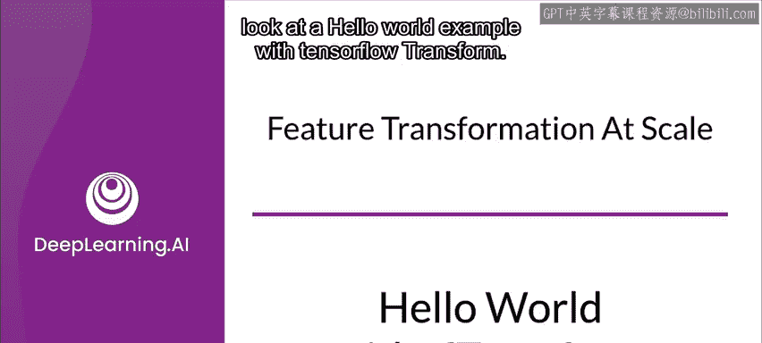
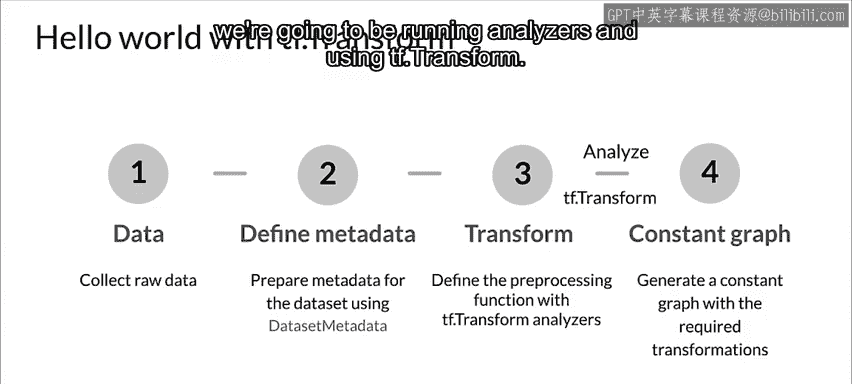
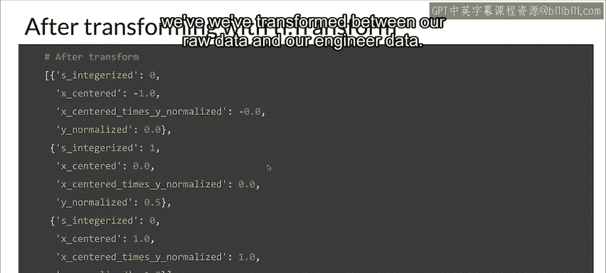
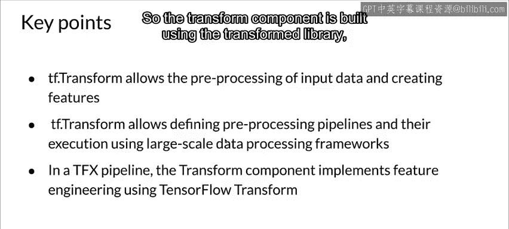
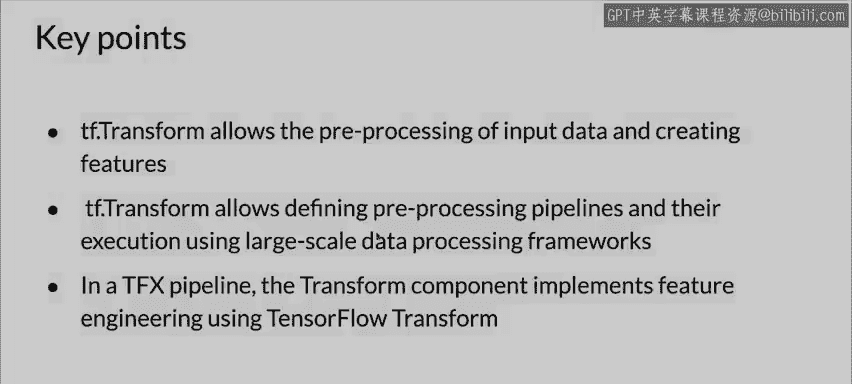

# 吴恩达《机器学习工程师的生产实践（MLOps）Machine Learning Engineering for Production》中英字幕 - P59：18_使用TF Transform的Hello World.zh_en - GPT中英字幕课程资源 - BV1pi4y167g5

。Now， let's put this all together and look at a hello world example with tensor flood transform。

So here's what we're going to do， we're going to collect some raw data。

And we're going to define the metadata around that data。

Then we're going to run transform to transform that raw data into features。

And that's going to produce a graph。And we're going to in the background we're going to be running analyzers and using TF transform so we start with collecting our raw data。

 which in this case is very simple， it's just some static data that we've created for the example。

 so we have three different features here X， Y and S so。

We express the types of those features and information about them， as metadata。

So we're going to import the metadata module within Tensorflow transform and we're going to express that metadata using a feature spec so we can create a feature spec that expresses some information about our feature so this is telling us that Y is a float feature first of all。

 and then it's a fixed length feature so this is not a for example。

 a sparse feature or a ragged tensor its fixed length feature so both y and x are fixed length float features and then S is a string feature also fixed length。

So now we go， this is our pre processing function， this is where our user code is going to go。

 it's the entry point for our user code anyway。So you can see here we're pulling the values for X。

 Y and S from our inputs， and then we're going to do some transformations。

 these are very simple transformations， so we're going to center X and that's going to require the mean so that in the background without us thinking about it really is going to make a pass over the data or as it makes it pass。

 it's going to collect that that that mean so we can use it here。

We're also going to do a normalization using very simple scale to between0 and 1。

 so that's our y normalized again， going to need pass over the data to do that that's going to be the same pass It only does one pass。

And then we're going to take that string feature that we have S and we're going to create a vocabulary for it and apply it so that we get at an integer value for S。

 a vocabulary， and then we create a feature cross， so this is a purely synthetic feature。

 so we're using our value for X that we've centered and our value for y that we've normalized and we're creating a synthetic feature called appropriately x centered at times y normalized。

 which is verbose but accurate。Okay， and then that's going to return well。

 the values that we just created， so that's our feature engineering。

 we took in raw data and here are our transformed features that we've created。

 we've engineered these features。So。Again。We took tensors in。 So for x， we took integer values。

 and for S， we took strings。 and for y， we also took integer values。

 Those passed through the code that we wrote to express our feature engineering。

 The entry point of that was the pre processing function。And coming out of that。

 we get our engineered features。Including the vocabulary version of our string feature that we have created vocabulary for。

So now we're going to run our code to do the processing that requires us to create a main in this case。

 because we're just using pure Tensorflow transform as a library to run our feature engineering。

 I want to point out， though， typically you would often be doing this in a TFX pipeline using a transform component。

 The code is really the same in the preprocessing function that we just looked at。

But here it's a little bit different because we're running in Tensorflow transform and not in a transform component in a TFx pipeline。

 So this is one of the ways that you can run transform。

 I just want to make you aware that this part that we're looking at here is not how it looks when you run it in TFx。

 So here we're using we're just running it inside a main function。

 and we're going to do that using Apache beam that's going to require us to establish a context for Apache beam。

 and then we're going to define a beam pipeline using the beam Python syntax。

 which is a little bit different than you might expect one of the things to get used to here is the pipe operator。

 So what that says is I'm going to run Tft beam I've establish that in the context。

 I'm going to use the analyze and transform data set to run my preprocess function。

That's going to return a result。 Actually， in this case， is a tuple result。

 So it's going to return both the raw data and the raw data metadata。

 So this Python syntax is a little bit different than what you might be used to for Python。

 That is specific to Apache beam。So we have our transform data， we have our transform metadata。

 and we get that from our transform data set。So we can print out the raw data and the transform data and run our main so before we ran transform。

 we had features like this。After running transform， we have。Features like this。

So that's our transformation， we've transformed between our raw data and our engineered data。

So key points on this hello world example of using Tensorflow transform actually outside of TFX。

 although you would often be running this as part of the TFX transform component。

It allows pre processing on the input data and creating the features。

 well that's what transform is for it's the feature engineering that we're going to do。

It allows defining pre processing pipelines that are going to run and do their execution on large scale data processing frameworks using Apache Beaam。

 Apache Beaam runs on top of other frameworks like Spark or Flink or Google Cloud Dataflowlow or actually just on your laptop using what's called the direct runner。

And at TFX pipeline， the transform component implements feature engineering using Tensorflow transform。

 so the transform component is built using the transform library。

 the TensorFlow transformform library。

