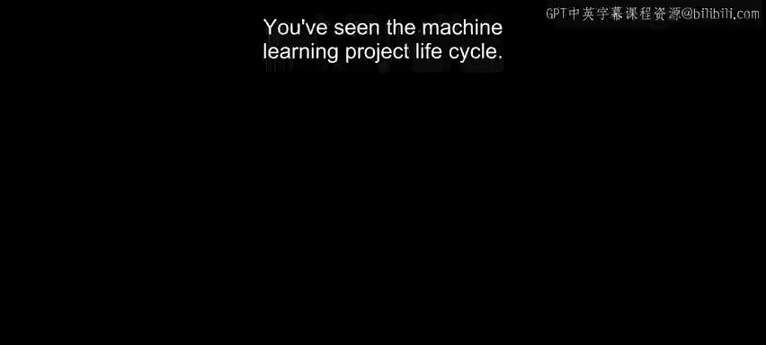
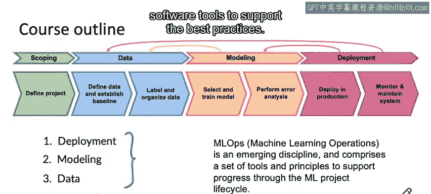

# 吴恩达《机器学习工程师的生产实践（MLOps）Machine Learning Engineering for Production》中英字幕 - P5：4_课程大纲.zh_en - GPT中英字幕课程资源 - BV1pi4y167g5

Yeah。

You've seen the Ma learning Project lifecycle， let's briefly go over what you learn in the rest of this course。

Even though I presented the life cycle going from left to right。

 I found that for learning these materials。It'll be more efficient for you to start at the end goal and start from deployment and then work backwards to modeling data and then scoping。

 So in the rest of this week， starting with the next video。

 you learn about the most important ideas in deployment。😊，Next week， in week two。

 you learn about modeling。You may have learned about how to train a machine learning model from other causess in this video I'll share some new ideas that you may not have heard before of how to systematically use a datacentric approach to be more efficient in how you improve the performance of your model then in the third and final a week of this course。

 you learn about data how to define data and establish a baseline and how to label and organize your data in a way that is systematic。

 not at ho， not hacking around in the Jupyter notebook in the hope that you stumble on the write insight。

 but in the more systematic way that helps you be more efficient in defining the data that will help the modeling to help you get to deployment and then finally in week3 we' also have an optional section on scoping in which I hope to share a few some tips I've learned on how to define effective machine learning projects throughout this course you also learn about M。

Oor machine learning operations， which is an emerging discipline that comprises a set of tools and principles to support progress through the machine learning project lifecycle。

 but especially these three steps for example， at landing AI where on'm CO。

 we used to do a lot of these steps manually， which is okay， but slow。

 but after building an MOs2 called Land lens for computer vision applications。

 all these steps became much quicker。The key idea in MLOs is that systematic ways to think about scoping。

 data， modeling and deployment， and also software tools to support the best practices。

So that's it in this course， we're going to start at the end goal， start from deployment。

 and then work our way backwards。As you already know。

 being the deploy a system is one of the most important and valuable skills in machine learning today。

 so let's go on to the next video where we'll dive deep into the most important lessons。

 most important ideas needed to deploy machine learning systems I will see in the next video。😊。

