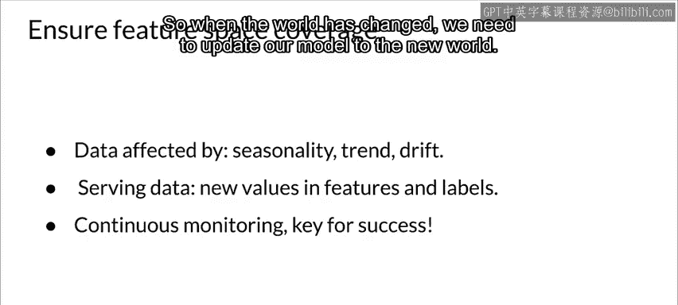

# 吴恩达《机器学习工程师的生产实践（MLOps）Machine Learning Engineering for Production》中英字幕 - P60：19_特征空间.zh_en - GPT中英字幕课程资源 - BV1pi4y167g5

One of the important aspects of shaping your data is to consider the feature space that your data covers。

 let's take a look。

So here's what we're going to be talking about， first of all， just an introduction to feature spaces。

And then an introduction to feature selection as well。

We'll talk about filter methods and wrapper methods and embedded methods。

 Those are methods of feature selection In this first section。

 we're really just looking at feature spaces。So what are feature spaces？ Well。

 a feature space is defined by the n dimensional space that your features define。

 So if you have two features， a feature space is two dimensional。 If you have three features。

 it's three dimensional and so forth。 it does not include the target label so that we're just talking about your features。

So if this is your feature vector， you have a feature vector x and it has values from zero to D here。

 that's the dimensionality of that vector。And that defines a space。

 So in this case that's a 3D space。 we have three features， we have a 3D space。

Or if we're looking at it in a2D space with with a two dimensional feature vector。

 we could express it as a scatter plot with a 2D space。

 Those are fairly easy for us as humans to imagine。So looking at it a little differently。

 here's an example using features that you might have for a house。

So the number of rooms for the house or actually any kind of building， really。

 the square footage of it， where it's located and a price。

 So maybe we're trying to figure out how sales。So in this case。

 the F is your model and it's acting in your feature space， and it's going to produce a result why。

Looking at a classification situation or problem we have again so this is going to be a two dimensional space。

 we have different distributions of the examples within our feature space in an ideal case they're easily separable ideally with a linear function in a realistic case。

 well maybe we can do that with a linear function if we sort of fudge around some of the some of the examples。

And then we have， you know poor examples where it's difficult to do with a linear function。

 we're working in a nonlinear feature space and you know maybe we can use a projection to help with that or maybe we just have to use a nonlinear model。

But what we're going to try to do is draw a boundary within that feature space。

 so here's a case where we're drawing you know maybe a parametric boundary。

But the model is going to try to learn that decision boundary。

The boundary is used to classify the data points。 So that's what our model is learning。

 As a result of knowing where that boundary is。 It can take an example that is given to it and decide。

 in this case， which class it falls into。So feature space coverage is important。

 the examples that you give data to your model rather to train and for evaluation have to be representative of the examples that you're going to see when you serve your model。

 in other words， the requests that are going to be given to your model and where they fall in your feature space that region of your feature space has to be covered when you train and evaluate your model as well。

 so that means the same numerical ranges or for classes， the same classes。

And you need similar characteristics for image data as well。 So it's not quite so， you know。

 numerical， but it's still expressing a space。And similarly for vocabulary， in this case。

 we have syntax and semantics that we have to consider as well for natural language problems。

So we need to ensure that we've covered the same space if we're doing time series problem。

 we need to consider seasonality， trend and drift， and that includes for the serving data。

 we may have new values that we find in new labels。

 that's going to influence the concept drift as we've talked about previously。

 so we need to be aware of that and design processes to deal with that。

That means we need continuous monitoring， which is going to be a key for success in these situations。

 Remember， as we've talked about before， the world changes。

 and our model only learns one version of the world。 So when the world has changed。

 we need to update our model to the new world。

