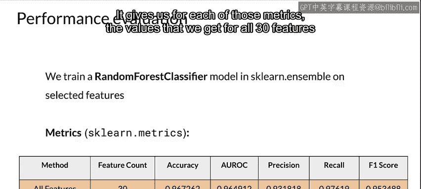

# 吴恩达《机器学习工程师的生产实践（MLOps）Machine Learning Engineering for Production》中英字幕 - P61：20_特征选择.zh_en - GPT中英字幕课程资源 - BV1pi4y167g5

Now， let's talk about feature selection。 What is feature selection， Well。

 we have a number of features。And as it turns out， we may need some of them and perhaps not all of them。

So we try to select which features we actually need and eliminate the features that we don't need。

So that gives us a smaller set of features， which are our useful features。

 the ones that we've selected。 Fe selection identifies the features that best represent the relationship between the features and the target that we're trying to predict。

So it removes features that don't influence the outcome。That reduces the size of the feature space。

 So remember depending on the number of features in the feature vector that defines the size of a space。

 every time we add a feature， the space increases exponentially。

 so we want to try to reduce the number of features。

 that reduces the resource requirements for processing our data and the model complexity as well。

 So why is feature selection needed， Well， we want to reduce storage and IO requirements。

 that's part of it， less features means smaller data。

And we want to minimize the training and inference costs， especially in many cases。

 the inference cost， because we may be serving millions of requests with once we have trained our model and each one of those costs a certain amount to serve。

So there's different ways to do feature selection。First of all。

 you can do unsupervised feature selection， meaning you don't have to or it doesn't account really for the labels。

Or a supervised feature selection。 So it is going to use the information in the labels。

So for unsupervised feature selection， it takes the features and the target variable relationship is not considered。

It removes the redundant features， which in unsupervised really means looking for correlation。

 When you have two features or more than two features that are highly correlated。

 you really only need one of those。 and you're going to select the one that probably gives you the best result。

For supervised feature selection， it is going to use the target relationship。

 so the relationship between each of the features and the target or label。

 so it's going to select those features that contribute most to correctly predicting the target。

So let's take a look at some supervised methods we're going to use feature selection and there's different methods to do that filter methods。

 wrapper methods and embedded methods for a practical example we're going to work with a data set from breast cancer diagnostic so this is going to be the data we're going to use for looking at several different kinds of feature selection but this is going to be our example so we're going to try to predict whether the tumor is benign or malignant and that gives you some notion of how cancer reproduces this is our feature list and as you can see we've created assigned an ID for our example and we also have an irrelevant feature that's been added here so that we have something there this is just an example usually it's not quite so obvious as something named unnamed32 but you do often see you know not a number values。

That's often a clue or missing values， that's often a clue that you have an irrelevant feature。

And for performance evaluation， we'll start as a baseline value。

 we're going to use a random force classifier using PsK learn to work with our selected features。

 and we're going to use some metrics for that， so that's going to include the accuracy score。

 the AUC score， the precision recall and F1。So here's。

 this is our baseline here with all 30 features， it gives us for each of those metrics。

 the the values that we get for all 30 features。

