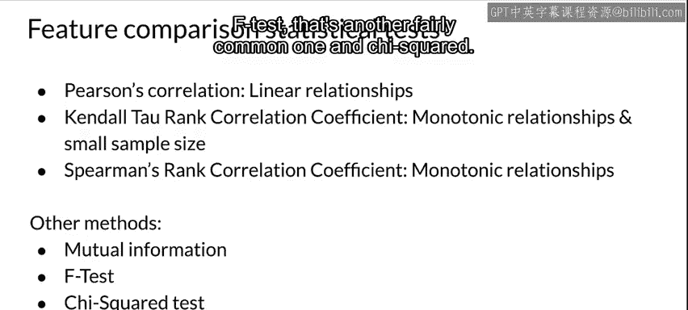
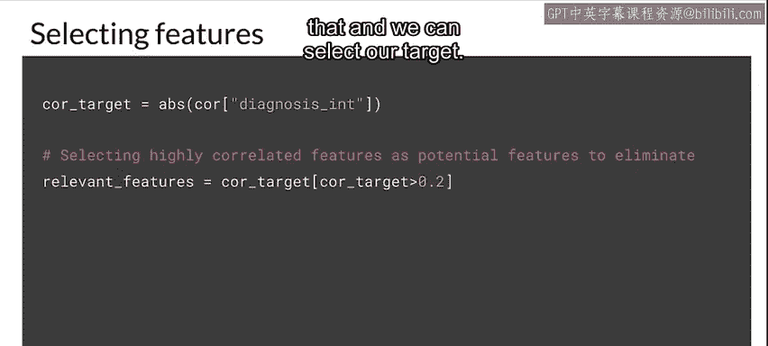
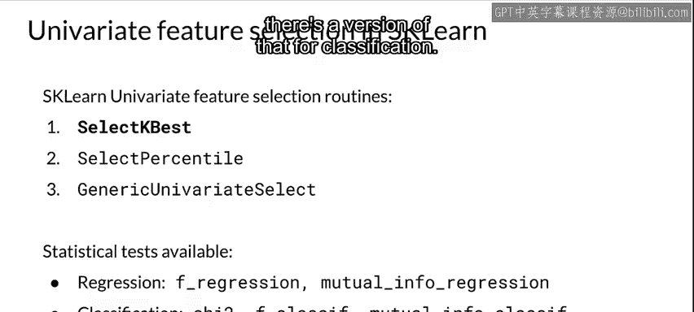
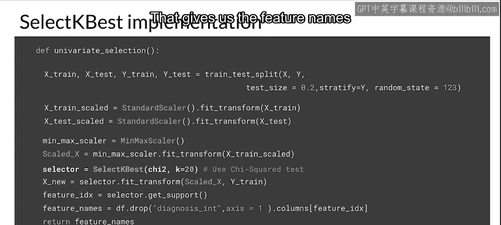
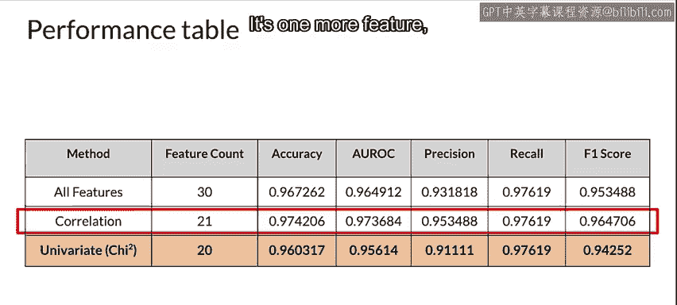

# 吴恩达《机器学习工程师的生产实践（MLOps）Machine Learning Engineering for Production》中英字幕 - P62：21_过滤法.zh_en - GPT中英字幕课程资源 - BV1pi4y167g5

So let's start with filter methods。Filter methods are one of the supervised methods of doing feature selection。

 which includes wrapper methods and embedded methods also， but for filter methods。

 we're primarily using correlation to look for the features that contain the information that we're going to use to predict our target Uniivariate feature selection is also very often used often for efficiency really。

So let's take a look at some filter methods， so correlated features are usually redundant as we just talked about when you have two features that are highly correlated with each other。

 that usually is an indicator that they're redundant so you want to choose one of those so you remove the other one。

So popular filter methods include Pearson correlation。

 so these are different ways to do correlation right Pearson correlation is one that's correlation between features and between the features and the label that' that's why it's the supervised method。

And you can also do Uniivariate feature selection， which is very common。Filter methods， well。

 we're going to start with all of the features and we're going to select the best subset and we're going to give those to our model。

And that's going to give us our performance for the model with this subset of our features。

 So one of the ways to visualize this is with the correlation matrix。

We can look for features where we can see that there is a correlation between two or more of our features。

 It helps show how features are related both to each other and with a target variable and to emphasize that。

When they're related to each other， that's bad。 you only want one of those。 And， and， of course。

 you do want it correlated with a target。 So that's going to fall in a range of correlation between negative one and one。

 And one is highly positive correlation and negative one is highly negative correlation。

 So comparing the different tests。 You have Pearson's correlation for linear relationships。 That's。

 by far， I think the most common。Kenddall Dow is a rank correlation coefficient。

 looks at monotonic relationships， and it's usually used with a fairly small sample size for efficiency Spearman's is another one。

 it's also rank correlation and it also is looking at monoonic relationships。Other methods。 Well。

 there's mutual information。 Mu information has some nice characteristics to it。 F test。

 That's another fairly common one。And chi squared chi squared is also fairly common one。

 so looking at how we would do this in code， let's just take a look using Pearson's correlation。

 this is going to use pandas so we have a data frame and we're using the Pearson correlation。

 corere method so that gives us our correlation and we can then draw our heat map with Cborn and that's what that's going to look like that that gives us our correlation matrix。

So。Looking at it， again， we've got the absolute value of that。And we can select our target。

So that gives us our results。With a subset of our features that we've selected。 in this case。

 we've eliminated 7 features because they were correlated。 So now we have， instead of 30。

 we have 21 features in our feature vector。 The accuracy is not。 Well。

 it' accuracy is actually better。 The A U C is actually better。 Precision is actually better。

 and recall is exactly the same。At least five decimal places。The F's1 scores a little better。

 so removing features， mostly almost all are metrics improved。

That also goes along with the improvements that we made in the compute resources that are required to process 21 features instead of 30。

So that's our best result so far。All right， let's look at Uniivevariate feature selection。

So Univari feature selection， and we're going to do that using P psyche alone。There's select KS。

There's a select percentile， generic Uniivariate select。

 which is fairly generic I assume and some statistical test we can use with that。

 there's mutual information and F test for regression problems for classification we have chi squared and there's version of the F test for classification and similarly for mutual information there's a version of that for classification so let's look at how that gets implemented in code we've got a function that we're going to defined for Uniivariate selection it's going to take our test set actually our training set that's been split for both train and test and then that's going to be scaled with a standard scalar。

And we're going to use the minmac Scalar as well to give us a scaled X。

 And then our selector we're going to use is the select K best。

And we're going to use that with the chi squared test。

And that's going to look for the 20 best features here， so we're going to fit that transform。

 we're going to get the features that it selects， and we're going to drop the other features in our original data set。

So that gives us the feature names of the features that we've selected。

So how does that perform？ Well， a Uniivaria test using chi squared。 We asked for 20 features。

 So it gave us 20 features。 The accuracy dropped a little bit。 So did the A U。

 So did the precision recall interestingly， did not。 still exactly the same。

And the F1 score is unfortunately a little bit lower。 So the correlation is still our best result。

It's one more feature， but it's still our best result。

