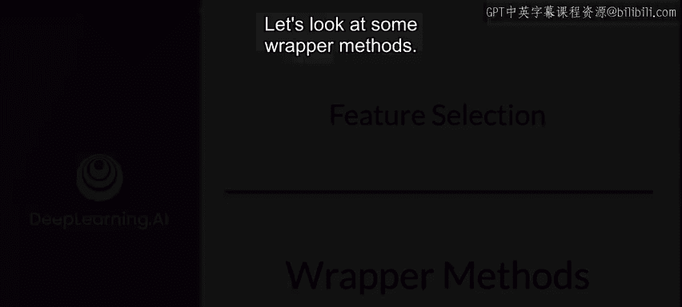
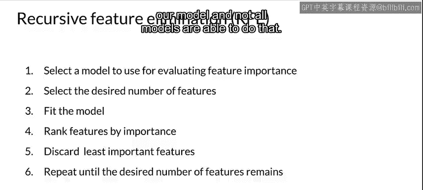
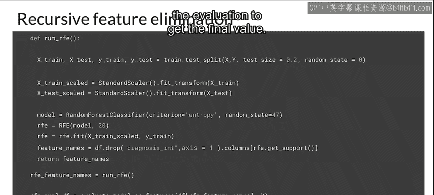
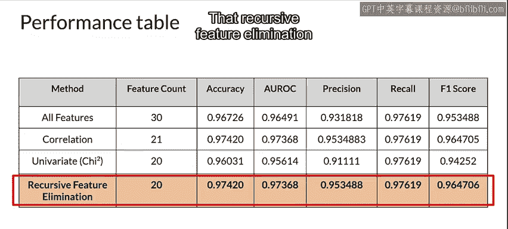

# 吴恩达《机器学习工程师的生产实践（MLOps）Machine Learning Engineering for Production》中英字幕 - P63：22_包装法.zh_en - GPT中英字幕课程资源 - BV1pi4y167g5

All right， let's look at some wrappper methods。So wrapper methods work a little differently。

 It's still a supervised method， but we're going to use this with a model。

 and there's different ways to do it， but basically you're iterating through it's kind of a search method against the features that you have using a model as the measure of their effectiveness。

 So we can do it through forward elimination and we'll talk about this in a second。

 forward elimination， backward elimination or recurrent feature elimination。

 So let's take a look at these。 we start with all of our feature。

We generate a subset of those features and we'll talk about how that gets generated。

 that gets given to our model。The result that is generated from that model is then used to generate the next subset so that becomes this feedback loop to select the best subset of our features using our model as a measure。

And that gives us the performance of a final best subset that is selected。

So there's different wrapper methods， forward selection。

 So forward selection and backward selection and recursive feature selection are recurive feature elimination rather。

 these can all be used to select that subset that we just looked at through each iteration of that feedback loop。

 So for forward selection， it's an iterative greedy method。 So we start with one feature。

 It's greedy。 and then we evaluate model performance， and we add one at a time features。

 So we're adding， we're gradually building up this this feature vector one feature at a time starting with just one feature。

 we try to add the next feature that gives the best performance。

 but we're going to measure that to see what the result is。😊。

We keep repeating this until there's no improvement。

 and then we know that we've generated the best subset of our features backward elimination。 Well。

 if you think about it， we just looked at forward elimination。

 backward elimination starts with all of the features。

And it evaluates the model performance when removing the features。

 So it's exactly what you might think from the name one at a time。We remove the next feature。

 trying to get to better performance with less features。

 and we keep doing that until there's no improvement。Recursive feature elimination。

 we select a model to use for evaluating our feature importance。

We select the desired number of features。And we fit them up。 We rank the features by importance。

 so we need to have a method of assigning importance to those features。

 and then we discard the least important features， and we keep doing that until we get down to the number of features that we're looking to target an important aspect of this is that we need to have a measurement of feature importance in our model and not all models are able to do that。

 So for recursive feature and elimination， this is what the code might look like again。

 we're pulling in our data and splitting it with train and test and pulling out the labels from our data as well。

 So we have X and Y。 we're going to scale it because it's always a good idea。

 And then we're going to use a random force classifier。

And a random force classifier is one of the model types where we can get the feature importance。

So in this case， we're using entropy as a metric， and we're initializing it with a random state。

We're going to apply our random feature elimination trying to get to 20 features with our model that gets fitted so that's going to do that elimination and that results in the list of features that we've selected those are the names of the features that we've selected the 20 features that we were looking for to eliminate all but 20 of our features and then we're going to use that to do the evaluation to get the final value。

So how does that look compared to our other examples， well。

 so recursive feature elimination also got to our 20 features。

The accuracy was quite a bit better than it was for Uniivvariate。 In fact。

 it's as good as correlation。The A U C， also as good as correlation， which is great。

 The precision also as good， I would say， as correlation。 It doesn't go quite so far out。

 but that's for precision。😊，And for recall， exactly the same for the F1 score。

 it's actually slightly better。 I mean， just barely， but slightly better。

 And we've gotten to fewer features。 We did it with 20 features instead of 21 for correlation。

 So that recursive feature elimination is now our best result。😊。

