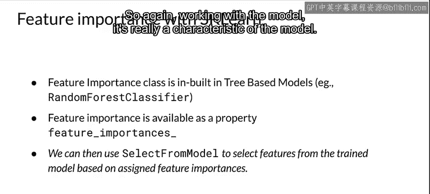
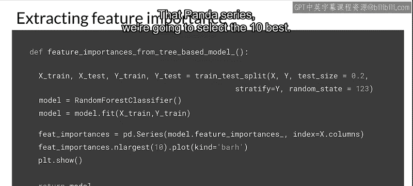
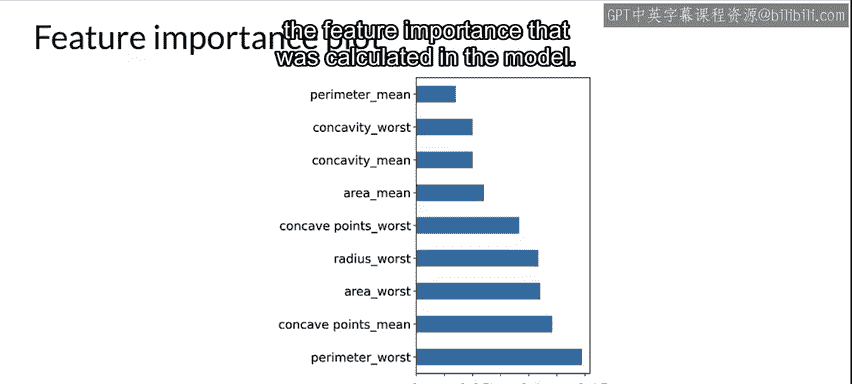
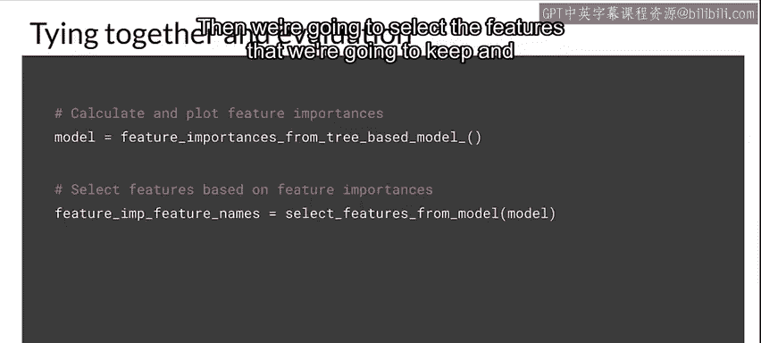
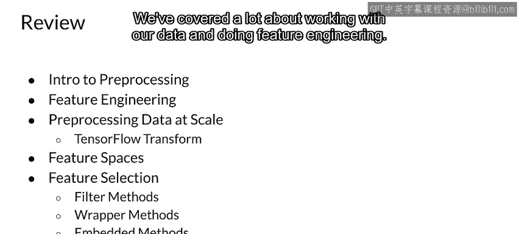

# 吴恩达《机器学习工程师的生产实践（MLOps）Machine Learning Engineering for Production》中英字幕 - P64：23_嵌入法.zh_en - GPT中英字幕课程资源 - BV1pi4y167g5

Now let's look at some embedded methods。

So what are embedded methods， Well， it's a， again， a supervised method of feature selection。

And we've looked at filter methods， we've looked at wrapper methods， let's look at embedded methods。

So L1 or L2 regularization is essentially an embedded method for doing feature selection feature importance is another method。

 both of these are highly connected to the model that you're using so these both L1 regularization and feature importance really sort of an intrinsic characteristic of the model that you're working with so it assigns scores and for regularization really what we're talking about waiting for each feature in the data and it discards features often by setting those weights to zero or near zero and that's going to eliminate the features that we're talking about based on the feature essentially in the feature important。

So to look at that in SK learn， if we look at feature importance class that's built into the tree based model。

 So again we're still using the random force classifier that we've been using all along。

 that's one of the model types that does include feature importance。

 it's available as a property of that model， the feature importances。

And we can use select from model to select the features from the train model based on the assigned feature importances。

 so again， working with the model it's really a characteristic of the model。

How does that look in code， Well we're going to define a function feature importances from tree based model。

And here's our data， it's been split into training and test， and we've separated our labels。

We're going to use our random force classifier as our model and we're going to fit it。

And then we're going to pull out the feature importances here that's going to give us a series that we're going to use a panda series。

That panda series， we're going to select the10 best。

 so the 10 highest feature importances and show that。

So if we do that， this is the visualization that we get。

And we can see the the 10 best features that we have based on the feature importance that was calculated in the model。

 So using that to select those features。

We're going to go back and select from our model that's going to give us our model and we're going to get support to get the indexes for those features。

 and then we're going to drop the other features from our feature vector and that's going to give us the names of the features that we're keeping。

So tying those together， we've got feature important from tree based model that that's going to give us the feature importances and plot them。

Then we're going to select the features that we're going to keep that's going to give us our performance。

So in this case， we've selected 14 features。And looking at the metrics for them。

 they're actuallyre not quite as good， but they're pretty good。 So accuracy。

 it's now down a little bit。The ROC is up a little bit。

It's kind of back to what it was with all features or almost there。Precision is down a little bit。

 but still， I mean， it's， yeah， it's down a little bit。 recall is。

Not bad really recall pretty much the same， it is the same。

And the F1 score is back to what it was with all of the features。

 so recursive feature elimination is really still our best result， although with feature importance。

 we were able to get down to 14 features so。This is a question where we need to consider the importance of our metrics versus the importance of reducing our compute resources。

If it's really important that we compute resources。

 we may want to do that with the 14 features that were selected with feature importance。

But if we're really interested in maintaining those metrics or improving them。

 then recursive feature elimination is still the best result。

So to review we've covered a lot this week we started out with an introduction to preprocessing。

 We talked at some length about feature engineering and why it's so important to doing machine learning。

 especially in production settings。 We looked at preprocessing data at scale which is going to be important whenever you're working with large amounts of data or large models and specifically at Tensorflow transform。

 we also looked at feature spaces and understanding how feature spaces work and and why we need to consider that as we do feature selection and we looked at different kinds of feature selection So filter methods。

 wrapper methods and embedded methods， we've covered a lot about working with our data and doing feature engineering。

 This has been quite a week so far。

