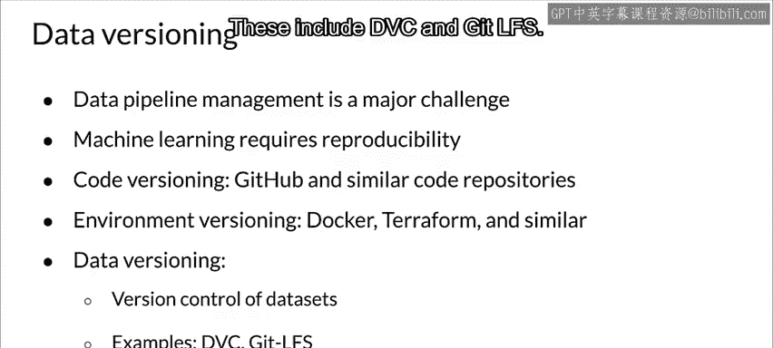

# 吴恩达《机器学习工程师的生产实践（MLOps）Machine Learning Engineering for Production》中英字幕 - P65：24_数据之旅.zh_en - GPT中英字幕课程资源 - BV1pi4y167g5

Hello and welcome to our continuing saga of data。

This week we'll be talking about several data related topics， including metadata。

 which is important for understanding our data over time and our training runs。

 we'll also talk about schemas which help describe our data and we'll look at some places where we might want to store our data to make it easier to work with。

 It's a lot to cover so let's get started。Welcome to data journey and data storage。

 Let's begin with the data journey in all it takes to understand this important process。

 Understanding data provenance requires understanding the data journey throughout the life cycle of the production pipeline。

 more specifically， Ac for the evolution of data and models throughout the process。

ML metadata is a versatile library to address these challenges。

 which helps with debugging and reproducibility Conretely。

 it allows us to revisit and track data and model changes as they occur during training。

Trying to understand data provenance begins with a data journey。

 The journey starts with raw features and labels from whatever sources that we have。

The data describes a function that maps the input in the training set。

To the labels that we're trying to predict。During training。

 the model learns the functional mapping from the input to the labels so as to be as accurate as possible。

The data transforms and changes as part of this training process。

As the data flows through the process， it transforms， examples of this are changing data formats。

 applying feature engineering， and training the model to make predictions。

There's a dual connection between understanding these data transformations and interpreting the model's results。

Therefore， it's important to track and document these changes closely。

Data artifacts are created as pipeline components execute。 So what exactly is an artifact。

 Each time a component produces a result， it generates an artifact。

This includes basically everything that is produced by the pipeline。

 including the data in different stages of transformation。

 often as a result of feature engineering and the model itself and things like the schema and metrics and so forth。

Basically everything that's produced， every result that is produced is an artifact the terms data provenance and data lineage are basically synonyms and they're used interchangeably。

Data provenance or lineage。Is a sequence of the artifacts that are created as we move through the pipeline。

 Those artifacts are associated with the code and components that we create。

Tracking those sequences is really key for debugging and understanding the training process and comparing different training runs that may happen months apart。

Data provenance matters a great deal， and it helps us to understand the pipeline and to perform debugging。

Debugging an understanding requires inspecting those artifacts at each point in the training process。

 which can help us understand how those artifacts were created and what the results actually mean。

Prominence will also allow you to track back through a training run from any point in the process。

Also， Proence makes it possible to compare training runs and understand why they produce different results。

Under GDPR or the general data protection regulation， organizations are accountable for the origin。

 changes， and location of personal data。Personal data is highly sensitive。

 so tracking the origins and changes along the pipeline are key for compliance。

Data lineage is a great way for businesses and organizations to quickly determine how the data has been used and which transformations were performed as the data moved through the pipeline。

 So data prominence is key to interpreting model results。Model understanding is related to this。

 but it only part of the picture。 The model itself is an expression of the data in the training set。

 So in some sense， we can look at the model as a transformation of the data。

 Proviance also helps us understand how the model evolves as it is trained and perhaps optimized。

Let's add an important ingredient here， tracking different data versions。

Managing a data pipeline is a big challenge as data evolves through the natural life cycle of a project over many different training runs。

 a machine learning， when it's done properly， should produce results that can be reproduced fairly consistently。

There will naturally be some variance， but the results should be close。

Code version control is probably something you're familiar with。

 Gitthub is one of the most popular cloud based code repositories， and and there are others as well。

 Environment versioning is also important， so tools like Docker and terraform help us create repeatable environments and configuration。

 However， data versioning is also important and plays a significant role for tracking provenance and lineage。

 Data versioning， its essentially version control for data files so that you can trace changes over time and restore previous versions early。

😊，But the tools are somewhat different for one thing because of the size of files that we deal with。

 which are typically or can be anyway much larger than a code file would ever be。

 So tools for data versioning are just starting to become available。

 and these include DVC and Git LFS， LFS for large file storage。

