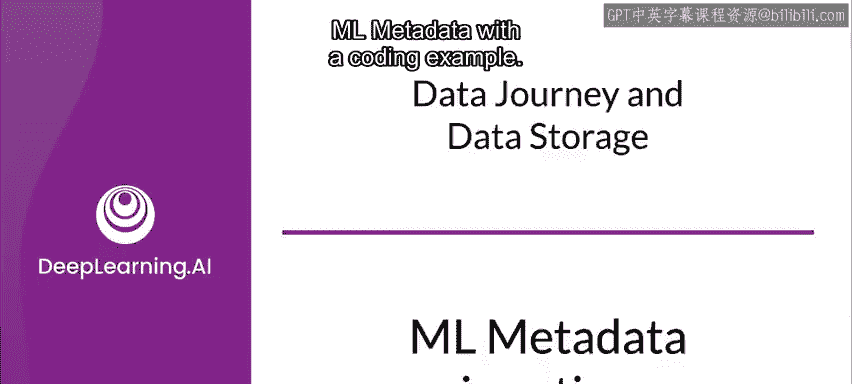
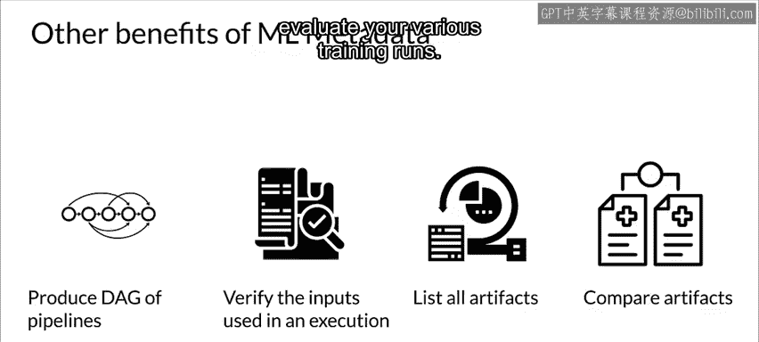
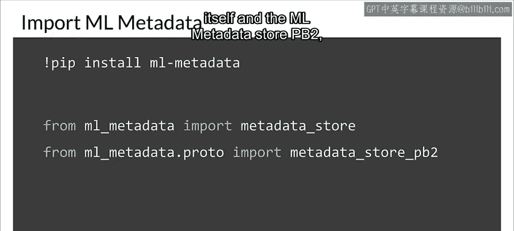
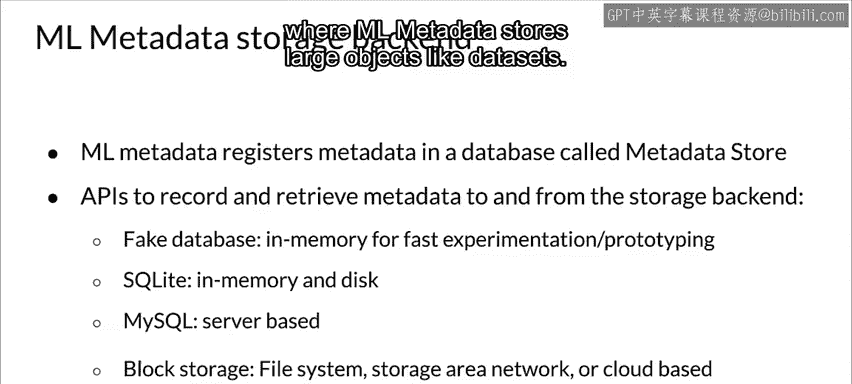
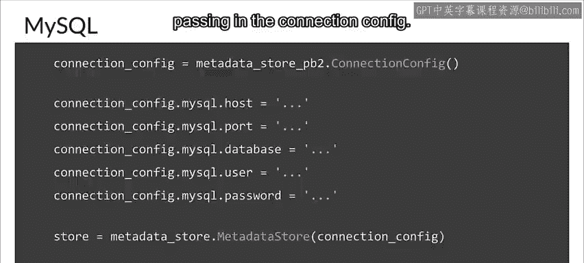
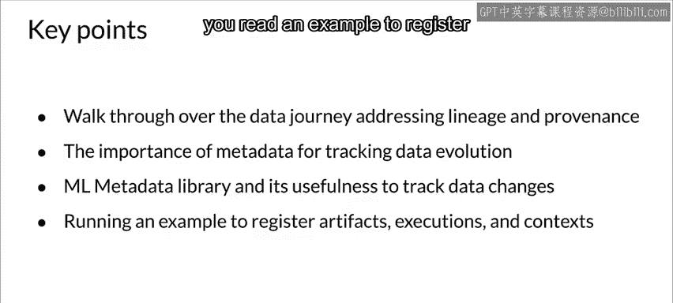

# 吴恩达《机器学习工程师的生产实践（MLOps）Machine Learning Engineering for Production》中英字幕 - P67：26_机器学习元数据实战.zh_en - GPT中英字幕课程资源 - BV1pi4y167g5

Now let's take a look at using ML metadata with a coding example。

Besides data lineage and provenance tracking， you get several other benefits through MO metadata。

This includes the ability to construct a directed acyclic graph or dag of the component executions occurring in a pipeline。

 which can be useful for debugging purposes。 Through this。

 you can verify which inputs have been used in an execution。

 You can also summarize all the artifacts belonging to a specific type generated after a series of experiments。

 For example， you can list all of the models that have been trained。

You can then compare them to evaluate your various training runs。

Okay， now let's get started with writing code for M metadata。 You may have to install MO metadata。

 which you can do using PIP as shown here。Then there are two imports from Momoidtaadata。

 which are used frequently， the metadata store itself， and the metadata store PB2。

 which is a protocol buffer or protocoltobuff。

Start by setting up the storage back in。Metaadata Store is the database where MO metadata registers all of the metadata associated with your project。

MO metadata provides APIs to connect with a fake database for quick prototyping， SQL light。

 and MySQL。We also need a block store or file system where MO metadata stores large objects like data sets。

 Let's quickly explore the first three options。

For any storage backend， you'll need to create a connection config object using the metadata store PB2 Protobuff。

Then based on your choice of storage back end， you need to configure this connection object。 Here。

 you're signaling that your fake database is in， which is the primary memory of the system on which it's running。

Finally， you create the store object passing in the connection config。

Regardless of what kind of storage or database you use。

 the store object is a key part of how you interact with ML metadata。To use SQL light。

 you start by creating a connection config again， then you configure the connection config object with a location of your SQLite file and make sure to provide that with the relevant read and write permissions based on your application。

And finally， you create the store object passing in the connection config。As you might imagine。

 using MySQL is very similar。You start by creating a connection config。

Your connection config object should be configured with the relevant host name， the port number。

 the database location， username and password of your MySQL database user。

 and that's shown shown here finally you create the store object passing in the connection config。

Now that the storage back end is configured， it's time to use MO metadata to solve a problem。

Let's go over a workflow using TFTV， we're going to use that in conjunction with ML metadata。

The choice here is a tabular data set containing many features。In the lab。

 ML metadata is explicitly programmed because in a full fledged ML pipeline。

 ML metadata is intrinsically capable enough to understand the flow of data between various components and perform its necessary duties so to help you better understand M metadata。

 you'll be using it outside of a pipeline。The lab also shows MO metadata integration with TensorF data validation or TFDV。

By the end of the lab， you should have some intuition about how ML metadata can keep track of progress and how you can use ML metadata to track your training process and pipeline。

Let's review the key points which we covered in this lesson。First。

 you learned about data lineage and provenance to address data evolution over the ML pipeline lifecycl。

 Then you went over metadata for tracking those data changes。

Then you inspected the architecture of the M metadata Library。And finally， in the ungraded lab。

 you ran an example to register artifacts， executions and contexts。😊。

