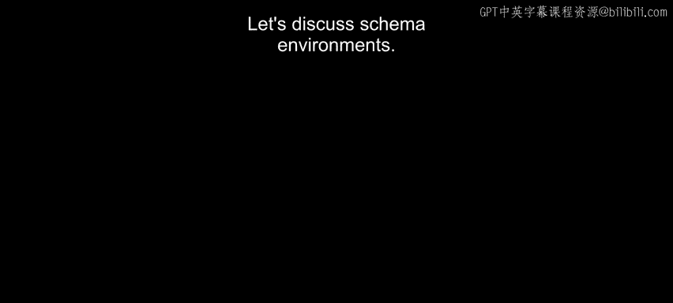
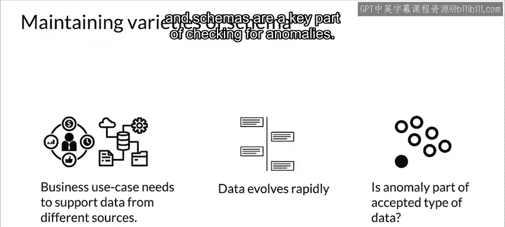
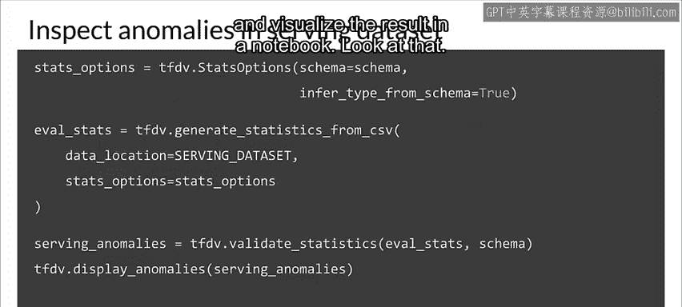
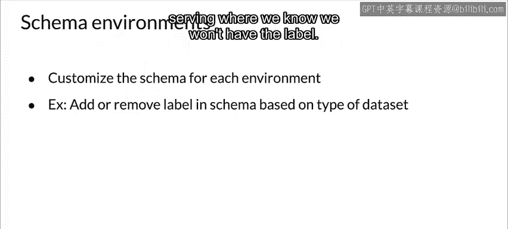
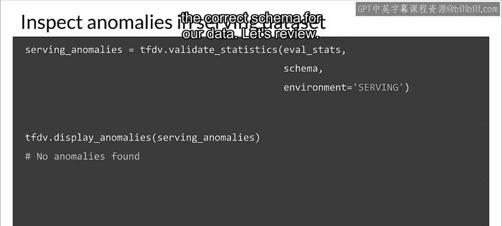
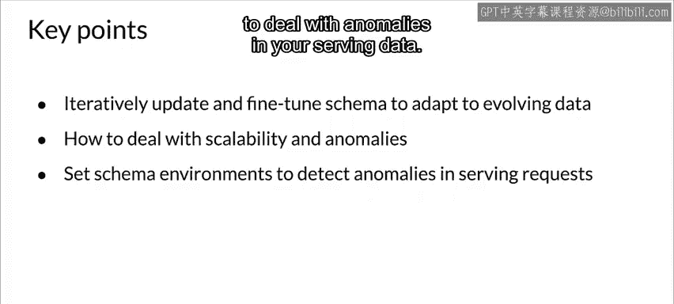

# 吴恩达《机器学习工程师的生产实践（MLOps）Machine Learning Engineering for Production》中英字幕 - P69：28_模式环境.zh_en - GPT中英字幕课程资源 - BV1pi4y167g5

Now let's discuss schema environments。Your business and data will evolve throughout the lifetime of your production pipeline。

 it's often the case that as your data evolves， your schema evolves also。

As you're developing your code to handle changes in your schema。

 you may have multiple versions of your schema all active at the same time。

You may have one schema being used for development， one currently in test。

 and another currently in production。Having version control for your schemas。

 just like you do for your code， helps make this manageable。In some cases。

 you may need to have different schemechemas to support multiple training and deployment scenarios for different data environments。

For example， you may want to use the same model on a server and in a mobile application。

But imagine that a particular feature is different in those two environments， maybe in one case。

 it's an integer and the other case， it's a float。You need to have a different schema for each to reflect the difference in the data along with that。

 your data is evolving， potentially in all your different data environments at once。

But at the same time， you also needed to check your data for problems or anomalies。

 and schemas are a key part of checking for anomalies。

Let's look at an example of how a schema can help you detect errors in your serving request data and why multiple versions of your schema are important。

We'll start by inferring the serving schema and we'll use TensorFlow data validation or TFTV to do that。

And then we're going to generate statistics for the serving data set。

Then we'll use TFTV to find if there are any problems with this data and visualize the result in a notebook。

Oh oh， look at that。TFDV reports back that there are anomalies in the serving data。

But since this is a data set that contains prediction requests， that's actually not surprising。

The label， which is cover type， is missing， but the schema is telling TF TV that the cover type feature is required。

 So it's flagging this as an anomaly。 How do we fix this problem。

In scenarios where you need to maintain multiple types of the same schemas。

 you often need to keep the schema environment。This is most commonly true of the difference between training and serving data。

You can choose to customize your schema based on the situation you're going to handle。For example。

 in this case， the setup is to maintain two schemas， one for training data。

 where the label is required， and the other for serving where we know we won't have the label。

The code for multiple schema environments is fairly straightforward In our existing environment。

 we already have a schema for training。We then create two named environments called traininging and Sering。

And we modify our serving environment by removing the cover type feature。

 since we know that in serving， we won't have that in our feature set。Lastly。

 the code sets up the serving environment and uses it to validate the serving data。Now。

 there are no anomalies found since we're using the correct schema for our data。

So let's review first we discussed how to iteratively update and fine tune your schema to adapt to evolving data。

 Then we focused on reliability and scalability during the evolution cycle of data。

Then you implemented schema environments to deal with anomalies in your serving data。

