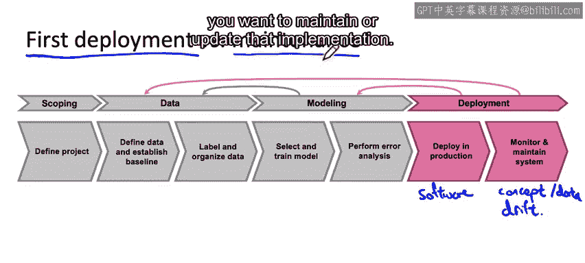

# 吴恩达《机器学习工程师的生产实践（MLOps）Machine Learning Engineering for Production》中英字幕 - P6：5_关键挑战.zh_en - GPT中英字幕课程资源 - BV1pi4y167g5

One of the most exciting moments of any machine learning project is when you get to deploy your model。

 but what makes deployment hard I think there are two major categories of challenges in deploying a machine learning model first are the machine learning or the statistical issues and second are the software engine issues let's step through both of these so you can understand what you need to do to make sure that you have a successful deployment of your system。

😊，One of the challenges of a lot of deployments is concept drift and data drift Lucy this means what your data changes after your system has already been deployed I had previously given an example from manufacturing where you might have trained a learning algorithm to detect scratches on smartphones under one set of lighting conditions and then maybe the lighting and the factory changes that's one example of the distribution of data changes let's walk through a second example using speech recognition I've trained a few speech recognition systems and when I built speech systems quite often I would have some purchase data so this would be some purchase or license data which includes both the input X the audio as well as the transcript Y that the speech system is supposed output。

And in addition to data that you might purchase from a vendor。

 you might also have historical user data of user speaking to your application。

Together with transcripts of that road user data and such user data， of course。

 should be collected with very clear user opt in permission。

And clear safeguards for use of privacy After you've trained your speech recognition system on a data set like this。

 you might then evaluate it on a test set， but because speech data does change over time when I build speech recognition system。

 sometimes I would collect a depth set or holdout validation set as well as test set。

Comprising data from just the last few months， so you can test it on fairly recent data to make sure your system works even on relatively recent data and then after you push the system to deployment。

 the question is， will the data change or after you've run it for a few weeks or a few months？

Has the data changed yet again？Because of the data has changed， such as the language changes。

 or maybe people are using a brand new model of smartphone， which has a different microphone。

 so the audio sounds different， then the performance of your speech recognition system can degrade and it's important for you to recognize how the data has changed and if you need to update your learning algorithm as a result。

When data changes， sometimes it is a gradual change。Such as see English language， which does change。

 but changes very slowly with new vocabulary introduced at a relatively slow rate。And sometimes。

 data changes。Very suddenly where there's a sudden shock to a system。For example。

 when COVID-19 the pandemic hit， a lot of credit card fraud systems started to not work because the purchase patterns of individuals suddenly changed。

 many people that did relatively little online shopping suddenly started to use much more online shopping and so the way that people were using credit cards changed very suddenly。

And this actually tripped up a lot of antif systems and this very sudden shift to the data distribution meant that many machine learning teams were scrambling little bit at the start of COVID to collect new data and retrain systems in order to make them adapt to this very new data distribution。

 sometimes the terminology of how to describe these data changes is not used completely consistently。

 but sometimes the term data drift is used to describe if the input distribution exchanges。

Such as if a new politician or celebrity suddenly becomes well known and is mentioned much more than before。

And the term concept drift。Refers to if the desired mapping。From x to Y changes。

Such as if before COVID 19， perhaps for a given user。

 a lot of surprising online purchases should have flagged that account for fraud。

But after the start of COVID 19， maybe those same purchases would not have really been any cause for alarm in terms of flagging that the credit card may have been stolen。

Or another example of concept drift， let's say that X is the size of a housese and y is the price of a housese because you're trying to estimate housing prices。

 well if because of inflation or changes in the market。

 houses maybe become more expensive over time then the same sizehu will end up with a higher price and so that would be concept drift。

 maybe the size of houses haven't changed but the price of a given house changes whereas data drift would be if say people start building larger houses or start building smaller houses and does the input distribution of the sizes of houses actually changes over time。

So when you deploy a machine learning system， one of the most important tasks will often be to make sure you can detect and manage any changes。

 including both concept drift， which is when the definition of what is Y given X changes as well as data drift。

 which is if the distribution of X changes， even if the mapping from X or Y does not change。

In addition to managing these changes to the data， a second set of issues that you will have to manage to deploy a system successfully are software engineering issues。

When you are implementing a prediction service whose job it is to takequeries X and output。

Prediction Y you have a lot of design choices as to how to implement this piece of software here's a checklist of questions that might help you with making the appropriate decisions for managing the software engineering issues One decision you have to make for your application is do you need realtime predictions or are batch predictions okay。

For example， if you are building a speech recognition system where the user speaks and you need to get a response back in half a second。

 then clearly you need real time predictions。In contrast。

 I have also built systems for hospitals that take patient records。

 take electronic health records and run an overnight batch process to see if there's something associated with the patients that we can spot so in that type of system it was fine if we just ran it in a batch of patient records once per night and so whether you need to write realtime software that can respond within you hundreds of milliseconds or whether you can write software that just does a lot of computation overnight that will affect how you implement your software。

And by the way， later this week， you also get to step through an optional programming exercise where you get to implement a real time prediction service on your own computer。

You see that at the optional exercise at the end of this week so a second question you need to ask is does your prediction service run in the cloud or does it run at the edge or maybe even in a web browser today there are many speech recognition systems that run in the cloud because having the computer resources of the cloud allows for more accurate speech recognition。

But there are also some speech systems， for example。

 a lot of speech systems within cars actually run at the edge and there are also some mobile speech recognition systems that work even if your internet。

 even if your w-fi is turned off so those would be examples of speech systems that run at the edge when I'm deploying visual inspection systems in factories。

 I pretty much almost always run that at the edge as well。

 because sometimes unavoidably the internet connection between the factory and the rest of the internet may go down and you just can't afford to shut down the factory whenever this internet connection goes down which happens very rarely but maybe sometimes does happen and with the rise of modern web browsers。

 there are better and better tools for deploying learning algorithms right there within a web browser as well。

When building a prediction service is also useful to take into account how much compute resources you have。

There have been quite a few times where I trained a neural network on a very powerful GPU only to realize that I couldn't afford an equally powerful set of GPUs for deployment and wound up having to do something else to compress or reduce the model complexity so if you know how much CPUU or GPU resources and maybe also how much memory resources you have for your prediction service。

 then that could help you choose the right software architecture。Depending on your application。

 especially if it's a realtime application， latency and throughput such as measured in terms of QPS queries per second will be other software engineering metrics you may need to hit in speech recognition is's not uncommon common to want to get an answer back to the user within half a second or 500 milliseconds and of this 500 millisecond budget you may be able to allocate only say 300 milliseconds to your speech recognition。

And so that gives a latency requirement。For your system。

And throughput refers to how many queries per second do you need to handle。

 given your compute resources， maybe given a certain number of cloud servers？So for example。

 if you're building a system that needs to handle 100 queries per second。

 it would be useful to make sure to spec out your system so that you have enough compute resources to hit the QPS requirement。

Next is logging when building your system， it may be useful to log as much of the data as possible for analysis and review as well as to provide more data for retraining your learning algorithm in the future。

Finally， security and privacy。I find that for different applications。

 the required levels of security and privacy can be very different for example。

 when I was working on electronic health records， patient records。

 clearly the requirements for security and privacy were very high because，😊。

Patient records are very highly sensitive information and depending on your application。

 you might want to design in the appropriate level of security and privacy。Based on how sensitive。

That data is and also sometimes based on regulatory requirements。

So if you save this checklist somewhere， going through this when you're designing your software might help you to make the appropriate software engineering choices when implementing your prediction service。

So to summarize， deploying a system requires two broad sets of tasks， there is writing the software。

To enable you to deploy the system in production。 And there is what you need to do to monitor the system performance and to continue to maintain it。

 especially in the face of。Concept drift。As well as。Data drift。

One of the things you see when you're building machine learning systems is that the practices for the very first deployments will be quite different compared to when you are updating or maintaining a system that has already previously been deployed。

 I know that theres some engineers that view deploying the machine learning model as getting to the finish line。

Unfortunately， I think the first deployment means you may be only about halfway there and the second half of your work is just starting only after your first deployment。

 because even after you've deployed， there's a lot of work to feed the data back and maybe to update the model to keep on maintaining。

The model， even in the face of changes to the data。

 One of the things we touch on related videos is some of the differences between the first deployment。

 such as if your product never had a speech recognition system。

 but you've trained the speech recognition system and you're deploying for the first time versus you already have the learning algorithm running for some time and you want to maintain or update that implementation to summarize in this video you saw some of the machine learning or statistical related issues such as concept Jeff and data drift。

 as well as some of the software engineering related issues such as whether you need a batch or realtime prediction servers and whether the compute and memory requirements you have to take into account Now it turns out that when you're deploying a machine learning model there are a number of common design patterns。

 common deployment patterns that are used in many applications across many different industries。

the next video， you see what are some the most common deployment patterns so that you can hopefully pick the right one for your application Let's go on to the next video。

