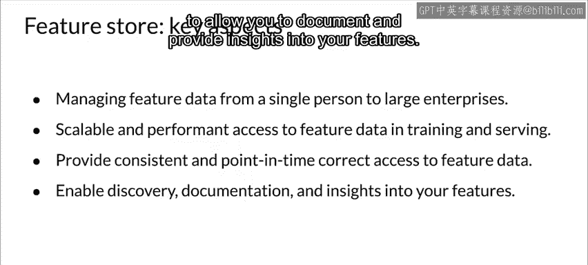

# 吴恩达《机器学习工程师的生产实践（MLOps）Machine Learning Engineering for Production》中英字幕 - P70：29_特征存储.zh_en - GPT中英字幕课程资源 - BV1pi4y167g5

In these next three topics， we'll be talking about data storage。 Now。

 there are no assignments for you to turn in for these three segments。

 but I highly encourage you to take a look。 There are some great information here。

 and it's becoming increasingly important， especially the part about feature stores。

 but depending upon where you are and what you already have。

 you may have a data warehouse or data lake that you want to leverage so understanding those becomes important。

 Okay， let's get started。Now it's turn to the question of where we should store our data。

We'll start with a discussion of feature stores。

A feature store is a central repository for storing documented。

 curated and access controlled features。 Using a feature store enables teams to share。

 discover and use highly curated features。 A feature store makes it easy to discover and consume that feature。

😊，And that can be both online or offline for both serving and training。

What people often discover is that many modeling problems use identical or similar features。

So often the same data is used in multiple modeling scenarios。In many cases。

 a feature store can be seen as the interface between feature engineering and model development。

Feature stores are valuable， centralized feature repositories that reduce redundant work。

 They're also valuable because they enable teams to share data and discover data that is already available。

 You may have different teams in an organization with different business problems that they're trying to solve。

 but they're using identical data or data that's very similar。For these reasons。

 feature stores are becoming the predominant choice for enterprise data storage。

 for machine learning， for large projects and organizations。

Feature stores often allow transformations of data so that you can avoid duplicating that processing in different individual pipelines。

The access to the data in feature stores can be controlled based on role based permissions。

The data in the feature stores can be aggregated to form new features。

 It can also be anonymized and even purged for things like wipeouts for GDPR compliance。 for example。

 feature stores typically allow for feature processing offline。That can be on a regular basis。

 maybe on a Cr job， for example。Imagine that you're going to run a job to ingest data and then maybe do some feature engineering on it and produce additional features from it。

 maybe for feature crosses， for example。These new features will also be published to the feature store。

 you can also integrate that with monitoring tools as you're processing and adjusting your data。

 you could be running monitoring again offline Those processed features are stored for offline use they can also be part of a prediction request by doing a join with the data provided in the prediction request to pull in additional information feature metadata allows you to discover the features that you need The metadata that describes the data that you are keeping is a tool and often the main tool for trying to discover the data that you're looking for。

For online feature usage， where predictions must be returned in real time。

 the latency requirements are typically fairly strict。

 You're going to need to make sure that you have fast access to that data。

 If you're going to do a join， for example， maybe with user account information。

 along with individual requests， that join has to happen quickly。 That's good。

 but it's often difficult to compute some of those features in a performant manner online。

 So having precomputd features is often a good idea。 If you precompute and store those features。

 then you can use them later。 And typically that's at fairly low latency。

You can also do this in a batch environment。 Again， you don't want the latency to be too long。

 but it probably isn't as strict as an online request。From pre computing and loading。

 especially things like historical features， it tends to be fairly simple。

For historical features in a bad environment， it's also usually straightforward。 However。

 when you're training your model， you need to make sure that you only include data that will be available at the time that a serving request is made。

Including data that is only available at some time after a serving request is referred to as time travel。

 and many feature stores include safeguards to avoid that。 Besides it violates the laws of physics。

 and we don't want to do that。You might do pre computinguting on a clock every few hours or once a day。

You're going to use of course， that same data for both training and serving in order to avoid Tra serving SU。

The goals of most feature stores are providing a unified means of managing feature data that can scale from a single person up to large enterprises。

 It needs to be performant。 And you want to try to use that same data。

 both when youre training and serving your models。You want consistency and also point in time correct access to feature data。

You want to avoid making a prediction， for example。

 using data that will only be available in the future when you serving your model。 In other words。

 if you're trying to predict something that will happen tomorrow mor you want to make sure that you are not including data from tomorrow。

 It should only be data from before to。 Most feature stores provide tools to enable discovery and to allow you to document and provide insights into your features。

