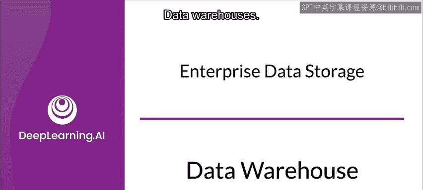
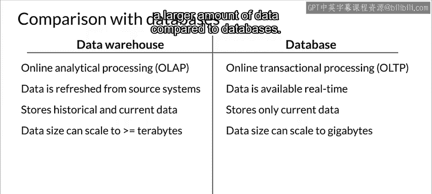

# 吴恩达《机器学习工程师的生产实践（MLOps）Machine Learning Engineering for Production》中英字幕 - P71：30_数据仓库.zh_en - GPT中英字幕课程资源 - BV1pi4y167g5

Now， we're going to discuss data warehouses。 Fun fact， I once worked in a warehouse。

 but it wasn't a data warehouse。 It was an industrial tool warehouse。 Anyway， let's get started。

 data warehouses。Now let's discuss another popular enterprise data storage solution。

Data warehouses data warehouses were originally developed for big data and business intelligence applications。

 but they are also valuable tools for production M。

 A data warehouse is a technology that aggregates data from one or more sources so that it can be processed and analyzed。

A data warehouse is usually meant for long running batch jobs and their storage is optimized for read operations。

Data entering into the warehouse may not be in real time when you're storing data in a data warehouse。

 your data needs to follow a consistent schema。 Let's look at some key features of data warehouses。

 A data warehouse is subject oriented， and the information it's stored in it revolves around a topic。

 For example， data stored in a data warehouse may be focused on the organization's customers or vendors。

 etc cetera。 The data in a data warehouse may be collected from multiple types of sources。

 such as relational datas or files and so forth。 The data collected in a data warehouses usually timested to maintain the context of when it was generated。

 Data warehouses are nonvolat， which means that previous versions of data are not erased when new data is added。

That means that you can access the data stored in a data warehouse as a function of time and understand how that data has evolved。

Let's look at some advantages of data warehouses。 First。

 data warehouses offer enhanced ability to analyze your data by time stamping your data。

 a data warehouse can help maintain context。When you store your data in a data warehouse。

 it follows a consistent schema， and that helps improve the data quality and consistency。

Studies have shown that the return on investment for data warehouses tend to be fairly high for many use cases。

Lastly， the read and query efficiency from data warehouses is typically high。

 giving you fast access to your data。You're probably familiar with databases。

 so a natural question is， what's the difference between a data warehouse and a database？

Here's some comparisons。Data warehouses are meant for analyzing data。

 whereas databases are often used for transaction purposes。Inside a data warehouse。

 there may be a delay between storing the data and the data getting reflected in the system。

But in a database， data is usually available immediately after it's stored。

 data warehouses store data as a function of time， and therefore historical data is also available。

Data warehouses are typically capable of storing a larger amount of data compared to databases。

Querries in data warehouses are complex in nature and tend to run for a long time。

 whereas queries in databases are simple and tend to run in real time。

Normalization is not necessary for data warehouses， but it should be used with databases。

