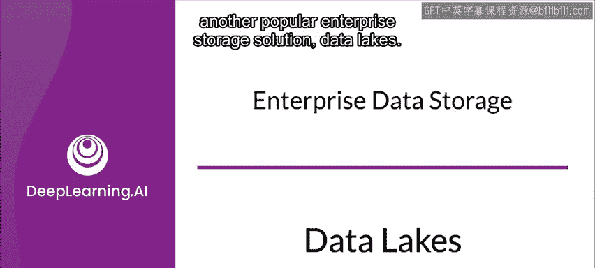
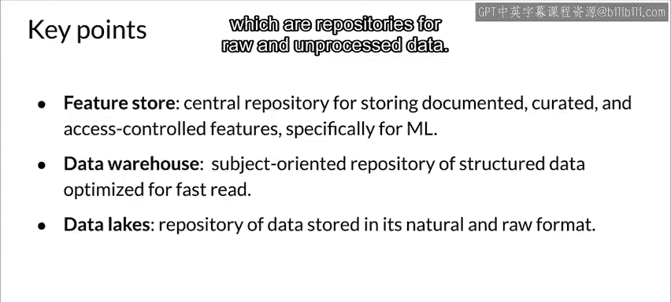

# 吴恩达《机器学习工程师的生产实践（MLOps）Machine Learning Engineering for Production》中英字幕 - P72：31_数据湖.zh_en - GPT中英字幕课程资源 - BV1pi4y167g5

Now let's discuss another popular enterprise storage solution， Data Lakes。

A data lake is a system or repository of data stored in its natural and raw format。

Which is usually in the form of blobs or files。A data lake， like a data warehouse。

 aggregates data from various sources of enterprise data。

 A data lake can include structured data like relational databases or semi structured data like CSV files or unstructured data like a collection of images or documents and so forth。

 since data lakes store data in its raw format， they don't do any processing。

 and they usually don't follow a schema。So how does a data lake differ from a data warehouse？

Let's compare the two。The primary difference between them is that in a data warehouse。

 data is stored in a consistent format which follows a schema。Whereas in data lakes。

 the data is usually in its raw format。 In data lakes。

 the reason for storing the data is often not determined ahead of time。

 This is usually not the case for a data warehouse where it's usually stored for a particular purpose。

Data warehouses are often used by business professionals as well。

 whereas data lakes are typically used only by data professionals such as data scientists。

Since the data in data warehouses is stored in a consistent format。

 changes to the data can be complex and costly。Data lakes， however。

 are more flexible and make it easier to make changes to the data。

Let's review our discussion of enterprise data storage。First， you learned about feature stores。

 which are repositories for highly curated feature data， specifically for use in machine learning。

 You learned about subject oriented read optimized data repositories known as data warehouses。

 And finally， you explore data lakes， which are repositories for raw and unprocessed data， Well。

 we've come to the end of another week。 And we talked about a lot of great stuff this week。

 M O metadata working with storage for feature stores， schemas， data lakes and data warehouses。

 I hope you had fun。 Iisher did。 We'll see you next time。😊。

