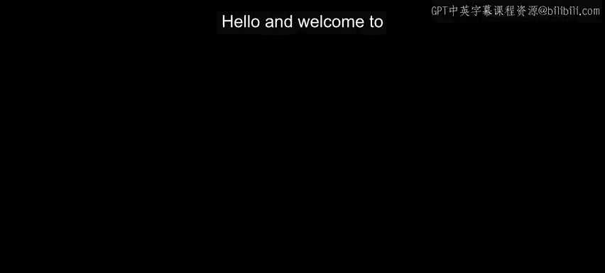
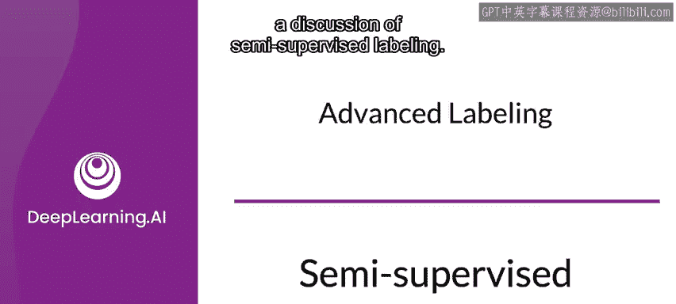
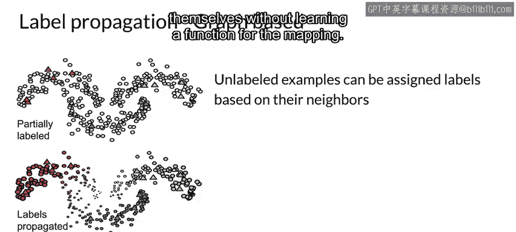

# 吴恩达《机器学习工程师的生产实践（MLOps）Machine Learning Engineering for Production》中英字幕 - P73：32_半监督学习.zh_en - GPT中英字幕课程资源 - BV1pi4y167g5

Hello and welcome to Adv labeling， data augmentation and data preprocessing This is a lot of great stuff this week。

 so I hope you enjoy it。Welcome back。 This week。 We're going to be talking about advanced labeling techniques。

 some data augmentation and more on data pre processing。 Let's get started。

 We'll start with a discussion of semi supervised labeling。

 Let's address an important question first。 How can we assign labels in other ways。

 other than going through each example manually， In other words， can we automate the process。

 even at the expense of maybe introducing inaccuracies in the labeling process。

This lesson is all about exploring some powerful advanced labeling techniques。

 The first stop in this journey is exploring how semi supervised labeling works and how you can use it to improve your model's performance by expanding your labeled data set。

 The next stop is active learning， which uses intelligent sampling to assign labels based on the existing data to unlabeled data。

 The last stop is weak supervision， which is a way to programmatically labeled data typically by going or using heuristics which are designed by subject matter experts。

😊，Snorkel is a friendly framework for applying weak supervision。

Let's get started with semi supervised learning First why is advanced labeling important Well。

 machine learning is growing everywhere and machine learning requires training data。

 labeled data at least if you're doing supervised learning。

 so that means we need labeled training sets， but manually labeling data is often expensive and difficult while unlabeled data is typically pretty cheap and easy to get and unlabeled data contains a lot of information that can help improve our model。

So advanced labeling techniques help us reduce the cost of labeling data while leveraging the information in large amounts of unlabeled data。

With semi supervised labeling， you start with a relatively small data set that's been labeled by human。

Then you'll combine that labeled data with a large amount of unlabeled data where you'll infer the labels for the unlabeled data by looking at how the different human labeled classes are clustered or structured within the feature space。

And then you'll train your model using the combination of the two data sets。

 This method is based on the assumption that different label classes will cluster together or have some sort of recognizable structure within the feature space。

Using semi supervised labeling is advantageous for really two main reasons。

Combining labeled and unlabeled data can improve the accuracy of machine learning models。

 and getting unlabeled data is often very inexpensive。

 since it doesn't require people to assign labels。 Often unlabeled data is easily available in large quantities。

 label propagation is an algorithm that assigns labels to previously unlabeled examples。

 This makes it a semisupervised algorithm， where a subset of the data points have labels。

 The algorithm propagates the labels to data points without labels。 It does that。

 based on the similarity or community structure of the labeled data points and the unlabeled data points。

 This similarity or structure is used to assign labels to the unlabeled data。 So， for example。

 there is graph based in this figure， you can see some labeled data that the red。

 blue and green triangles here， and a lot of unlabeled data， which are。

The gray circles so with this method， you assign labels to the unlabeled examples based on their neighbors。

The labels are then propagated to the rest of the clusters， as shown here by the colors。

 We should mention that there are many different ways to do label propagation。

 Graph based label propagation is only one of several techniques。

 Label propagation itself is considered transductive learning。

 meaning that we mapping from the examples themselves without learning a function for the mapping。

