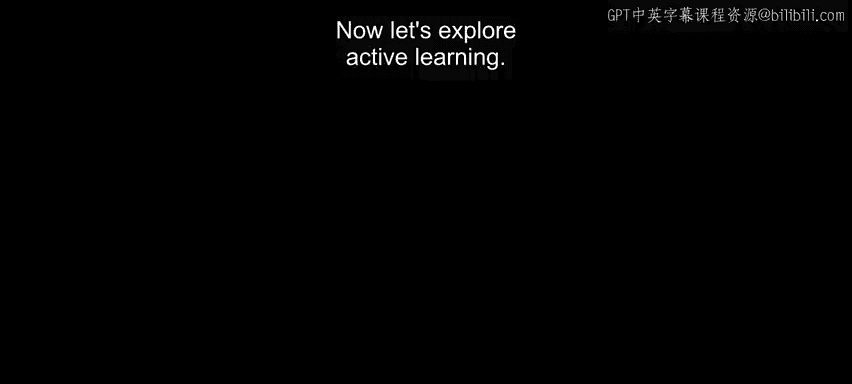
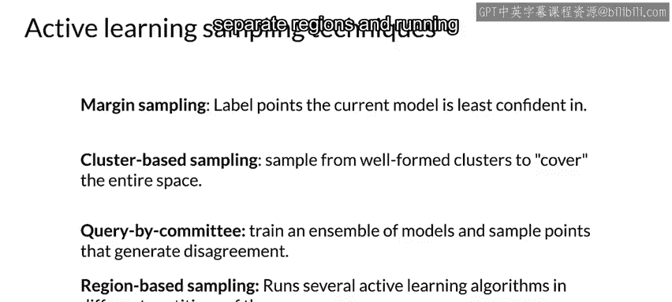

# 吴恩达《机器学习工程师的生产实践（MLOps）Machine Learning Engineering for Production》中英字幕 - P74：33_主动学习.zh_en - GPT中英字幕课程资源 - BV1pi4y167g5

Now， let's explore active learning。 Active learning is a way to intelligently sample your data。

The intelligent sampling selects the unlabeled points that would bring the most predictive value to your model。

This is very helpful in a variety of contexts。First of all。

 limited data budget it costs money to label data， especially when you're using human experts to look at the data and assign a label to it。

 for example， maybe in healthcare， active learning helps offset this costs and burden if you have an imbalanced data set。

 active learning is an efficient way to select rare classes at the training stage。

 and if standard sampling techniques don't help with improving accuracy and other target metrics。

 active learning can find ways to achieve or help achieve the desired accuracy。

Active learning strategy works by selecting labeled examples that will best help the model learn in a fully supervised setting。

 the training data set consists of only the examples that you've labeled in a semi supervised setting。

 you leverage those examples to perform some sort of labeled propagation So that's in addition to active learning。

 This is the typical active learning life cycle。 you start with a pool of unlabeled data。

And then active learning selects a few examples using intelligent sampling。

 and we'll talk about what intelligent sampling is in a second。

 and then you annotate the data with human annotators or by leveraging some other technique。

 this annotation or labeling procedure， generates a labeled training data set。

 and finally you use this labeled data to train a model and make predictions。The cycle goes on。

 but this begs the question。 How do we do intelligent sampling？

 marginin sampling is one widely used technique for doing intelligent sampling。 In this example。

 the data belong to two classes。 Additionally， there are unlabeled data points。 in this setting。

 the simplest strategy is we're just going to train a binary linear classifier model that just makes it simple。

 we're going to just use a linear model for the example。

 So we're going to train that on the labeled data， and that's going to give us a decision boundary。

 Now， among the unlabeled data。 The most uncertain point is the one that is closest to the decision boundary。

 So with active learning， you'll select that most uncertain point to be labeled next and added to the data set。

 So now using this new labeled data point as part of the data set。

 you retrain the model to learn a new classification boundary。Moving the boundary。

 the model learns a bit better to separate those classes。 Next。

 you find the most uncertain data point again and repeat the process until the model doesn't improve。

 So this plot shows model accuracy as a function of the number of training examples for different sampling techniques。

 The red line shows the results of just selecting points at random to label。

 The blue and green line shows the performance of two margin sampling algorithms using active learning。

As you can see， the margin sampling methods achieve a higher accuracy with fewer training examples than the random sampling technique。

 but of course， eventually as a higher percentage of the unlabeled data is labeled with even using random sampling。

 it will catch up to margin sampling as we see here。But it requires a lot more data to be labeled。

There are several common active learning sampling techniques。 So with margin sampling。

 as we just saw， you assign labels to the most uncertain points based on their distance from the decision boundary with cluster based sampling。

 you select a diverse set of points by using clustering methods over your feature space with query by committee。

 you train several models and select the data points with the highest disagreement among those models。

And finally， region based sampling is a relatively new algorithm。 At a high level。

 this algorithm works by dividing the input space into separate regions and running an active learning algorithm in those regions。

😊。

