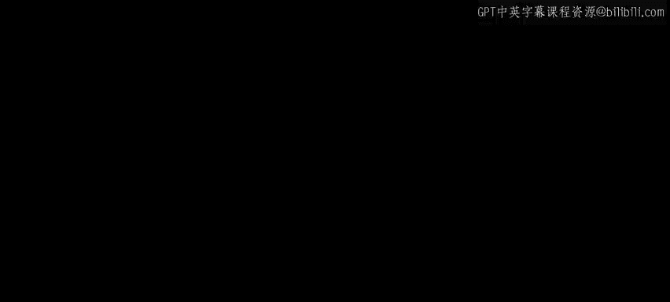
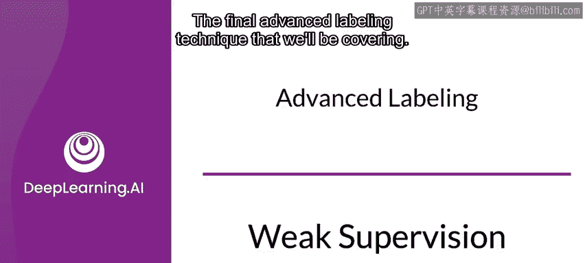
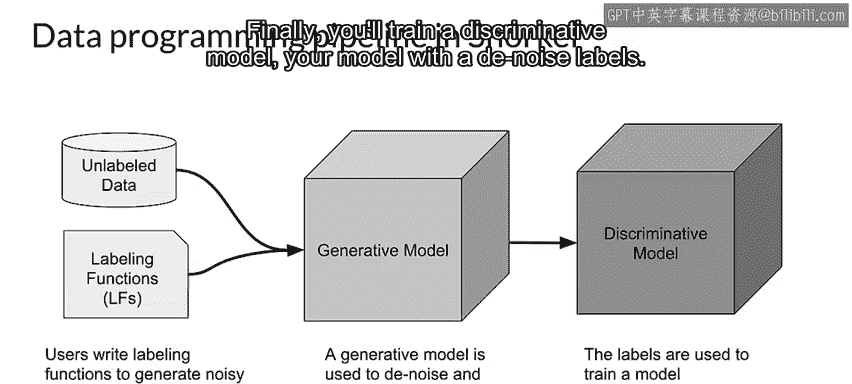
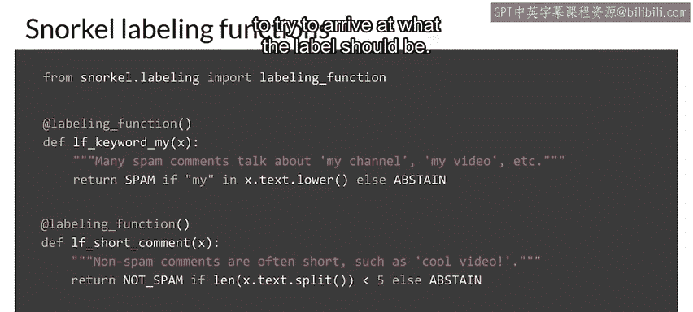
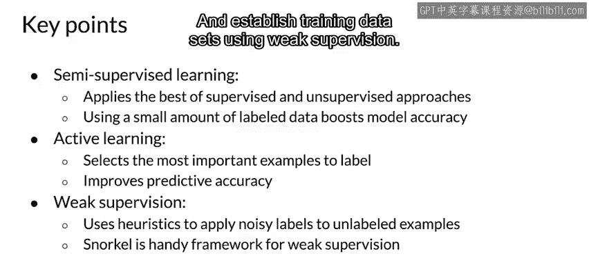

# 吴恩达《机器学习工程师的生产实践（MLOps）Machine Learning Engineering for Production》中英字幕 - P75：34_弱监督.zh_en - GPT中英字幕课程资源 - BV1pi4y167g5

Now， let's get started with weak supervision。 The final advanced labeling technique that we'll be covering。

 This is a quote from Jeff Dean， who leads the machine learning research group at Google。

 He's commenting on the cost in terms of both time and labor of labeling data。

 He's also commenting specifically on the work to create algorithmic approaches to labeling data that rely on other sources of information to produce noisy labels。

 weak supervision， which we'll discuss now， is the primary way of doing this kind of labeling。

So what is weak supervision Well， weak supervision is a way to generate labels using information from one or more sources。

Usually these are subject matter experts and usually they're designing heuristics。

The resulting labels are noisy rather than the deterministic labels that we're used to。

More specifically， weak supervision comprises one or more noisy conditional distributions over unlabeled data。

And the main objective is to learn a generative model that determines the relevance of each of these noisy sources。

 So you start with unlabelled data for which you don't know the true labels。

 Then you add to the mix one or more weak supervision sources。

 These sources are a list of heuristic procedures that implement noisy and imperfect automated labeling。

 subject to matter， Exper are the most common sources for designing these heuristics。

 which typically consist of a coverage set and an expected probability of the true label over the coverage set。

By noisy， we mean that the label has a certain probability of being correct。

 rather than the 0 per cent certainty that we used to for labels in our labeled data。

 The main goal is to learn the trustworthiness of each supervision source。

 And this is done by training a generative model。The snorkel framework came out of Stanford in 2016 and is the most widely used framework for implementing weak supervision。

It doesn't require manual labeling， so the system programmatically builds and manages training data set。

Snorkel provides tools to clean， model and integrate the resulting training dataris through the weak supervision pipeline。

Snorkel uses novel theoretically grounded techniques to get the job done promptly and efficiently。

 and in addition， Snorkel also offers data augmentation and slicing。With snorkel。

 you'll start with unlabeled data and apply labeling functions。

 which are the heuristics which are designed by subject matter experts to generate noisy labels。

You'll then use a generative model to dennoise the noisy labels and assign importance weights to the different labeling functions。

Finally， you'll train a discriminative model， your model with a denoed labels。

So let's take a look at what a couple of simple labeling functions might look like in code here I'll show a simple way to create functions to label spam using snorkel。

The first step is to import the labeling function from snorkel。And then with this function。

 I'll label a message spam。 If it contains the word my。 This is just an example。

 it's an easy example to show。 So messages with my don't have to be spam。 Otherwise。

 the function returns abstain， which means that it has no opinion on what the label should be。

 The second function labels a message spam。 If it's longer than five words。

 So what we're showing here is we're using multiple labeling functions to try to arrive at what the label should be。

So let's review a few of the key points of advanced labeling techniques supervised learning requires labeled data。

 but labeling data is often an expensive， difficult and slow process。

Semi superervised learning is one possible way to add labels to unlabeled data。

 so this method falls between unsupervised learning and supervised learning。

It works by combining a small amount of labeled data with a large amount of unlabeled data。

 and this improves learning accuracy。Active learning is another advanced labeling method。

 It relies on intelligent sampling techniques that select the most important examples to label and add to the data set。

Active learning improves predictive accuracy while minimizing labeling cost。

The last method you explored was weak supervision。Weak supervision leverages noisy。

 limited or inaccurate label sources。Inside a supervised learning environment to test labeling accuracy。

Snorkel is a compact and user friendly system to manage all these operations for weak supervision and establish training data sets using weak supervision。

