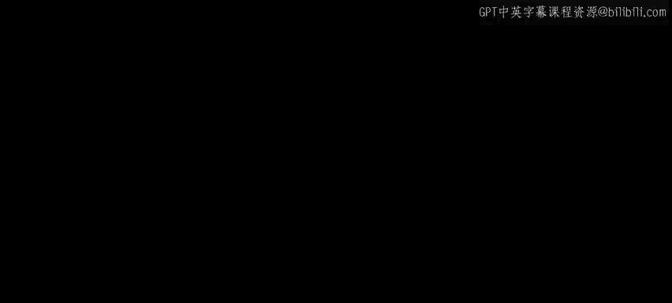
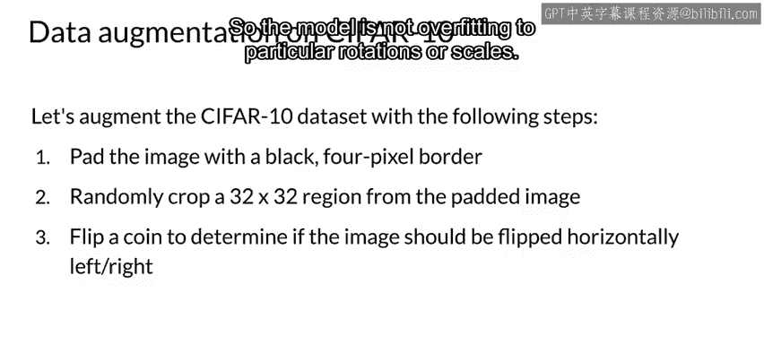
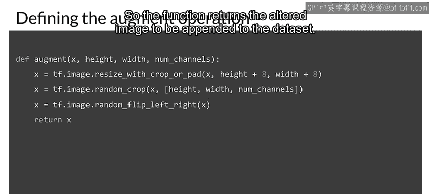
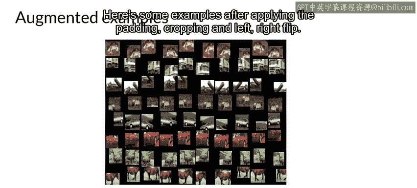
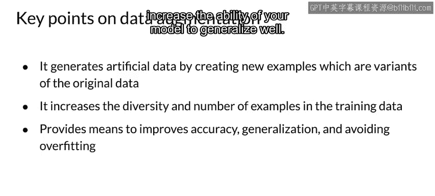

# 吴恩达《机器学习工程师的生产实践（MLOps）Machine Learning Engineering for Production》中英字幕 - P76：35_数据增强.zh_en - GPT中英字幕课程资源 - BV1pi4y167g5

Now let's get started with data augmentation in this video。

 I'll talk a bit about generating synthetic data， and then I'll walk through an example of augmenting images using the CFR 10 data set。

And finally， I'll mention a few other advanced techniques for data augmentation。Previously。

 you explored methods for getting more labeled data by labeling unlabeled data。

 but another method is to augment your existing data to create more labeled examples with data augmentation。

 you expand a data set by adding slightly modified copies of existing data or create new synthetic data from your existing data。

With the existing data， it is possible to create more data by making minor alterations or perturbations in the existing samples。

 simple tasks like flips or rotations and images are an easy way to double or triple the number of images in a data set。

Here's an example of these kinds of transformations。

Data augmentation is a way to improve your model's performance。

Add new valid examples that fall into regions of the feature space that aren covered by your real examples and add valid examples in this way improves coverage of your feature space。

 Keep in mind that if you add invalid examples， you run the risk of learning the wrong answer。

 or at the very least of introducing unwanted noise。

 So be careful to only augment your data in valid ways。CFR10， the CR 10 data set。

 CFAR is the Canadian Institute for Advanced Research。

Is a collection of images commonly used to train machine learning models and computer vision models？

It's one of the most widely used data sets for machine learning research CF4R 10 contains 60。

032 by 32 color images。There's 10 different classes with 6000 images in each class。

 So let's take a practical look at data augmentation with the C4 10 data set。

 We'll add a border padding the image， and that new example is perfectly valid。

 will crop the padded images to a 32 by 32 image and will flip or rotate the padded and cropped images based on a coin toss or random variable。

 So the model is not overfitting to particular rotations or scales。 Since color images are tensors。

 Tensorflowlow provides very useful functions to perform augmentations on image dataset sets。

Let's look at a chunk of code that encapsulates the steps for doing a left right flip。First。

 we define a function that we'll use to augment image data sets。Then we'll use Tf。image。

resize with crop or pad， which allows you to resize or crop the image in this case we're going to pad。

TF。 image。ran crop generates a crop of size height by width across all channels。

And then T F dot image dot random flip left right does the same thing with rotations like flipping left or right。

So the function returns the altered image to be appended to the data set heres some examples after applying the padding。

 cropping and left right flip。

Apart from simple image manipulation， there are other advanced techniques for data augmentation。

 such as semiupervised data augmentation， such as the unsupervised data augmentation or UDA or other methods using policy based data augmentation like auto augment。

On the right， there's an example of a movie review。And then using policy augmentation。

 we generate a variant example， So we have a new example perfectly valid that we've been able to generate with augmentation。

 and we can do it again。 We can generate another one。So in summary。

 data augmentation is a great way to increase the number of labeled examples in your data set。

It increases the size of your data set and the sample diversity。

 which results in better feature space coverage。Daate augmentation can reduce overfitting and increase the ability of your model to generalize well。

