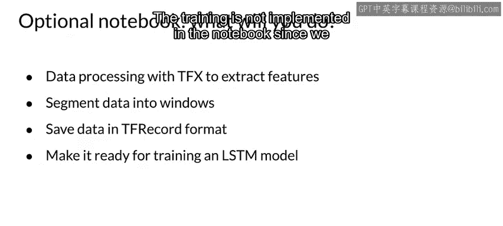

# 吴恩达《机器学习工程师的生产实践（MLOps）Machine Learning Engineering for Production》中英字幕 - P77：36_时间序列.zh_en - GPT中英字幕课程资源 - BV1pi4y167g5

Now let's look at a time series problem using data from sensors。

First， let's briefly mention some different types of data。

 depending on the problem that you're working on and the data that you have。

 you might be working with different types of data， each of which require different pre processing。

 and in some cases different modeling techniques。 For example。

 you might be working with images or video or text or audio。Or time series data。

 There are too many different types of data like this to discuss thoroughly in this class。

 So we've provided some optional materials for you to explore some of these on your own。

 There's an optional notebook to work with for the Cpar 10 image data set。

 and there's two other notebooks to work on with time series data。

One data is on weather data and the other contains data from an accelererometer and other sensors available on most cell phones。

Of all the data types listed here， time series is probably the one that most developers are the least familiar with。

 so let's get started by reviewing the key aspects of time series。

Time series are a sequence of data points in time， often from recorded events where the time dimension indicates when the event occurred。

They may or may not be ordered in the raw data， but you almost always want them to be in order by time for modeling。

We want to predict the value in a typical situation。

 We want to predict the value of y at time T sometime in the future based on previous measurements。

 The goal is to train a model that predicts future outputs with acceptable accuracy。

Carl Christians Dnicke pointed out that it's difficult to make predictions。

 especially about the future。The corollary to this， of course。

 is that it's relatively easy to make predictions about the past since that's already happened。

 I don't know about you， but I I tend to find that's true。 Time series forecasting does exactly that。

 It tries to predict the future。 It does it by analyzingna data from the past。

This requires time indexed data， for example， to predict future temperature at a given location。

 we could use other meteorological variables such as atmospheric pressure。

 wind direction and velocity， etc that have been recorded previously at some time in the past。

Let's look at a concrete example of making weather predictions In this example。

 you're going to be working with a time series data set that was recorded by the Max Planck Institute for Biogeochemistry。

This data set contains 14 different features including air temperature。

 atmospheric pressure and humidity。 They were recorded every 10 minutes beginning in 2003。

 Your job is to pre process the features with a TFX pipeline and convert the data into time sequences。

This format is required to train recurrent neural networks such as long。

 short term memory models or LSTMs。Let's take a closer look at how the data is organized and collected。

 There are 14 variables， including measurements related to humidity， wind direction and velocity。

 temperature and atmospheric pressure。 The target for prediction is the temperature。

 The sampling rate is one observation every 10 minutes。

 So you have six observations per hour and 144 in a given day。 In other words，6 times 24。

These are plots for a few of the features over time。 and the target variable T， which is temperature。

You can see that there's a pattern to this which repeats over specific intervals of time。

There's clear seasonality here， which we need to consider when doing feature engineering for this data。

We should consider doing seasonal decomposition， but to keep things simple in this example。

 we won't be doing that。 The data exhibits clear periodicity or seasonality， which in this case。

 is actually most likely do to the typical seasonal progression over the year。 But remember。

 seasonal as a characteristic of data often has nothing to do with the actual seasons of the year。

 It's really about periodicity。Using a windowing strategy to look at dependencies with the past data seems a natural path to take。

 and luckily， TFX has this functionality already built in。In the notebook。

 you will see that the window function of TF data and well use that to group the data set into Windows。

 So let's see exactly how this actually works using weather data as an example。

Windowing strategies in time series become pretty important。

 and they're kind of unique to time series and similar types of sequence data。In this example。

 you have a model that you can use to make a prediction one hour into the future。

 and given a history of6 hours， will use a sliding window with a window size of 6 and an offset of 1。

 So the total window size is 7，6 plus1。In another example。

 suppose you make a prediction 24 hours into the future， given 24 hours of history。

 so that in that case， your history size is 24。The offset size is also 24。

 so you could use a total window size of 48， which would be the history plus the output offset。

It's also important to consider when now is and not include data in the future。

 which is referred to as time travel In this example， if now is at t equals 24。

 then we need to be careful not to include the data from t equals 25 to t equals 47 in our training data。

 we could do that in feature engineering or by reducing the window to include only the history and the label。

Let's talk about the sampling strategy。 You already know that there are six observations per hour in our example。

 one observation every 10 minutes。In a day， theres going to be  a44 observations。

 If you take five days of past observations and make a prediction6 hours into the future。

 that means that our history size will be  five times 144 or 720 observations。

And the output offset will be 12 times 6 or 72。 So the total window size in time is 792。

 Since observations in an hour are unlikely to change too much。Let's sample one observation per hour。

 So instead of when every 10 minutes， we're going to go to one per hour。

So say we could take the first observation in the hour as the sample or even better。

 you could take the median of the observations in each hour。

 then our history size becomes five times 24 times 1 or 120， and our output offset will be 6。

 so our total window size becomes 126。So we've reduced the size of our feature vector from 792 to 126 by either sampling within each hour or aggregating the data for each hour by taking the median。

So I know the numbers might be a little confusing here。

 but the important point is to think about how we're treating the data in our window。

So what will you do in the optional notebook Well， in that notebook you're going to start with preprocessing the weatherath time series data set using TFX and you'll use Tf。

data。 datas。 window to create the windows that you will be using to build your examples and you'll save the transform and preprocess data in TF record format and finally you'll create training and test data sets in a way that the features can be easily used to train an LsTM model using either Tensorflowlow or CAIS with windowing strategies or in some other framework the training is not implemented in the notebook since we're focusing on the data itself。

