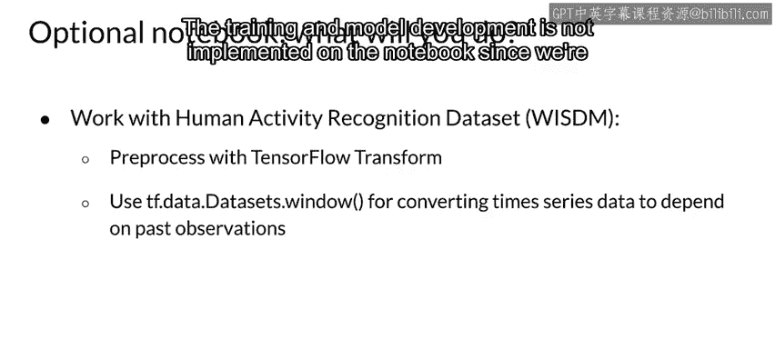

# 吴恩达《机器学习工程师的生产实践（MLOps）Machine Learning Engineering for Production》中英字幕 - P78：37_传感器与信号.zh_en - GPT中英字幕课程资源 - BV1pi4y167g5

Let's review sensor generated data， which is often referred to as signals。

Let's start by defining important terminology by means of an example using collected acceleroerometer data from smartphones。

 The accelerometer is a sensor。Signals are sequences of data collected by a sensor in real time。

Data points are indexed by timets， so therefore this is a time series， this is time series data。

 and we're going to use time series analysis。So let's look at a concrete problem。

 human activity recognition or horror。Can we infer the activity from the accelerometer patterns in time。

Let's look at some of the challenges of activity recognition。

Properly segmenting the sensor data is key to successful activity recognition。

 This is similar to the windowing strategy that we just discussed for weather data。

Inertial data like this fluctuates greatly over time。

 so segmentation is key to detecting proper activity chunks。

The raw time dependent acceleration data set is separated into segments during the data segmentation process。

All of the following ha related operations， including feature extraction。

 classification and validation， etc cetera， are based on these segments。

The length of the segments depends on the application， context and sampling rate of the sensors。

 segmentsments for ha are typically 1 to 10 seconds long。Now that the data is segmented。

 let's talk about typical transformations。The segmented data should be transformed for modeling because it helps with model accuracy and performance。

There are different ways to go about transforming your data。

A spectrogram of an inertial signal is a new representation of the signal as a function of frequency and time。

Specttrogram representation is a powerful method for extracting interpretable features that represent the intensity differences among different inertial data points。

 Other options include normalization and encoding， multichan processing。

 and applying a Fourier transform。Let's go over what you will do in the optional notebook。

You will try to recognize human activities from sensor data。

 The wireless sensor data mining data set contains data。

 which was collected through controlled laboratory conditions。

The data set is a test bench for activity recognition using cell phone accelerometer data。

In this notebook， youll pre processcess the data within a TfX pipeline there you will use Tf。data。

datasets。window to group the data into Windows， which can be used with an RNN or a similar model。

The training in model development is not implemented on the notebook since we're focusing here on the data itself。

