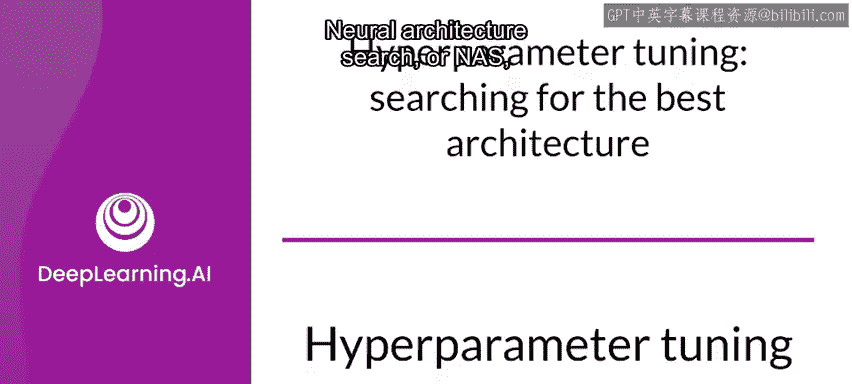
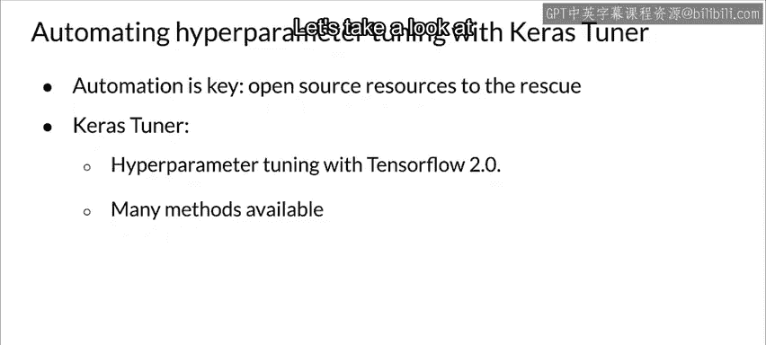

# 吴恩达《机器学习工程师的生产实践（MLOps）Machine Learning Engineering for Production》中英字幕 - P79：1_超参数调优.zh_en - GPT中英字幕课程资源 - BV1pi4y167g5

Welcome back。 We have a lot of great stuff to talk about this week。 First。

 we're going to start with a discussion of hyper parameterameter tuning and we'll do an exercise using Kais tuner。

😊，Then we'll dive into AutoM and really look to try to understand it at some depth。

And then we'll actually do an exercise using AutoM on the cloud， so it's going to be fun。

 Let's get started。We'll get started with neural architecture search。

 We'll start with a discussion of something that you might be more familiar with。

 hyperparameter tuning， and as I think you'll see， there are similarities between hyperparameter tuning and neural architecture search。

So neuroarchitecture search or NAS takes a prominent role in recent ML developments。

In essence， it's a technique for automating the design of neural networks。

 Mos found by nas are often on par with or outperform hand designed architectures for many types of problem。

The goal of NAS is to find the optimal architecture。

 Keep in mind that modern neural networks cover a huge parameter space。

 so automating the search with tools like AutoMl makes a lot of sense。

Before taking a deep dive into auto M， let's understand the problem it solves by analyzing one of the most tedious processes in M L modeling you' have done naively。

Which is hyperparameter tuning in a machine in machine learning models。

 there are two types of parameters。 There are model parameters。

 and so those are parameters that the model must learn using the training set they're fitted or trained parameters of our models。

 so usually that means weights and biases， and then we have hyperparameter。

 these are adjustable parameters that must be tuned in order to create a model with optimal performance。

 but unlike model parameters， hyperparameters are not automatically optimized during the training process。

 they need to be set before model training begins， and they affect how the model trainings。

 hyperparameter tuning can have a high impact on model performance and unfortunately the number of hyperparameters can be substantial even for small models。

So for instance， in a shallow D， you can make hyperparameter choices for architecture options。

For activation functions， for weight initialization strategy。And optimization。

 hyperpara and and others。 So performing manual hyperparameter tuning can be a real brain teaser。

 which is a nice way to put it since you're going to need to keep track of what you've tried and launch different experiments。

 a manual process like that is。😊，Tedious。Nonetheless， when done properly。

 hyperparaiting tutning helps boost model performance significantly。

Several open source libraries have been created using various approaches to hyperparameter tuning。

The Caris team has released one of the best， Caris Tuer。

Which is a library to easily perform hyperparameter tuning with Tensorflowlow 2。0。

 It offers a variety of different tuning methods， including random search。

 Hyband and Bayesian optimization。 Let's take a look at a concrete example in the next video。

