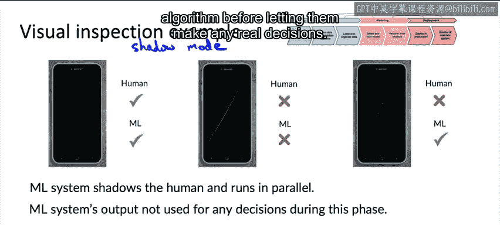
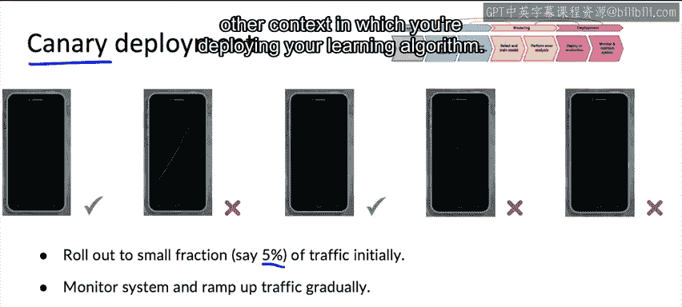
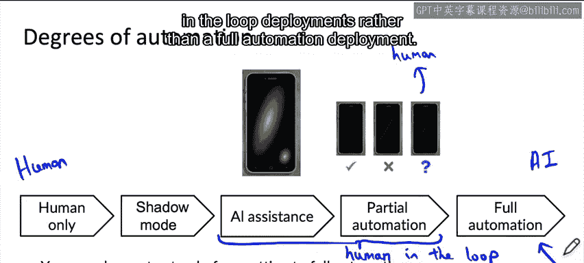

# 吴恩达《机器学习工程师的生产实践（MLOps）Machine Learning Engineering for Production》中英字幕 - P7：6_部署模式.zh_en - GPT中英字幕课程资源 - BV1pi4y167g5

When you train the learning algorithm， the best way to deploy it is usually not to just turn it on and hope for the best because well what if something goes wrong when deploying systems are a number of common use cases or types of use cases as well as different patterns for how you deploy depending on your use case let's go through that in this video。

In the last video I alluded to some of the differences between a first deployment versus a maintenance or an update deployment Let's flesh this out into a little bit more detail One type of deployment is if you are offering a new product or capability that you had not previously offered。

 for example， if you are offering a speech recognition service that you had not offered before。

In this case， a common design pattern is to start up a small amount of traffic and then gradually ramp it up a second common deployment use case is if there's something that's already being done by a person。

 but we would now like to use a learning algorithm to either automate or assist with that task for example。

 if you had people in a factory inspecting smartphones or stretches。

 but now you would like to use a learning algorithm to either assist or automate that task。

The fact that people were previously doing this gives you a few more options for how you deploy。

And you see， shadow mode deployment takes advantage of this。And finally。

 a third common deployment case is if you've already been doing this task with a previous implementation of a machine learning system。

 but you now want to replace it with hopefully an even better one。In these cases。

 two recurring themes you see are that you often want a gradual ramp up。With monitoring。

 in other words， rather than sending tons of traffic to a maybe not fully proven learning algorithm。

 you may send it only a small amount of traffic and monitor it and then ramp up the percentage or amount of traffic。

And the second idea you see a few times is rowback。

 meaning that if for some reason the algorithm isn't working。

 it's nice if you can revert back to the previous system， if indeed there was an earlier system。

Let's start with an example in visual inspection where perhaps you've had human inspectors inspect smartphones for defects。

 for stretches。And you would now like to automate some of this work with a learning algorithm when you have people initially doing a task。

 one common deployment pattern is to use shadow mode。

Deployment and what that means is that you will start by having a machine learning algorithm shadow the human inspector and run in parallel with the human inspector during this initial phase。

 the learning algorithms output is not used for any decision in the factory so whatever the learning algorithm says we're going to go of the human judgment for now。

So let's say for this smartphone， the human says it's fine。

 no defect the learning algorithm says it's fine， maybe for this example of a big stretch down the middle。

 person says it's not okay and the learning algorithm agrees and maybe for this example with a smaller stretch。

 maybe the person says this is not okay but the learning algorithm makes a mistake and actually thinks this is okay the purpose of a shadow mode deployment is that it allows you to gather data of how the learning algorithm is performing and how that compares to the human judgments and by sampling the output you can then verify if the learning algorithm's predictions are accurate and therefore use that to decide whether or not to maybe allow the learning algorithms to make some real decisions in the future。

So when you already have some system that is making good decisions and that system can be human inspectors or even an older implementation of a learning algorithm。

Using a shadow mode deployments can be a very effective way to let you verify the performance of a learning algorithm before letting it make any real decisions。

When you are ready to let a learning algorithm start making real decisions。

 a common deployment pattern is to use a cannery deployment So there's aphone album says it's okay rejects that says as' okay rejects that rejects that and in a cannery deployments you roll out to a small fraction。

 maybe 5% maybe even less of traffic initially and let the algorithm making real decisions。

 but by running this on only a small percentage of the traffic hopefully if the algorithm makes any mistakes or affect only a small fraction of the traffic and this gives you more of an opportunity to monitor the system and ramp up the percentage of traffic it gets only gradually and only when you have greater confidence in this performance the phrase cannery deployment is a reference to the English idiom or the English phrase cannery and a coal mine which refers to how coal miners used to use canneries to spot。

There's a gas leak。But a Academy deployment hopefully this allows you to spot problems early on before there are maybe overly large consequences to your factory or other context in which you're deploying your learning algorithm another deployment pattern that is sometimes use is a bluegreen deployment let me explain a picture say you have a system。

 a camera software for collecting phone pictures in your factory。

 these phone images are sent to a piece of software that takess images and routes them into some visual inspection system in the term of a bluegreen deployments。

 the old version of your software is called the blue version and the new version the learning algorithm you just implemented is called the green version in a bluegreen deployment what you do is have the router send images to the old or the blue version and have that make。

Desions and then when you want to switch over to the new version。

 what you would do is have the router， stop sending images to the old one and suddenly switch over to the new version So the way a blue greeneen deployment is implemented is you would have an old prediction service。

 maybe running on some set of service， you would then spin up a new prediction service。

The green version。And you would have the router suddenly switch the traffic over from the old one to the new one。

 The advantage of a bluegreen deployment is that there's an easy way to enable a rowback if something goes wrong。

 you can just very quickly have the router go back。

 reconfigure the router to send traffic back to the old or the blue version。

 assuming that you kept your blue version of the prediction service running in a typical implementation of a bluegreen deployment。

 people think of switching over the traffic 100% or at the same time。

 but of course you can also use a more gradual version where you slowly send traffic over As you can imagine whether you use shadow mode can remote remote bluegr or some of the deployment pattern quite a lot of software is needed to excuse this and the ops tools can help with implementing these deployment patterns or you can implement it yourself。

One of the most useful frameworks I have found for thinking about how to deploy a system is to think about deployment not as a01 is either deployed or not deployed。

 but instead to design a system thinking about what is the appropriate degree of automation For example。

 in visual inspection of smartphones， one extreme would be if there's no automation。

 so the human only system slightly more automated would be if your system is running in shadow mode。

 so your learning algorithms outputting predictions but it's not actually used in the factory so that would be shadow mode。

 a slightly greater degree of automation would be AI assistance in which given a picture like this of a smartphone。

 you may have a human inspector make the decision that may be an AI system can affect the user interface to highlight the regions where there's a scratch to help draw the person's attention to where it may be most useful for them to look。

The user interface or UI design is critical for human assistance。

 but this could be a way to get a slightly greater degree of automation while still keeping the human in the loop and even greater degree of automation may be partial automation where given the smartphone。

 if the learning algorithm is sure it's fine then that's its decision if is sure it's effective then we just go to the AI algorithms decision。

 but if the learning algorithm is not sure In other words。

 if the learning algorithm's prediction is not to confident zero or one maybe only then do we send this to a human。

So this would be partial automation where if the learning algorithm is confident of its prediction。

 we go of the learning algorithm， but for the hopefully small subset of images where the algorithm is not sure we send that to a human to get their judgment and the human judgment can also be very valuable data to feedback to further train and improve the algorithm I find that this partial automation is sometimes a very good design point for applications where the learning algorithm's performance isn't good enough for full automation and then of course beyond partial automation there is full automation。

where we might have the learning algorithm make every single decision。

 so there is a spectrum of using only human decisions on the left all the way to using only the AI systems decisions on the right。

And many deployment applications will start from the left and gradually move to the right。

 and you do not have to get all the way to full automation。

 You could choose to stop using AI assistance or partial automation。

 or you could choose to go to full automation， depending on the performance of your system and the needs of the application on this spectrum。

Both AI assistance and partial automation are examples of。Human in the loop。Deployments。

I find that for consumer internet applications such as if you run a web search engine or an online speech recognition system。

 a lot of consumer software internet businesses have to use full automation because it's just not feasible to have someone on the backend doing some work every time someone does a web search or does a product search。

 but outside consumer software internet， for example。

 inspecting things in factories there are actually many applications where the best design point maybe a human in the loop deployments rather than a full automation deployment In this video you saw a few patterns of deployment such as a shadowable deployment Academy deployment a bluegreen deployment and you also saw how you can pick the most appropriate degree of automation depending on your application which could be a human in the loop deployments or for automation。

As we went through these ideas， you heard me mention a few times the importance of monitoring to help you spot problems of any so they can address them。

 let's dive into the details of how to monitor the system in the next video。

