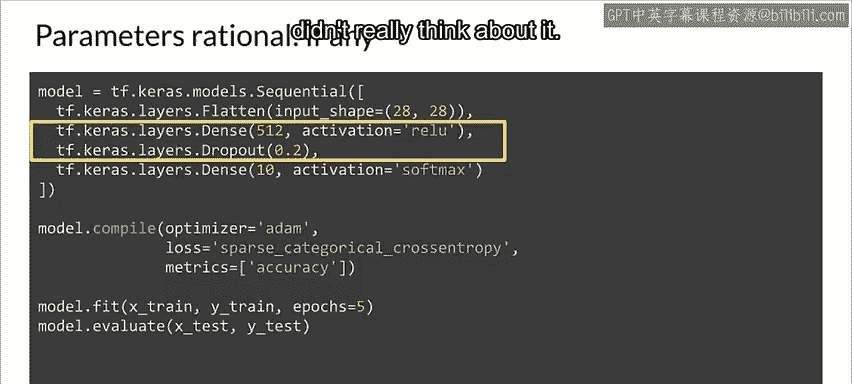
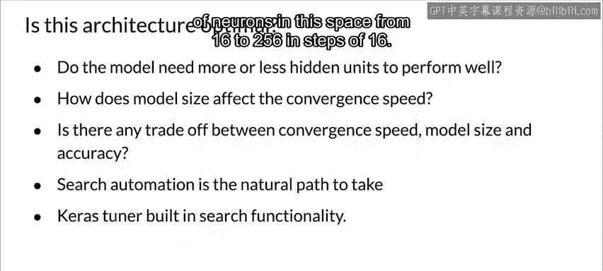
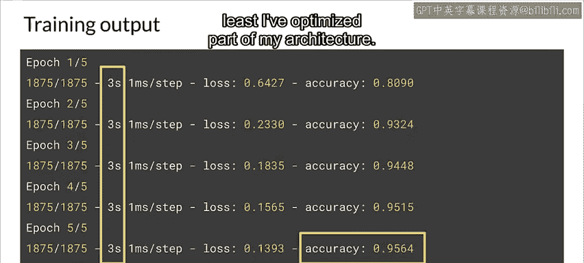

# 吴恩达《机器学习工程师的生产实践（MLOps）Machine Learning Engineering for Production》中英字幕 - P80：2_Keras AutoTuner演示.zh_en - GPT中英字幕课程资源 - BV1pi4y167g5

Now let's get started with a demo of Caris Auto Tur。In this example。

 you'll start by manually setting the hyperparameter for a model which classifies the MNS data set。

For simplicity， let's work with the most basic neural network architecture consisting of one input layer。

 one hidden layer and one output layer。 Let's begin by importing the required libraries and data set。

Here's the Kais code to implement the model。 This is maybe the hello world of deep learning。

 where you have a data set and of fashion items， and you want to build a basic model to recognize them。

 You can train a model in just a few seconds that is about 97 per accurate on this data set。

 As you can see when we run this。 We end up with 09866 accuracy。

 And each epic takes a little over 10 seconds。😊，But can we do better。

 The first question I usually get after showing this is， where do these numbers come from。

Why does this architecture have 512 neurons， Why not another number。And why does the dropout use 0。2。

 why not 0。5 or 0。1？Often the answer is that I used a lot of trial and error to come up with these numbers。

 or as is often the case， I just copied the code from a working example and didn't really think about it。

 Let's think about whether this is this is an optimalable choice or not。

 the natural questions are Will the model do better with more hidden units or less。

 will it learn faster with less units， Can a smaller architecture do that， without losing accuracy。

You could experiment by changing it， rerunning it， changing it again and rerunning it again， et ce。

 but that's a lot of work。What if you could automate this， so care tuner to the rescue？

Let's look at how to install and use it and maybe change the number of neurons in this space from 16 to 256 in steps of 16 and how to run it to get the best results。

So installing CA's tuner is as simple as just doing a Pip and like this and then importing it。

So we'll import it as KT in this example。Now let's go back to our model and take a look。

Instead of hard coat 512 neurons into the hidden layer， we'll use this code instead。

Notice that the number of units in the first dense layer is set to H。 int。

This will be tuned by the Caris tuner。 So this sets up an integer value starting at 16 and going to 512 in steps of 16。

Later， you'll see how Kis Tur will run the model multiple times。

 gathering metrics each time and optimizing for the best one。 In this case。

 the value is what drives the number of times。 K to E does its thing。 Next。

 you'll define your search strategy。 Caris tuner supports multiple strategies。

 and you define which one you want to use like this。😊，In this case， I'm using the hyperband strategy。

 It also supports random search and Bayesian optimization and SK Learn strategies。

 You can learn more about these at the Carris Tur site at Carristeamgithub。 io/caristuner。

The parameters you choose will vary based on your strategy。

 but the important one to note is the objective。In this case， our objective is Val accuracy。

 so we want to maximize on the validation accuracy， you can find details on the rest at the CA site。

Search can take a while to complete and use a lot of compute resources。

 but you can configure an early stopping callback that stops a search when the conditions are met。

 So， for example， here I'm monitoring the validation loss， and the patience is set to five。

 which means that it doesn't change significantly or if it doesn't change significantly in five epics。

 then stops searching on this iteration。And you set the call back as a search parameter。

 The rest of the parameters specify how to search， such as the data and label。

 the number of epics to train for and the validation split。 So， for example。

 how much data you will use to validate against the training set。As it searches。

 you'll see the results of each trial。 We're only searching on one parameter。

 the units in the dense hidden layer。As you can see， as it updates。

 you can keep track of the best value so far， which at this point that we have in the slide is 48。

 And in this case， actually， it ended up that way too when it completed。

 so I can go back and try my architecture again and use the results of the kis tuner to set the number of units manually。

 this time with 48 neurons in a layer， which is the number that we got from from Kris tuner。

And when it's retrained， you'll see the results。 It's only been five epics。

 and the value isn't quite as good as it was beforehand。

 but our epics are three times quicker than they were。

 So I can maybe be trained for longer to get better results， knowing that at the very least。

 I've optimized part of my architecture。

