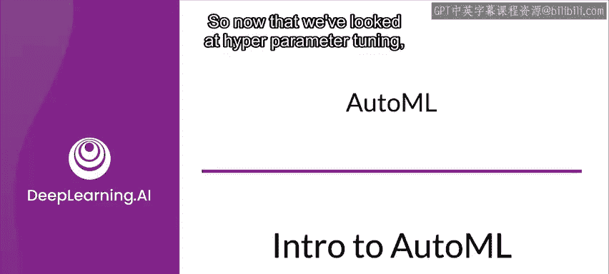
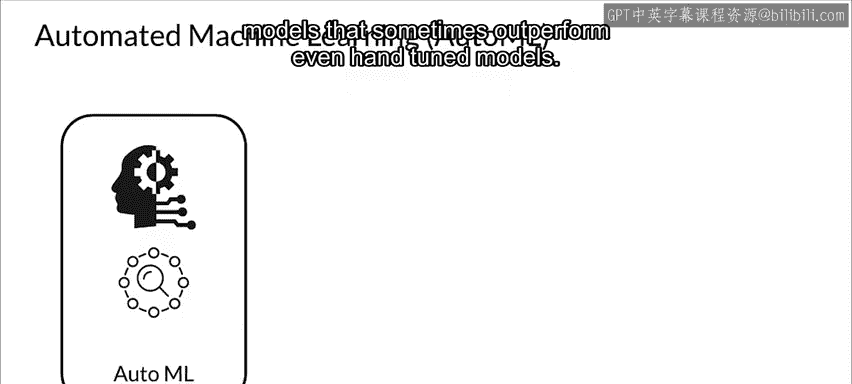
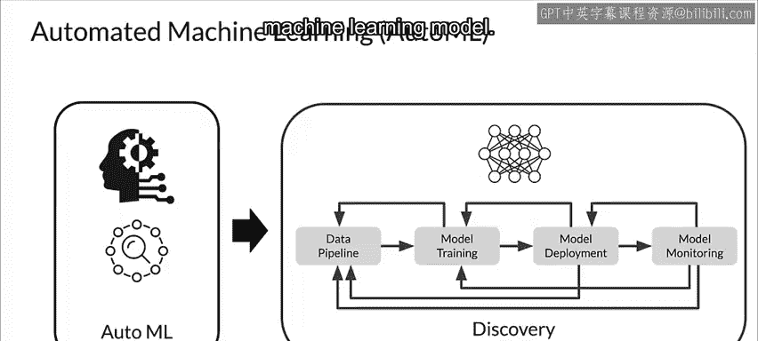
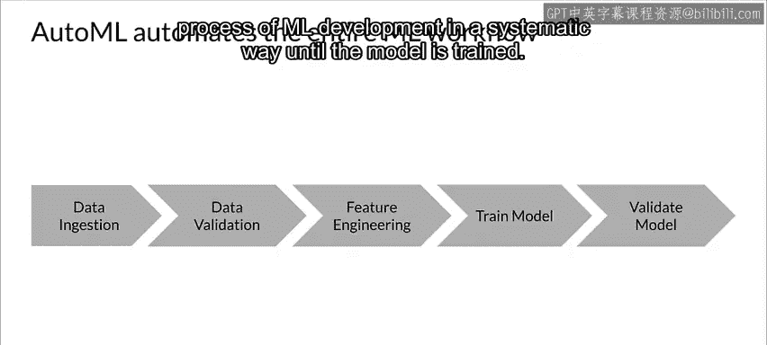
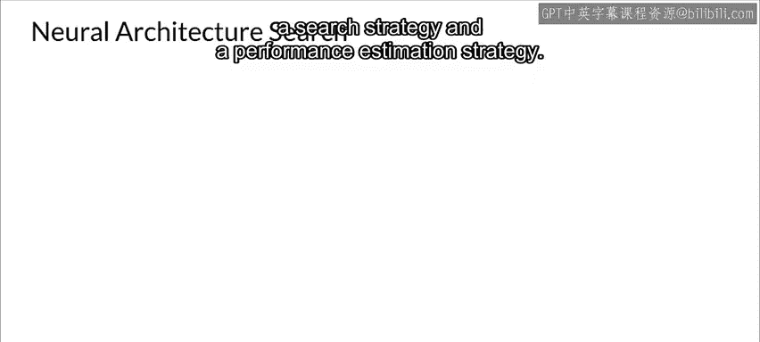
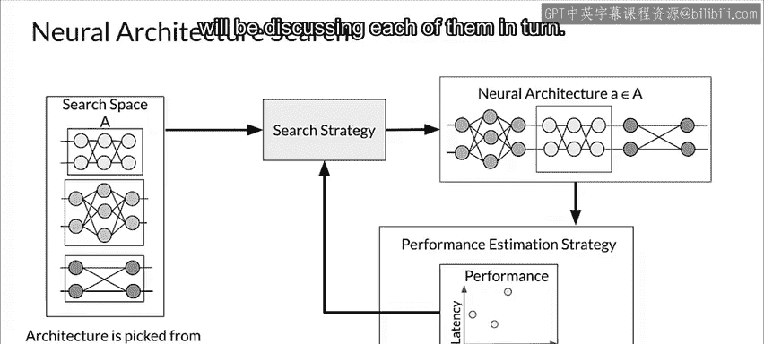
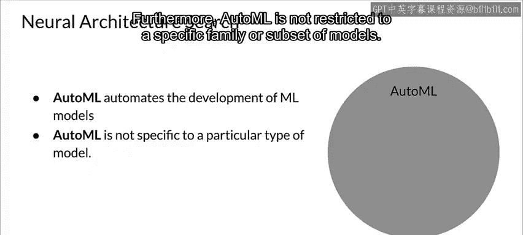
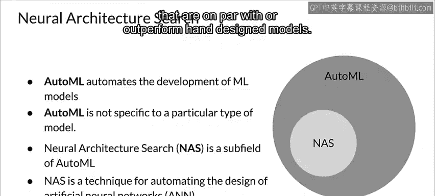
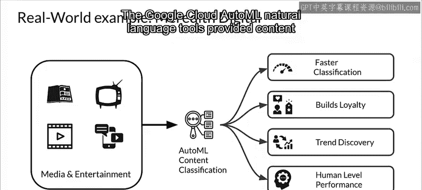

# 吴恩达《机器学习工程师的生产实践（MLOps）Machine Learning Engineering for Production》中英字幕 - P81：3_AutoML简介.zh_en - GPT中英字幕课程资源 - BV1pi4y167g5

So now that we've looked at hyperparameter tuning， let's take a look at actual AutoML in this lesson we'll be discussing AutoML。

 a set of very versatile tools to automate the machine learning process end to end。

Finding the right model is an important piece of the puzzle neural architectureecture search is a process to help find relevant models。

You'll be learning about search spaces and strategies。

 which are key for both hyperparameter tuning and AutoM。

We'll also discuss tools to quantify performance estimation on the explored models in your search。

Finally， you'll learn about different autoM offerings available in the cloud by major service providers Autoated machine learning or AutoML is aimed at enabling developers with very little experience in machine learning to make use of machine learning models and techniques。

It tries to automate the process of machine learning end to end in order to produce simple solutions。

 faster creation of those solutions and models that sometimes outperform even hand tune models。

 AutoMl applies machine learning and search techniques to the process of creating machine learning models and pipelines。

It covers the complete pipeline from the raw data set to the deployable machine learning model。

 In traditional machine learning， we write code for all of the phases of the process。

We start off with ingesting and cleansing the raw data and then perform feature selection and feature engineering。

 We select a model architecture for a task， train or model， and perform hyperparran tuning。

 maybe manually or using a tuner like Caris tuner。

And then we validate our model's performance。ML requires a lot of manual programming and a highly specialized skill set。

AutoM aims to automate the entire ML workflow。If we can provide the AutoML system with raw data and our model validation requirements。

 it goes through all of the phases in the ML workflow and performs the iterative process of ML development in a systematic way until the model is trained。

Neurural architecture Search or NAS is at the heart of AutoML。

There are three main parts to neural architecture search， a search space， a search strategy。

 and a performance estimation strategy。 The search space defines the range of architectures。

 which can be represented to reduce the size of the search problem。

 we need to limit the search space to the architectures which are best suited to the problem that we're trying to model。

 This helps reduce the search space， but it also means that a human bias will be introduced。

 which might prevent neural architecture search from finding architectural blocks that go beyond current human knowledge。

The search strategy defines how we explore the search base。

We want to explore the search base quickly， but this might lead to premature convergence to a suboptimal region in the search space。

The objective of neural architecture search is to find architectures that perform well on our data。

The performance estimation strategy helps in measuring and comparing the performance of various architectures。

A search strategy selects an architecture from a predefined search space of architectures。

 The selected architecture is passed to a performance estimation strategy which returns its estimated performance to the search strategy。

The search space， search strategy and performance estimation strategy are the key components of neural architecture search。

 and we'll be discussing each of them in turn。

AutoML facilitates building models in an automated fashion。Furthermore。

 AutoML is not restricted to a specific family or subset of models。

Neurural architectureect Search is a subfield of AutoML。

It specifically focuses on the model selection part of the AutoML workflow and the design of neural networks。

Neurural architecture search has been used to design architectures that are on par with or outperform hand designed models。

Let's look at a real world use of AutoM。

Meredith Digital is a publishing company specializing in multiple formats of media and entertainment。

Mereredith Digital uses AutoM to train models， mostly natural language based。

 to automate content classification。AutOM speeds up the classification process by reducing the process from months to just a few days。

It also helps by providing insightful， actionable recommendations to help build customer loyalty。😊。

It also helps by identifying new user trends and customer interests to adapt content to better serve customers。

To test its effectiveness， they conducted a test where they compared Ottomael with their manually generated models。

 and the results were pretty striking。The Google Cloud AutoMl Natural language tools provided content classification that was comparable to human level performance。

