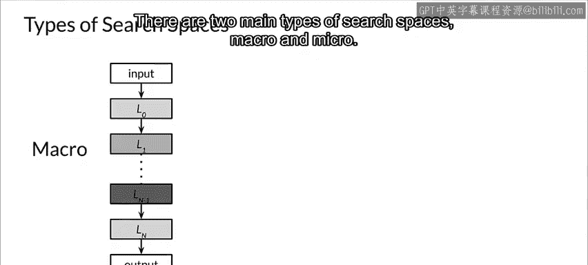
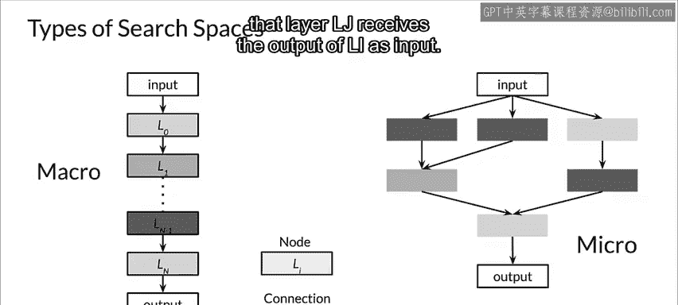
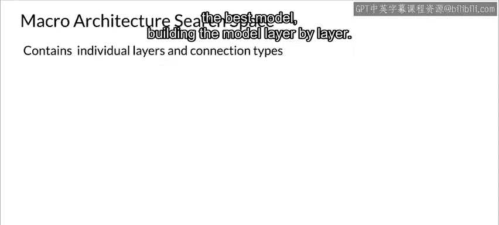
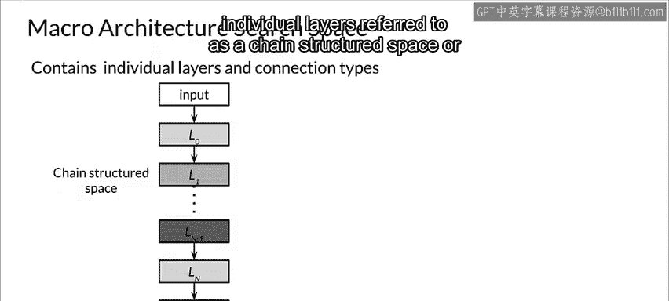
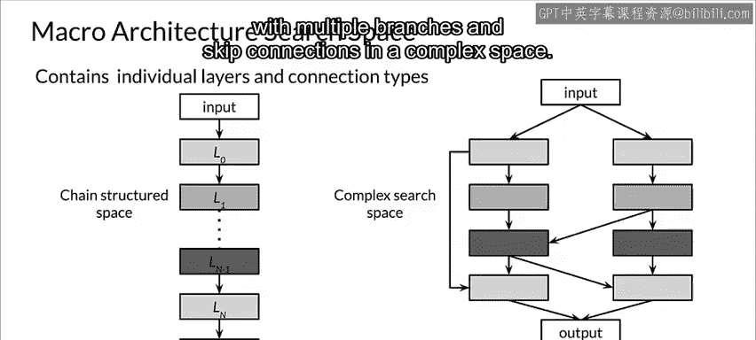
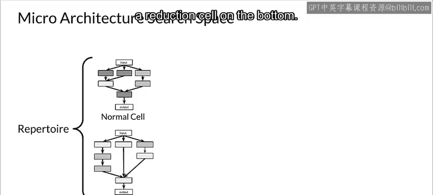
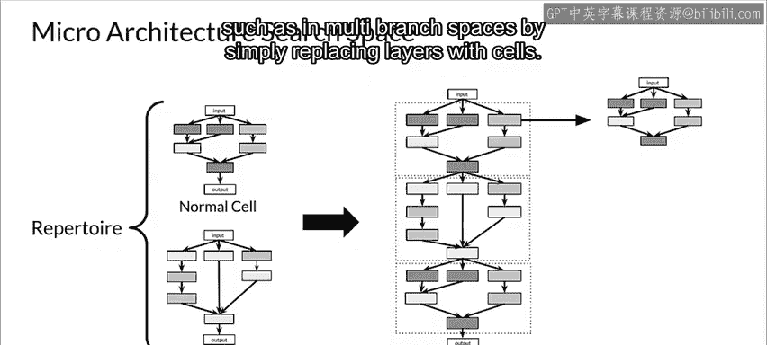

# 吴恩达《机器学习工程师的生产实践（MLOps）Machine Learning Engineering for Production》中英字幕 - P82：4_理解搜索空间.zh_en - GPT中英字幕课程资源 - BV1pi4y167g5

Now， let's continue our discussion of AutoML by discussing search spaces。

There are two main types of search bases。Macro and micro。

And actually， their names are kind of backwards， but that's what they're called。Let's look at both。

First， let's define what we mean by a node。 A node is a layer in a neural network like a convolution or pooling layer。

 In this illustration， each color represents a different layer type。

An arrow from layer L I to L J indicates that layer L J receives the output of L I as input。

A macro search space contains the individual layers and connection types of a neural network。

 and neural architecture search searches within that space for the best model。

 building the model layer by layer。

As shown here， a network can be built very simply by stacking individual layers referred to as a chain structured space。

Or with multiple branches and skip connections in a complex space。

By contrast， in a micro search space， neural architecture search builds a neural network from cells。

 where each cell is a smaller network。 Here are two different types of cells。

 a normal cell on the top and a reduction cell on the bottom。

Cells are stacked to produce the final network。This approach has been shown to have significant performance advantages compared to a macro approach。

 Here is an architecture built by stacking the cells sequentially。

Note that cells can also be combined in a more complex manner。

 such as in multi branch spaces by simply replacing layers with cells。

