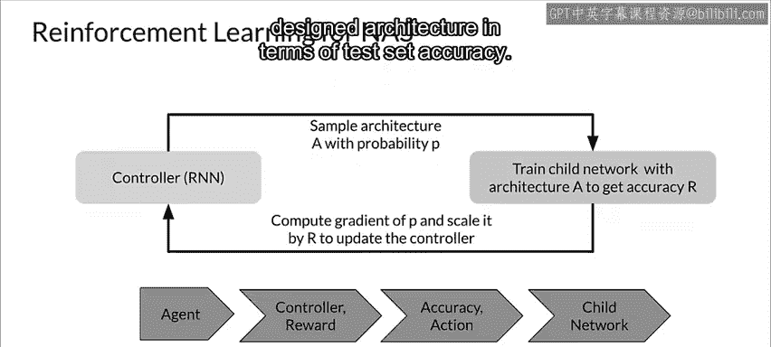

# 吴恩达《机器学习工程师的生产实践（MLOps）Machine Learning Engineering for Production》中英字幕 - P83：5_搜索策略.zh_en - GPT中英字幕课程资源 - BV1pi4y167g5

But how does neural architecture search decide which options in the search space to try next？

It needs to have a search strategy。 Let's discuss that next neural architecture search searches through the search base for the architecture that produces the best performance。

 A variety of different approaches can be used for that search。 These include grid search。

Random search。Baesian optimization。Evolutionary algorithms。And reinforcement learning。

In gridd search， you just search everything。That means you cover every option we have in the search base。

In random search， you select the next option randomly within the search space。

Both of these work reasonably well in smaller search bases。

 but both also fail fairly quickly when the search base grows beyond a certain size。

 which is all too common。Baesian optimization is a little more sophisticated。

It assumes that a specific probability distribution， which is typically a Gaussian distribution。

 is underlying the performance of model architectures。

 So you use observations from tested architectures to constrain the probability distribution and guide the selection of the next option。

This allows us to build up an architecture stochcastically based on the test results and the constrained distribution。

 neural architecture search can also use an evolutionary method to search。 Here's how it works。

 First， an initial population of n different model architectures is randomly generated。

The performance of each individual， in other words。

 each architecture is evaluated as defined by the performance estimation strategy。

 which we'll talk about next。Then the X highest performers are selected as parents for a new generation。

This new generation of architectures might be copies of their respective parents with induced random alterations or mutations。

Or they might arise from combinations of the parents。

The performance of the offspring is assessed again， using the performance estimation strategy。

 The list of possible mutations can include operations like adding or removing a layer adding or removing a connection。

 changing the size of a layer or changing another hyperparameter。

 Why architectures are selected to be removed from the population。

 This might be the why worst performers， the why oldest individuals in the population or a selection of individuals based on a combination of these parameters。

 The offspring replaces the removed architectures。And the process is restarted with this new population in reinforcement learning。

 agents take actions in an environment。Trying to maximize a reward。After each action。

 the state of the agent and the environment is updated。

And a reward is issued based on a performance metric。

Then the range of possible next actions is evaluated。

 The environment in this case is our search space， and the reward function is our performance estimation strategy。

 A neural network can also be specified by a variable length string where the elements of the string specify individual network layers。

😊，That enables us to use a recurrent neural network or R NN to generate that string。

 as we might do for an NLP model。The RNN that generates the string is referred to as the controller after training the network referred to as the child network on real data。

 we can measure the accuracy on the validation set。

The accuracy determines the reinforcement learning reward in this case。Based on the accuracy。

 we can compute the policy gradient to update the controller RNN。In the next iteration。

 the controller will have learned to give higher probabilities to architectures that result in higher acuracies during training。

This is how the controller will learn to improve its search over time。For example。

 on the CFR10 data set， this method starting from scratch can design a new network architecture that rivals the best human designed architecture in terms of test set accuracy。

