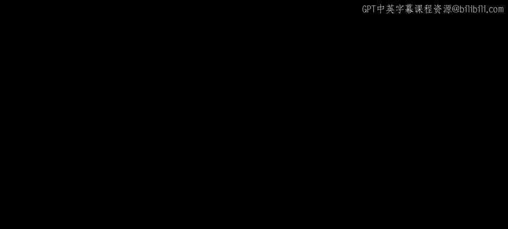
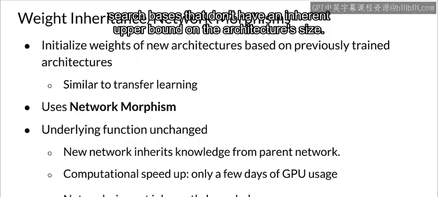

# 吴恩达《机器学习工程师的生产实践（MLOps）Machine Learning Engineering for Production》中英字幕 - P84：6_测量AutoML的功效.zh_en - GPT中英字幕课程资源 - BV1pi4y167g5

Neurural architecture search relies on being able to measure the accuracy or effectiveness of the different architectures that it tries。

 This requires a performance estimation strategy。 Let's talk about that Now。

 the search strategies in neural architecture search need to estimate the performance of generated architectures so that they can generate architectures that perform better。

 Let's discuss some of the performance estimation strategies which are used in neural architecture search。

The simplest approach is to measure the validation accuracy of each architecture that is generated。

 like we saw with a reinforcement learning approach。

 This becomes computationally heavy especially for large search spaces and complex networks。

 And as a result， it can take several GP days to find the best architectures using this approach It makes it expensive and slow。

 It also makes neural architecture search impractical for many use cases。

Is there a way to reduce performance cost estimation？Several strategies have been proposed。

 including lower fidelity estimates。Learning curve extrapolation and weight inheritance or network morphism。

Let's discuss each of these。Lower fidelity or lower precision estimates try to reduce the training time by reframing the problem to make it easier to solve。

By training on a subset of data or using lower resolution images， for example。

 or using fewer filters per layer and fewer cells。It greatly reduces the computational cost but ends up underestimating performance。

 that's okay if you can make sure that the relative ranking of the architectures does not change due to their lower fidelity estimates。

 but unfortunately， recent research has shown that this is not the case。Bummer。What else can we try？

Learning curve extrapolation is based on the assumption that you have mechanisms to predict the learning curve reliably。

 And so extrapolation is a sensitive and valid choice。 On the right。

 there are learning curves for different architectures。😊。

Based on a few iterations and available knowledge， the method extrapolates the initial learning curves and terminates all architectures that perform poorly。

The progressive neural architectureitect search algorithm。

 which is one of the approaches for neural architecture search。

Uses a similar method by training a surrogate model and using it to predict the performance using architectural properties。

Another method for speeding up architecture's search initializes the weights of novel architectures based on the weights of other architectures that have been trained before。

 similar to the way that transfer learning works。One way of achieving this is referred to as networkmorphism。

Network morphism modifies the architecture without changing the underlying function。

This is advantageous because the network inherits knowledge from the parent network。

 which results in methods that require only a few GPU days to design and evaluate。

This allows for increasing the capacity of network successively and retaining high performance without requiring training from scratch。

 One advantage of this approach is that allows for search bases that don't have an inherent upper bound on the architecture's size。

