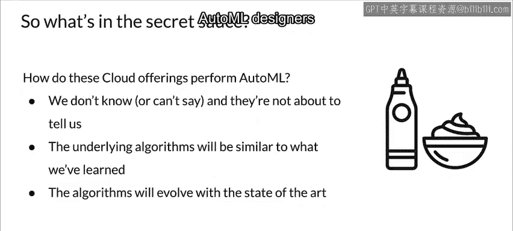

# 吴恩达《机器学习工程师的生产实践（MLOps）Machine Learning Engineering for Production》中英字幕 - P85：7_云端的AutoML.zh_en - GPT中英字幕课程资源 - BV1pi4y167g5

One of the easiest ways to use Auto M is by using a cloud service。 Let's talk about some of those。

 now。

We'll review three popular offerings。Amazon SageMaker autopilot。Microsoft。

 Azure Auto machine learning and Google Cloud Autom in the exercises。

 you'll train a model using Google Cloud Automl。 Let's begin with Amazon SageMaker Autopilot。

Amazon SageMake Autopilot automatically trains and tunes the best machine learning models for classification or regression based on your data while allowing you to maintain full control and visibility。

Starting with your raw data， you select a label or target。

Autopiillot then searches for candidate models for you to review and choose from。

All of these steps are documented on executable notebooks that give you full control and reproducibility of the process。

This includes a leader board of model candidates to help you select the best model for your needs。

You can then deploy the model to production or iterate on the recommended solutions to further improve model quality。

Autopilot is optimized for quick iteration。It generates high quality models quickly。

 After the initial set of iterations， Autopilot creates a leaderboard of models ranked by performance。

You can see which features in your data set were selected by each model。

 you can then deploy a model to production。The process of generation of the models is completely transparent。

Autopilot allows you to create a sagemakerr notebook from any model it created。

 You can then check the notebook to dive into details of the model's implementation。 If need be。

 you can refine the model and recreate it from the notebook at any point in time。

Amazon suggests that autopilot can be applied for a number of different use cases。For example。

 it can be used to predict future prices to help you make sound investment decisions based on your historical data。

 such as demand， seasonal trends and the price of other commodities。

 price predictions are particularly useful in the financial services sector to predict this price of stocks or real estate to predict real estate prices or energy and utilities to predict the prices of natural resources。

 Turn prediction can be useful in predicting the loss of customers or churn Compies are always looking for ways to eliminate churn。

And churn prediction works by learning patterns in your existing data and identifying patterns in the new data sets so that the model can predict which customers are most likely to churn。

Another application is risk assessment Rik assessment requires identifying and analyzing potential events that may negatively impact individuals。

 As and your company risk assessment models are trained using your existing data sets so that you can optimize the model's predictions for your business。

Next， let's discuss Microsoft Azure Autoated Mach learninging。

Microsoft Azure Autoated machine learning aims to empower professional and nonprofession data scientists to build machine learning models rapidly。

 it automates time consuming and iterative tasks of model development， so basically it does AutoML。

It starts with automatic feature selection。Followed by model selection and hyperparameter tuning on the selected model。

To generate the most optimized model for the task in hand。

You can either create your models using a no code UI or using code first notebooks。

 you can quickly customize your models， apply control settings to iterations， thresholds。

 validations， blocked algorithms， and other experimental criteria。

It also provides tools to fully automate the feature engineering process。

You can also easily visualize and profile your data to spot trends。

 as well as discover common errors and inconsistencies in your data。

This helps you better understand recommended actions and apply them automatically。

 It also provides intelligent stopping to save time on computing and prioritize the primary metric the and sub sampling to streamline experiment runs and speed results。

😊，It also has built in support for experiment run summaries and detailed metrics visualizations to help you understand your models and compare model performance。

Model interpretability helps evaluate model fit for raw and engineered features and provides insights into feature importance。

You can discover patterns， perform what if analysis。

 and develop deeper understanding of models to support transparency and trust in your business。

Now let's discuss Google Cloud AutoM， which you'll be using in the upcoming exercise。

Google Cloud AutoMl is a suite of machine learning products that enables developers with limited machine learning expertise to train high quality models specific to their business needs。

 It relies on Google's state of the art transfer learning and neural architecture search technologies。

Cloud AutoMl leverages more than 10 years of Google research to help your machine learning models achieve faster performance and more accurate predictions。

You can use Cloud AutoM's simple graphical user interface to train， evaluate， improve。

 and deploy models based on your data。You're really only a few minutes away from your own custom machine learning model。

Google's human labeling service can also put a team of people to work annotating or cleaning your labels to make sure that your models are being trained on high quality data。

 because different kinds of problems and different kinds of data need to be treated differently。

 Cloud Automl isn't just one thing。 It's a suite of different products。

 each focused towards particular use cases and data types。😊，For example， for image data。

 there's AutoML vision and for video data， there's AutoML video intelligence。For natural language。

 there's automl， natural language。 and for translation， there's automl translation。 Finally。

 for general structured data， there's automl tables。 Some of these are broken down even further。

For image data， for example， there's both vision classification and vision object detection。

And then there are also edge versions of both of these focused on optimizing for running inference at the edge in mobile applications or IoT devices。

For video。There's both video intelligence， classification and video object detection。Again。

 focused on these specific use cases。 So how do all three of these different cloud services operate under the hood。

Well， no one knows exactly or can't say if they work for a given provider。However。

 it is safe to assume that the algorithms at play will be similar to the ones that we've discussed in previous lessons。

Also keep in mind that ML engineering for production is a rapidly changing field。

And new technologies and developments emerge every few months。

These new advancements are typically incorporated and exploited to their greatest extent by the AutoM providers。

Also notice that these different AutoM offerings each perform the same kinds of operations that you perform or should perform as you train your model。

 including feature selection and feature engineering and cleaning your labels。

AutoM designers understand the importance of these activities。

