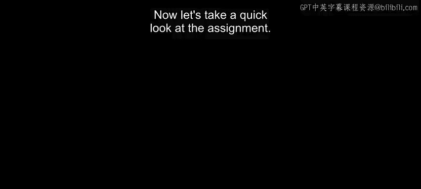
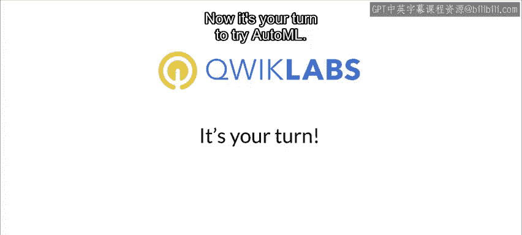

# 吴恩达《机器学习工程师的生产实践（MLOps）Machine Learning Engineering for Production》中英字幕 - P86：8_作业设置.zh_en - GPT中英字幕课程资源 - BV1pi4y167g5

Now let's take a quick look at the assignment。There are six steps to classifying images using Google Cloud Auto Vision。

First， you set up AutoM， and then you create the data set in vision by first uploading images to cloud storage and then proceeding to create the data set。

This data set contains images of clouds， and we're also running on a cloud。 So don't get confused。

 Automl then performs the actual training by selecting the best model for the task。Finally。

 we can deploy the model trained by Ottawamalvission。

And test the model by generating predictions using the deployed model so that you can perform the exercise in a cloud environment will be using Quicklabs。

Quicklabs provides real cloud environments that help developers and IT professionals learn how to apply cloud platforms and software。

 You'll be using Quicklas to learn how to train models using Google Cloud AutoMl。

 This exercise has six steps which you'll perform live on the Google Cloud using Quicklabs。😊。

Please check the accompanying lab for details on how to get started with Quick Las。

And now it's your turn to try AutoM。

