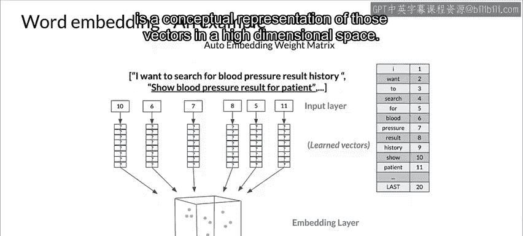
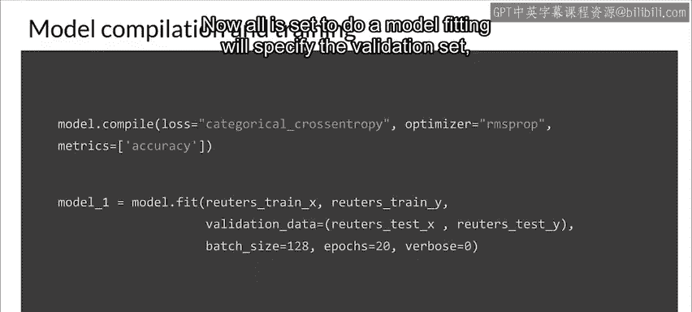
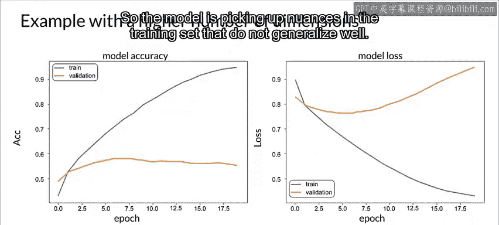
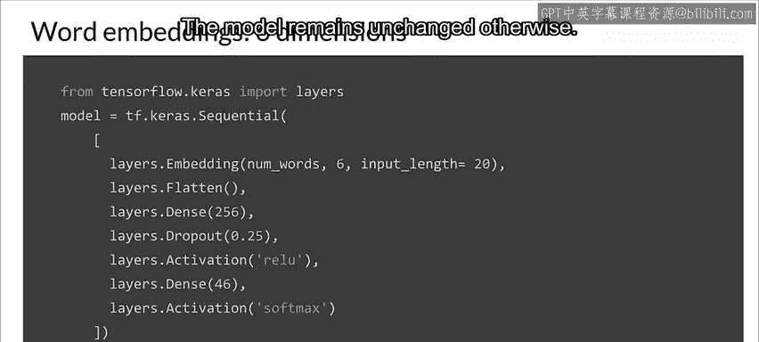
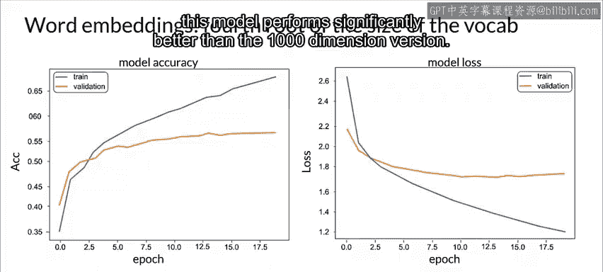

# 吴恩达《机器学习工程师的生产实践（MLOps）Machine Learning Engineering for Production》中英字幕 - P88：10_维度对性能的影响.zh_en - GPT中英字幕课程资源 - BV1pi4y167g5

Welcome back。 This week is all about model optimization and resource management。

 We'll be talking about a lot of interesting issues。

 including dimensionality and ways to reduce it and why it's important。

 So we'll look at some really resource constrained scenarios， including mobile and Io applications。

 and ways to deal with resource usage in those situations such as quantization and pruning。

 So we have a lot to talk about Let's get started。😊，The compute。

 storage and I O systems that your model requires will determine how much it costs to put your model into production and maintain it during its entire lifetime。

This week， we'll be taking a look at some important techniques that can help us manage model resource requirements。

We'll begin by discussing dimensionality and how it affects our model's performance and resource requirements。

In the not so distant past， data generation and to some extent。

 data storage was a lot more costly than it is to day。 Back then。

 a lot of domain experts would carefully consider which features or variables to measure before designing their experiments and feature transforms as a result。

Data sets were expected to be well designed and potentially contain only a small number of relevant features。

Today， data science tends to be more about integrating everything end to end。

Generating and storing data is becoming faster， easier and less expensive。

 So there's a tendency for people to measure everything they can and include ever more complex feature transformations。

 As a result， data sets are often high dimensional， containing a large number of features。

 Although the relevancy of each feature for analyzing this data is not always clear。

 before going too deep， let's discuss a common misconception about neural networks。

 Many developers correctly assume that when they train their neural network models。

 the model itself as part of the training process will learn to ignore features that don't provide predictive information by reducing their weights to0 or close to 0。

 While this is true。 The result is not an efficient model。

Much of the model can end up being shut off when running inference to generate predictions。

 but those unused parts of the model are still there。

They take up space and they consume compute resources as the model server traverses the computation graph。

Those unwanted features can also introduce unwanted noise into the data。

 which can degrade model performance。And outside of the model itself。

 each extra feature still requires systems and infrastructure to collect that data， store it。

 manage updates， et cetera。 which adds cost and complexity to the overall system。

 That includes monitoring for problems with the data and the effort to fix those problems if and when they happen。

 Those costs continue for the lifetime of the product or service that you're deploying。

 which could easily be years。There are techniques for optimizing models with weights that are close to zero。

 which you'll learn more about later in this course。But in general。

 you shouldn't just throw everything at your model and rely on your traininging process to determine which features are actually useful。

In machine learning， we often have to deal with high dimensional data。

Consider an example where we're dealing with recording 60 different metrics for each of our shoppers。

That means we're working in a space with 60 dimensions。 In other cases。

 if you're trying to analyze grayscale images that are 50 by 50。

 you're working in an area with 2500 dimensions。If the dimensions or if the images rather are RGB。

 the dimensionality increases to 7，500 dimensions。In this case。

 we have one dimension for each color channel in each pixel of the image。

 Some feature representations such as one hot encoding。

 are problematic for working with text in high dimensional spaces。

 as they tend to produce very sparse representations that do not scale well。

One way to overcome this is to use an embedding layer that tokenizes the sentences and assigns af float value to each word。

This leads to a more powerful vector representation that respects the timing and sequence of the words in a given sentence。

This representation can be automatically learned during training。

The cube labeled embedding layer in this figure is a conceptual representation of those vectors in a high dimensional space。

Let's look at a concrete example of word embedding using Caris。

Let's start by loading the necessary libraries and modules and defining some important parameters。

The Reuterss News data set that we'll be working with contains 11。

228 news wires labeled over 46 topics。The documents are already encoded in such a way that each word is indexed by an integer。

 its overall frequency in the data set。While loading the data set。

 we specify the number of words we'll work with 1000 so that the least repeated words are considered unknown。

Let's further pre processces the data so it's ready for trading a model。First。

 this converts the training vector Y into a categorical variable for both train and test。Next。

 the code segments the input text into 20 word long sequences。

Building the network is the next logical step， so here the choice is to embed a 1000 word vocabulary using all dimensions。

 Here we're using all the dimensions of the data。The last layer is dense with dimension 46。

 since the target variable is a 46 dimensional vector of categories。With the model structure ready。

 let's compile the model by specifying the loss， Opr and output metric For this problem。

 the natural choices are categorical cross entropy loss。

 R M S prop optimization and accuracy is the metric。Now， all is set to do a model fitting。

 willll specify the validation set， batch size and the number of epics for training。

Here。Ar is the accuracy as a function of training epics and the model loss as a function of training epics。

Notice that after about two Es， our training data results in significantly higher acuracies and lower losses compared to the validation set。

This is a clear indication that the model is severely overfitting。

This may be the result of using all the dimensions of the data。

 So the model is picking up nuances in the training set that do not generalize well。

 Let's try reducing the dimensionality and see how this affects model performance。 For that。

 let's embed a 1000 word vocabulary into six dimensions。

This is roughly a reduction of a fourth root factor。The model remains unchanged， otherwise。

There may still be some overfitting， but with that one change。

 this model performs significantly better than the 1000 dimension version。

