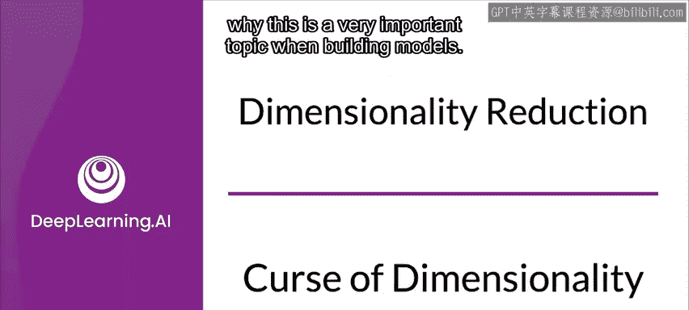
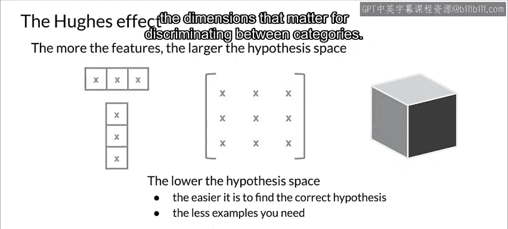

# 吴恩达《机器学习工程师的生产实践（MLOps）Machine Learning Engineering for Production》中英字幕 - P89：11_维度灾难.zh_en - GPT中英字幕课程资源 - BV1pi4y167g5

Let's talk about the curse of dimensionality and why this is a very important topic when building models。

Many common machine learning tasks like segmentation and clustering rely on computing distances between observations。

For example， supervised classification uses the distance between observations to assign a class。

K nearests neighbors is a basic example of this。 Support vector machines。

 or S VMs deal with projecting observations using kernels based on the distance between the observations after projection。

Another example is recommendation systems that use a distance based similarity measure between the user and the item attribute vectors。

 There could even be other forms of distance being used。

 So distance plays an important role in understanding dimensionality。

One of the most common distance metrics is Euclidean distance。

 which is simply a linear distance between two points in a multidimensional space。

The Euclidean distance between two dimensional vectors with Cartesian coordinates is calculated using this familiar formula。

But why is distance important？Let's look at some issues with measuring distance in high dimensional spaces。

For example， you might wonder why data being high dimensional can be an issue in extreme cases where we have more features and observations。

 we run the risk of massively overfitting our model。But in the more general case。

 when we have too many features。Observations become harder to cluster。

 too many dimensions can cause every observation in your data set to appear equiistant from all the others。

And because clustering， using a distance measure such as Euclidean distance to quantify the similarity between observations。

 this is a big problem。 If the distances are all approximately equal。

 all the observations appear equally alike and no meaningful clusters can be formed。

As dimensionality grows， the contrast provided by the usual metrics decreases。 In other words。

 the distribution of norms in a given distribution of points tends to concentrate。

That can cause unexpected behavior in high dimensional spaces。

 This phenomenon is called the curse of dimensionality。

It includes situations where non intuitive properties of data are observed in these high dimensional spaces。

This is specifically related to the usability and interpretation of distances and volumes。

 When it comes to the curse of dimensionality， there are two things to consider。On the one hand。

 machine learning is good at analyzing data when dealing with many dimensions。 However。

 we humans aren't adept at finding patterns in data that may be spread out across several dimensions。

 especially if those dimensions are interrelated in counterin ways。On the other hand。

As we add more dimensions， we also increase the processing power we need to analyze the data。

And at the same time， we also increase the amount of training data required to make meaningful models。

If you're curious， Richard Bellman first coined the term curseive dimensionality over half a century ago in 1961 in his book。

 Adapive control processessses， A guided tour。 So adding more features can easily create problems。😊。

This could include redundant or irrelevant features appearing in data。Moreover。

 noise is added when features don't provide predictive power for our models。On top of that。

 more features make it harder for one to interpret and visualize data。Finally。

 more features mean more data， so you need to have more storage and more processing power to process it。

 ultimately， having more dimensions often means our model is less efficient。

When you have problems getting your model to perform。

 you are often tempted to try adding more and more features。But as you add more features。

 you reach a certain point where your model's performance degrades。

This graph shows this well here you see that as the dimensionality increases。

 the classifier's performance increases until the optimum number of features is reached。

A key point to understand here is that you are increasing the dimensionality without increasing the number of training samples。

 and that results in a steady decrease in classifier performance。After the optimum。

Let's look at another problem with dimensionality to uncover what is behind this behavior。

 let's look deeper to try to understand why more dimensions can hurt your models。

Let's start by understanding why the number of parameters of a function impact the difficulty of learning that function。

Take the， for example， the parameters of a line function。 In this case， the list is finite。

 This is simply means discretizing the features。 Let's simplify this by using numbers from one to 5。

 assuming that you have a function where a single parameter。

 Then there are only five possible or values that this parameter can take。

What happens if you add a second parameter that can also take five values？ Well。

 let's see there are now  five times 5 or 25 possible pairs。

 This is a simple example using discrete parameter values， but， of course。

 it's even worse with continuous variables。What happens if you add a third parameter now。

 the representation is a cube。You probably see the formula behind this reasoning。

 If we have n values that a parameter can take and M parameters。

 you end up with n to the M possible parameter values。

 The number of parameter values grows exponentially。Now， how big of a problem is it， Well。

 it's a very big problem indeed， which is why this is called the curse of dimensionality。

An increase in the number of dimensions of a data set means there are more entries in the feature vector representing each training example。

 Let's focus on a Euclidean space and Euclidean distance measure。

 Each new dimension adds a non negative term to the sum。

 So the distance increases with the number of dimensions for distinct vectors。In other words。

 as the number of features grows for a given number of training examples。

The feature space becomes increasingly sparse with more distance between training examples。

Because of that， the lower data density requires more training examples to keep the average distance between data points the same。

 it's also important that the examples that you add are significantly different from the examples that you already have that are already present in the sample。

Here the argument is built using Euclidean distance。

 but it is true for any properly defined distance measure。Now， let's understand why this happens。

When the distance between observations grows， supervised learning becomes more difficult because predictions for new samples are less likely to be based on learning from similar training examples。

 The size of the feature space grows exponentially as the number of features increases。

 making it much harder to generalize efficiently。The variance increases。

And there's a higher chance of overfitting to noise in more dimensions。

 resulting in poor generalization performance。 in practice。

 features can also be correlated or do not exhibit much variation。For these reasons。

 there's a need to reduce dimensionality。 The challenge is to keep as much of the predictive information as possible。

 using as few features as possible。Regardless of which modeling approach you're using。

 increasing dimensionality has another problem， especially for classification。

 which is known as the Hughes effect。This is a phenomenon that demonstrates the improvement in classification performance as the number of features increases until we reach an optimum where we have enough features。

Adding more features while keeping the training set the same size will degrade the classifier's performance。

 We saw this earlier in our graph In classification。

 the goal is to find a function that discriminates between two or more classes。

 You could do this by searching for hyperplanes in space that separate these categories。😊。

The more dimensions you have， the easier it is to find a hyperplane during training。

 But at the same time， the harder it is to match that performance when generalizing to unseen data。

And the less training data you have， the less sure you are that you identify the dimensions that matter for discriminating between categories。

