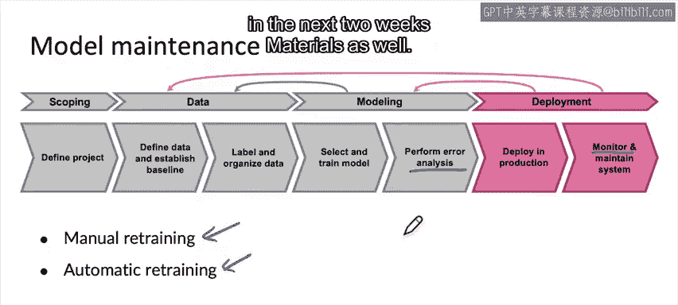

# 吴恩达《机器学习工程师的生产实践（MLOps）Machine Learning Engineering for Production》中英字幕 - P8：7_监控.zh_en - GPT中英字幕课程资源 - BV1pi4y167g5

How can you monitor a machine learning system to make sure that it is meeting your performance expectations in this video you learn about best practices for monitoring deployed machine learning systems。

😊。

The most common way to monitor a machine learning system is to use a dashboard to track how it is doing over time depending on your application。

 your dashboards may monitor different metrics For example。

 you may have one dashboard to monitor the server load。

Or a different dashboard to monitor diffraction of non-nell outputs so sometimes the speech recognition system outputs no and the things the user didn't say anything so if this changes dramatically over time it may be an indication that something is wrong or one common one I've seen for a lot of structured data tasks is monitoring diffraction of missing input values if that changes it may mean that something has changed about your data。

So when you're trying to decide what to monitor。My recommendation is that you sit down with your team and brainstorm all the things that could possibly go wrong and that you want to know about if something does go wrong。

And for all the things that could go wrong， brainstorm a few statistics or a few metrics that will detect that problem for example。

 if you're worried about user traffic spiking causing the service to become overloaded。

 then server loads would be maybe one metric you could track and so on for the other examples here and when I'm designing my monitoring dashboards for the first time。

I think it's okay to start off with a lot of different metrics and monitor a relatively large set and then gradually remove the ones that you find over time not to be particularly useful Here are some examples of metrics I've used or I've seen others used on a variety of projects First are the software metrics such as memory compute latency through server load things that help you monitor the health of your software implementation of the prediction service or of other pieces of software around your learning algorithm but these software metrics will help you make sure that your software is running well Many MOs tools will come other the abouts already tracking these software metrics in addition to the software metrics I would often choose other metrics that help monitor the statistical health or the performance of the learning algorithm。

Broadly there are two types of metrics you might brainstorm around， one is input metrics。

 which are metrics that measure has your input distribution exchanged， for example。

 if you are building a speech recognition system， you might monitor the average input length in seconds of the length of the audio clip that to your system。

 you might monitor the average input volume。And if these change for some reason that might be something you would want to take a look at just to make sure this hasn't hurt the performance of your algorithm。

 I mentioned just now number or percentage of missing values is a very common metric when using structured data。

 some of which may have missing values or for the manufacturing visual inspection example。

 you might monitor average image brightness if you think that lighting conditions could change and you want to make sure you know if it does。

 so you can brainstorm different metrics to see if your input distribution X might have changed。

A second set of metrics that help you understand that your learning algorithm is performing well are output metrics。

Such as， how often does your speech recognition system return no。

 the empty strain because it thinks the user didn't say anything or？

If you have built a speech recognition system for voice searcharch for web search using voice。

 you might decide to see how often does a user do two very quick searches in a row with substantially the same input that might be a sign that you misrecogognize their query the first time round as an imperfect signal but you could try this metric and see if it helps or you could monitor the number of times that the user first try to use the speech system and then searches over to typing that could be a that the user got frustrated or gave up on your speech system and could indicate degrading performance and of course for web search you would also use maybe very coar metrics like clickthrough rate or CTR just to make sure that the overall system is healthy。

So these output metrics can help you figure out if either your learning algorithm output Y has changed in some way。

 or if something that comes even after your learning algorithms output。

 such as a user switching over to typing has changed in some significant way。

Because input and output metrics are applications specific。

 most MLOs tools will need to be configured specifically to track the input and output metrics for your application You may already know that machine learning modeling is a highly iterative process。

 so is deployment tick modeling。You would come up with a machine learning model and some data。

 train a model， that's an experiment， and then do error analysis and use the error analysis to go back to figure out how to improve the model or your data and is by iterating through this loop multiple times that you then hopefully get to a good model。

I encourage you to think of deployments as an iterative process as well。

When you get your first deployment up and running and put in place a set of monitoring dashboards。

 that's only the start of this itative process a running system allows you to get real user data or real traffic and it is by seeing how your learning algorithm performance on real data on real traffic that that allows you to do performance analysis and this in turn helps you to update your deployment and to keep on monitoring your system in my experience it usually takes a few tries to converge to the right set of metrics to monitor sometimes I've deploy the machine learning system and is not uncommon common for you to deploy a machine learning system with an initial set of metrics。

Only to run the system for a few weeks and then to realize that something could go wrong with it that you hadn't thought of before and then to pick a new metric to monitor or for you to have some metric that you monitor for a few weeks and then decide that this metric hardly ever changes and does isn't useful and to get rid of that metric in favor of focusing attention on something else often you've chosen a set of metrics to monitor common practice would be to set thresholds for alarms so you may decide based on this that if the server load ever goes above 091。

That may trigger an alarm or a notification to let you know or let the team know to see if there's a problem and maybe spin up some more servers。

 or if the fraction of non-Nell outputs goes above or beyond certain thresholds。

 that might trigger an alarm， or if the not fraction of missing values goes above。

Or below some set of thresholds， maybe that should trigger an alarm and it is okay if you adapt the metrics and the thresholds over time to make sure that they are flagging to you the most relevant cases of concern if something goes wrong with your learning algorithm if it a software issue such as server load is too high then that may require changing the software implementation or if it is a performance problem associated with the accuracy of the learning algorithm then you may need to update your model or if an issue associated with the accuracy of the learning algorithm。

 then you may need to go back to fix that and that's why many machine learning models will need a little bit of maintenance or retraining over time just like almost all software needs some level of maintenance as well when a model needs to be updated you can either。

train it manually where an engineer， maybe you will retrain the model。

 perform error analysis on the new model and make sure it looks okay before you push that to deployment or you could also put in place a system where there is automatic retraining today manual retraining is far more common than automatic retraining for many applications developers are reluctant to let the learning algorithm room。

Be fully automatic in terms of deciding to retrain and push the new model to production。

 but there are some applications， especially in consumer software internet。

 where automatic retraining does happen。We'll talk more about retraining and how to vet or verify a model's performance before pushing a new model out to production in next week's videos。

 but the key takeaways are that it is only by monitoring the system that you can spot if there may be a problem。

That may cause you to go back to perform a deeper error analysis。

Or that may cause you to go back to get more data。With which you can update your model so as to maintain or improve your system's performance。

You learn more about how to update models in the next two weeks materials as well。

In this video you learn how to monitor the performance of a machine learning system so that in case something needs to be maintained or fixed you can be alerted so they can take the appropriate action we're talked about how to monitor the performance of a single machine learning model one of the most useful concepts is for more complex systems where you don't have just one model but a more complex machine learning pipeline how do you monitor the performance of that you learn about that in the next video。

😊。