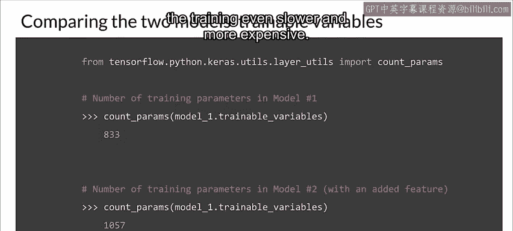

# 吴恩达《机器学习工程师的生产实践（MLOps）Machine Learning Engineering for Production》中英字幕 - P90：12_维度灾难示例.zh_en - GPT中英字幕课程资源 - BV1pi4y167g5

Let's look at an example of how dimensionality reduction can help our models perform better。

Apart from distances and volumes， increasing the number of dimensions can create other problems。

 processorsor and memory requirements often scale non linearly with an increase in the number of dimensions。

Due to an exponential rise in feasible solutions， many optimization methods cannot reach a global optima and get stuck in a local optima。

More dimensions also often increases the likelihood of having correlated features and parameter estimation can often be challenging in regression models。

 So let's look at how more features can make training a model harder with an example。

 When you create a model， you design it for a certain number of features or dimensions。

You might be tempted to add more features to get a better model。

 but more features can actually hurt your model。Each feature holds information that may or may not help your model predict accurately。

As you add more and more features， you need to add more and more training examples along the range of values for those features。

The amount of training data needed increases exponentially with each added feature。

That means that the volume of training data increases exponentially。

 and we need to make sure that the training data covers the same regions of the feature space as the prediction request that we'll receive。

All of these can reduce the ability of your model to generalize well。 A along with this。

 the number of trainable variables in the model also increases。To demonstrate this。

 let's look at an example of a binary classification model for the Cleveland Heart disease data set when a single additional feature is added。

Let's start by creating a structured classification model for the Cleveland Heart diseasease data set。

This data set has 14 features to predict whether or not a patient has heart disease。

 This is a binary classification problem。

This first model omits one of the original features called foul。

We'll look at this and how adding a feature to the data set impacts the number of trainable variables in the model。

So let's add back that signal additional feature that we removed in the first model for this。

 let's encode this as a categorical string feature using Kes's pre processing layers。

 which is available in Tensorflowlow。Next， let's see how adding it impacts your original model in terms of the number of trainable parameters。

 If you compare the number of trainable parameters between the two。

 even adding only one feature results in a 27% increase。

That's a considerable growth in the number of parameters。

 to say the least that will make training slower and more expensive。

 You'll also need to increase the size of the training dataset set。

 which will make the training even slower and more expensive。

The main point in this section is that when data dimensionality becomes too large。

 the performance of a classifier decreases and the demand for resources increases。

The question then is， what does too large really mean， Unfortunately。

 there's no fixed rule for how many features should be used in a machine learning problem。 In fact。

 this depends on the amount of training data available， the variance in that data。

 the complexity of the decision surface and the type of classifier used。

 It also depends on which features actually contain predictive information that will help your model trained。

You want enough data with the best features and enough variety in the values of those features and enough predictive information in those features to maximize the performance of your model while simplifying it as much as possible。

