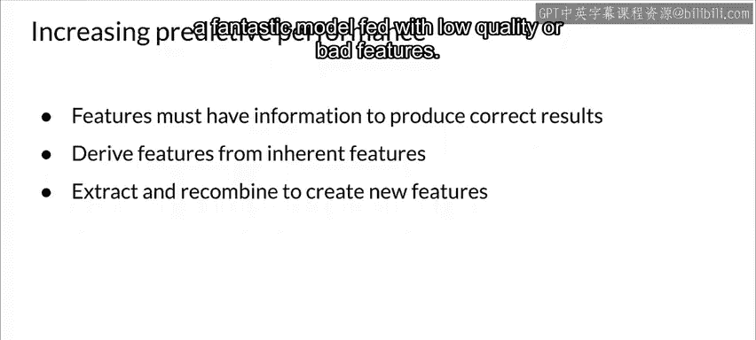
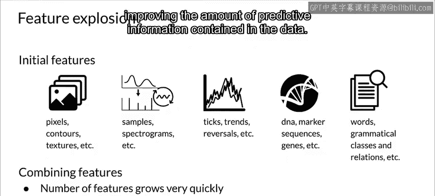
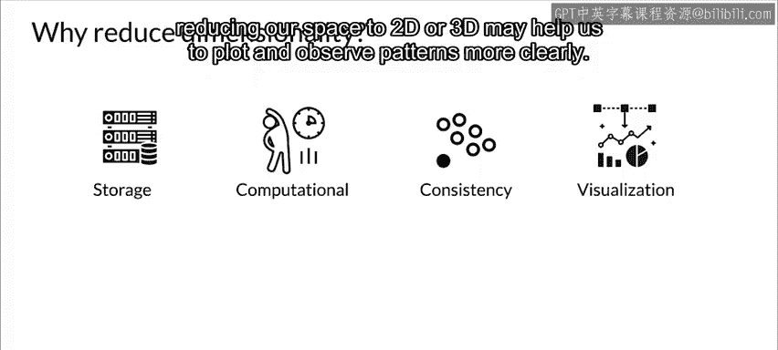
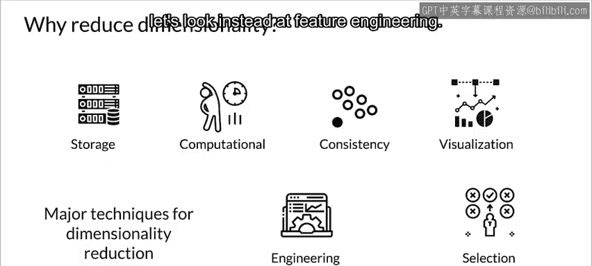
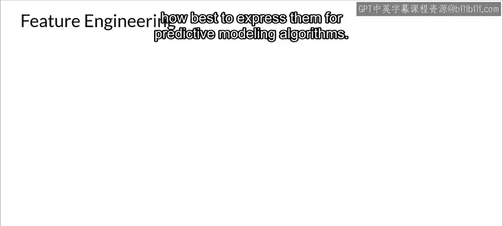
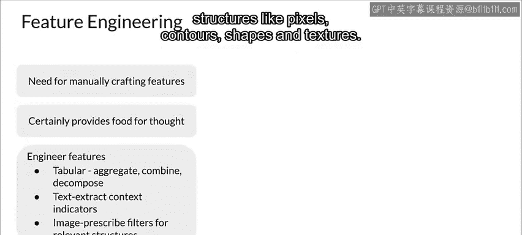
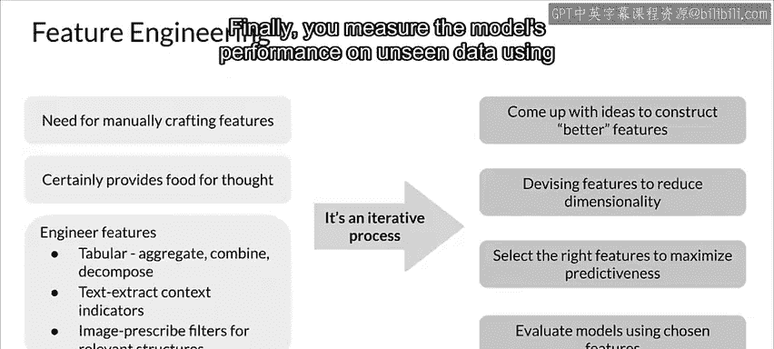

# 吴恩达《机器学习工程师的生产实践（MLOps）Machine Learning Engineering for Production》中英字幕 - P91：13_手动降维.zh_en - GPT中英字幕课程资源 - BV1pi4y167g5

Now that we've discussed how your data has an impact on the performance of your models and the resources required to train and serve those models。

 let's look at some manual techniques for doing dimensionality reduction。

When prepro a set of features to create a new feature set。

 it's important to retain as much predictive information as possible。 Without predictive information。

 all the data in the world won't help your model learn。

Features must be representative of the predictive information in the data set。

This information also needs to be in a form that will help your model learn。

While some inherent features can be obtained directly from raw data， you often need derived features。

 normalized， engineered or embedded features。 A poor model fed with important features will perform better than a fantastic model fed with low quality or bad features。

😊。

Main domains involve huge numbers of features and dimensions。

 Often the first pick of features is an expression of domain knowledge that can often result in more features than we really need or want。

 As we saw in our discussion of the curseive dimensionality， This has inherent drawbacks。

This means that you need to reduce dimensionality or more precisely the number of features you are including in your data while retaining or improving the amount of predictive information contained in the data。

Dimenssionalality reduction looks for patterns in data and uses these patterns to reexpress the data in a lower dimensional form。

 This makes computation much more efficient， which can be a significant factor in a world of big models and big data sets。

 However， dimensionality reduction's most essential function is to reduce the data set to its bare bones。

 discarding noisy features that cause significant problems for supervised learning tasks like regression and classification。

In many real world applications， it is the dimensionality reduction that makes predictions possible。

Your data collection and management infrastructure will be simplified Also。

 Another factor to consider is that some algorithms do not perform well when we have large dimensions。

 it also reduces multicolliity by removing redundant features。

 It helps when we're trying to visualize the data。 And as we discussed earlier。

 it isn't easy to visualize data in higher dimensions。

 So reducing our space to 2D or 3D may help us to plot and observe patterns more clearly。

Feature engineering helps meet these requirements。 It builds valuable information from raw data by reformatting。

 combining and transforming primary features into new ones until it yields a new set of data that results in a better model。

In addition， feature selection examines a set of potential features。

 Select some of them and discards the rest。 Feature selection is applied either to prevent redundancy and or to remove irrelevancy in the original features or just get to a limited number of features to avoid issues。

Since weve already seen various feature selection techniques。

 Let's look instead at feature engineering。 The best results come down to you。

 the practitioner crafting the features。 This is one of the areas where machine learning engineering is somewhat of an art form。

 feature importance and feature selection can help inform you about the objective utility of features。

 But those features have to come from somewhere。 You often need to manually create them。

 This requires spending a lot of time with the actual sample data and thinking about the underlying form of the problem。

 The structures in the data and how best to express them for predictive modeling algorithms。😊。

With tabular data， it often means a mixture of aggregating and or combining features to create new features and decomposing or splitting features to also create new features。

With textual data， it often means devising document or content specific indicators relevant to the problem with image data。

 it can often mean using filters to pick out relevant structures like pixels， contours。

 shapes and textures。

It tends to be an iterative process that involves data selection and model evaluation again and again。

The process usually starts with brainstorming features Here you really get into the problem。

 Look at a lot of data， study feature engineering on other problems and see what you can learn。

 Then you move on to devising new features。 It depends on your problem。

 but you may use automatic feature extraction， manual feature engineering or a mixture of the two。

Next， you pick the right features using feature important scorings and feature selection methods to prepare one or more views of your data。

Finally， you measure the model's performance on unseen data using the chosen features。

