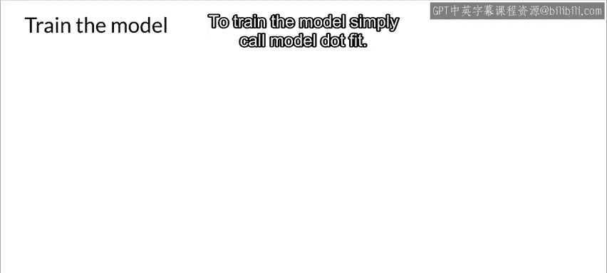
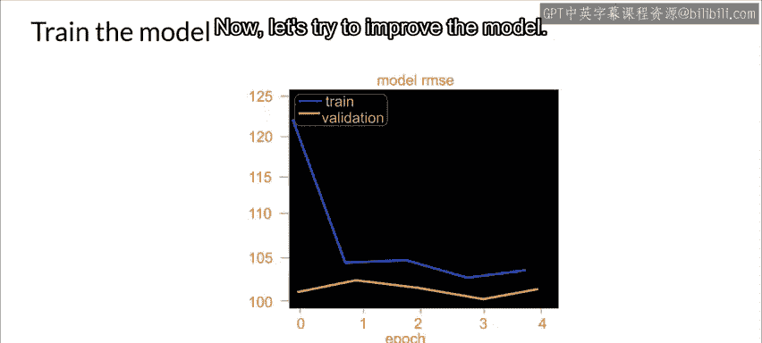
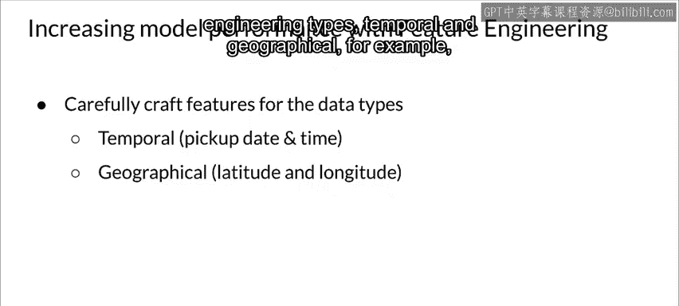
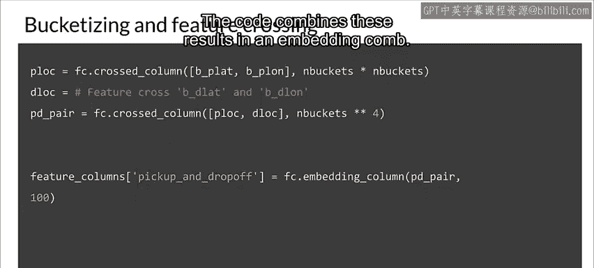
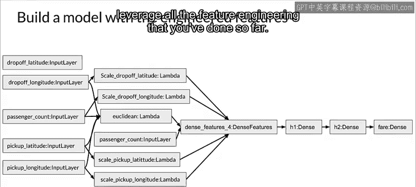
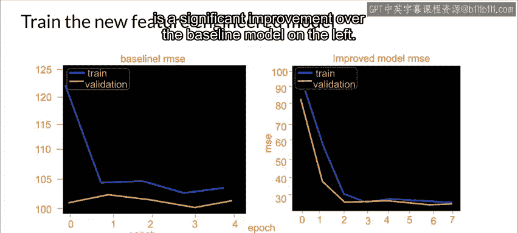

# 吴恩达《机器学习工程师的生产实践（MLOps）Machine Learning Engineering for Production》中英字幕 - P92：14_手动降维案例研究.zh_en - GPT中英字幕课程资源 - BV1pi4y167g5

Now that you've seen that the dimensionality of your data has an impact on the performance of your models and the resources required to train and serve those models。

This is even more important when dealing with resource constrained scenarios such as mobile deployments。

So you need to carefully manage the dimensionality of your data。

 which often means looking for ways to reduce it。Let's look now at some manual techniques for doing dimensionality reduction。

Let's look at a concrete example using the taxi fare data set。The data set consists of 106。

545 taxi rides。The objective is to predict the fair amount of each ride based on a variety of features such as time and location of pickup up。

 time， travel and distance， number of passengers， etc ceter。As usual。

 the first steps are downloading the dataset， which is in CSV format。

 separating the variables into string and numeric types and defining useful constants and parameters。

Let's build a baseline model to predict the fair。 We'll try using these features。 Drop off latitude。

 drop off longitude， Pass count， pick up latitude and pick up longitude。

 The network consists of a concatenation of dense hidden layers with the last one producing a fair prediction output。

 We'll build the model in Caris using the functional API。 Unlike the sequential API。

 you'll need to specify the input and hidden layers。

 Note that you're creating a linear regression baseline model with no feature engineering as a quick reminder。

 a baseline model is a naive implementation that helps with setting expectations for model performance。

After setting up the model for training and creating the data sets。

 you're ready to train the baseline model to train the model， simply call model dot fit。

Let's look at training and validation performance using the root mean squared error loss over the training Es。

 Ideally， you want the validation RMSC to be close to the training set。Now。

 let's try to improve the model to improve the model's performance。

 Let's create two new feature engineering types， temporal and geographical。 for example。

 we'll work with a temporal feature。

Pick up datetime。And pick up day time is a string， and we will need to handle this within the model。

 First， you'll include pick up date time as a feature。

 and then you'll need to modify the model to handle it as a string feature。

 The pick up or drop off longitude and latitude data are crucial to predicting the fair amount。

 Since fair amounts in New York City taxis are largely determined by the distance travel。As such。

 we need to teach the model the Euclidean distance between the pickup and drop off points。

Recall that latitude and longitude allows us to specify any location on Earth using a set of coordinates。

The data set contains information regarding the pickup and drop off coordinates。 However。

 there is no information regarding the distance between the pickup and drop off points。

 So let's create a new feature that calculates the distance between each pair of pickup and drop off points。

 You can do this using the Euclidean distance， which is a straight line distance between any two coordinate points。

 But note that this will only be a rough indicator of the actual driving distance。

It's very important for numerical variables to get scaled before they're fed into the neural network。

 Let's use minmac scaling， also called normalization on the geolocation features。 Later in our model。

 you'll see that these values are shifted and rescaled so that they end up ranging from 0 to 1。

We use domain knowledge to create a function named scale Longitude where you pass all the longitude values and add 78 to each value。

Note that our scaling longitude values range from negative 70 to negative 78。

 so the value 78 is the maximum maximum longitudinal value。

 the difference or delta between negative 70 and negative 78 is 8。

The function adds 78 to each longitudinal value and then divides by 8 to return a scaled value。

 Similarly， let's create a function named scale latitude where you pass in all the latitudinal values and subtract 37 from each value。

 Note that our scaling latitude ranges from 37 to 45。 Thus。

 the value 37 is the minimal latitudinal value。The deelta or difference between negative 37 and negative 45 also happens to be 8。

The function thus subtracts 37 from each latitudinal value and then divides by 8 to return a scaled value。

 Next， let's create a geo transform function。 This function passes in your numerical and string column features as inputs to the model。

 and then scales the longitude and latitude， as we saw in the last slide。

 Then we compute the Euclidean distance based on the geolocation parameters。😊。

Unless the specific geometry of the Earth is relevant to your data。

 a bucketized version of the map is likely to be more useful than the raw inputs。

 This requires bucketizing the dimensions of latitude and longitude separately， and then cross them。

 effectively doing a two dimensional bucketizing of location data。In this example。

 you bucketize these latitude and longitude features and create feature crosses out of the geolocational features。

Here， the code creates bucketetized columns for pickup and drop off latitude and longitude。

And then proceeds to create crossed columns for each。

 The code combines these results in an embedding column。

This is the new architecture of your model。As with your first attempted model。

 you need to create a model in Caris using the functional API。 This will， of course。

 leverage all the feature engineering that you've done so far。

Let's take a look at the performance of this new model。

 Looking at the results for training and validation。

 it's clear that the model with feature engineering on the right is a significant improvement over the baseline model on the left。

