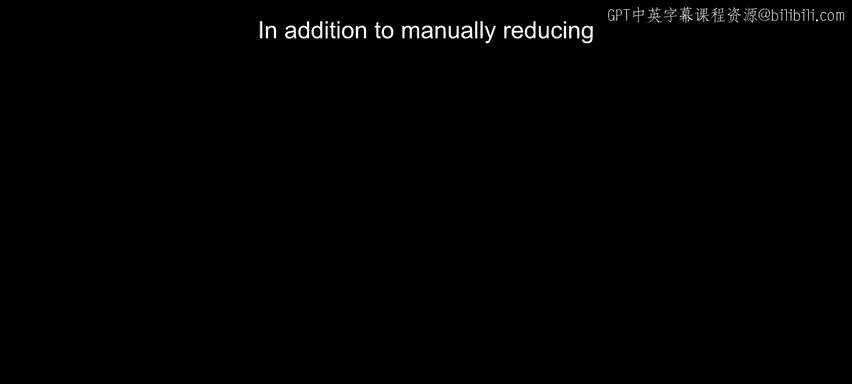
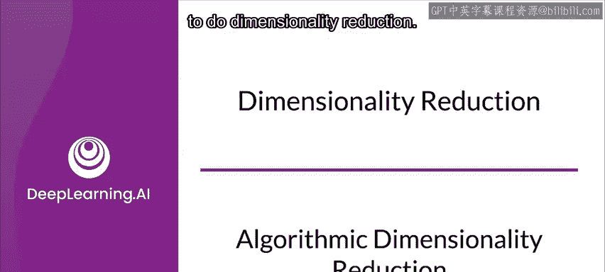
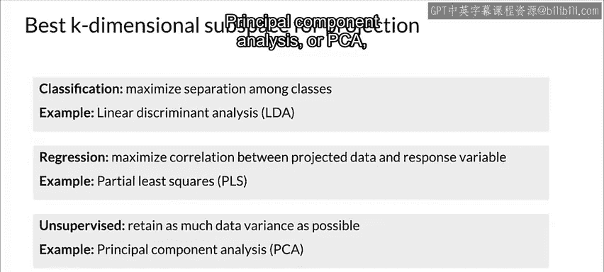

# 吴恩达《机器学习工程师的生产实践（MLOps）Machine Learning Engineering for Production》中英字幕 - P93：15_算法降维.zh_en - GPT中英字幕课程资源 - BV1pi4y167g5

In addition to manually reducing the dimensionality of your data sets。

You can also apply several algorithmic approaches to do dimensionality reduction。

 Let's look at some of those， now。

Let's look at techniques that you can use to reduce dimensionality automatically first。

 let's build some intuition on how linear dimensionality reduction actually works。In this approach。

 you linearly project n dimensional data onto a smaller K dimensional subspace Here。

 K is usually much smaller than N。 There are infinitely many dimensional subspaces that we can project data onto。

 So which subspace do we choose to understand how subspaces are chosen。 Let's take a step backwards。

 and look how one can project data onto a line。To start。

 let's think of features as vectors existing in a high dimensional space。

 Viualizing them would reveal a lot about the distribution of the data。

 though it's impossible for us humans to see so many dimensions all at once。 Instead。

 you need to project the data onto a lower dimension。

 which might allow you to visualize the data more directly。

This kind of projection is called an embedding。Computing this requires taking each sample and calculating a single number to describe it。

 A benefit of reducing to one dimension is that the numbers and the examples can be sorted on a line In this example。

 we're taking images and reducing the information they contained to just one dimension。

 their average pixel brightness， which we can then visualize as a point on a line。

Coming back to subspaces， there are several ways to choose these K dimensional subspaces。

 For example， in a classification test， you typically want to have the maximum separation among classes。

 linearar discriminant analysis or L D A generally works well for that。For a regression。

 you want to maximize the correlation between the projected data and the output， or partial squares。

 or PLS works well。Finally， in unsupervised tasks， we typically want to retain as much of a variance as possible。

 Princ component analysis or PC A is the most widely used technique for doing that。

