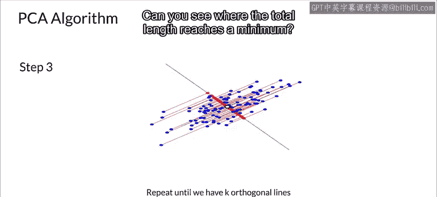

# 吴恩达《机器学习工程师的生产实践（MLOps）Machine Learning Engineering for Production》中英字幕 - P94：16_主成分分析.zh_en - GPT中英字幕课程资源 - BV1pi4y167g5

There are several algorithmic approaches for doing dimensionality reduction。

 and principal component analysis， or PCA is one of the most widely used to start。

 Let's look at how principal component analysis or PCA works。

This is an unsupervised algorithm that creates linear combinations of the original features。

 PC A performs dimensionality reduction in two steps。Starting with decocorlation。

 where it doesn't change the dimensionality of the data at all。 In the first step。

 PCA rotates the samples so that they are aligned with the coordinate axes。 In fact。

 it does more than this。 PC A also shifts the sample so that they have a mean of 0。

 These scatter plots show the effect PCA applied to three features of the iris data set。 Finally。

 PC A is called principal component analysis because it learns the principal components of the data。

These are the directions in which the samples vary the most depicted here in red。

It is the principal components that PCA aligns with a coordinate axes。

The goal of PC A is that it tries to find a lower dimensional surface onto which to project the data so as to minimize the squared projection error。

 in other words。To minimize the square of the distance between each point and the location of where it gets projected。

The result will be to maximize the variance of the projections。

 The first principle component is the projection direction that maximizes the variance of the projected data。

 The second principle component is the projection direction that is orthogonal to the first principal component and maximizes the remaining variance of the projected data。

 Here's a toy example consisting of a cloud of points in 2 D。

 Let's try to apply PC to this two dimensional data and see what happens。

The first principle component is a projection direction that maximizes the variance of the projected data。

In the plot， you can see three attempts at producing such a line。 In this case。

 it's quite obvious that the variance is maximd in the direction indicated by the red line。

 The second principal component is the projection direction that is orthogonal to the first principal component。

And maximizes the remaining variance of the projected data indicated here by the green line。

The full set of principal components comprises a new orthogonal basis for feature space。

 whose axes follow the maximum variances of original data。

These projections are simply transformed to the new K dimensional reduced space。

 This means that when youre projecting your original data on the first K principal components。

 you are reducing the dimensionality of the data。 Later。

 you can recover the original space from this reduced dimensionality projection。

This reconstruction will， of course， have some amount of error。

 but this is often negligible and acceptable， given the other benefits of dimensionality reduction also。

Look at how the red dots change as the line rotates。 That's the variance。

 Can you see when it reaches its maximum。Second， if we reconstruct the original two characteristics。

 the blue dots。From the new ones， the the red dots。

The reconstruction error will be given by the length of the connecting red line。

Observe how the length of these lines， the red lines， changes as while the line rotates。

Can you see where the total length reaches a minimum？

Here we apply the PCA algorithm with two principal components on the IIS data set and visualize the results Now。

 assuming you've applied PCA again using four components instead of two。

 let's visualize how much variance has been explained using these four components。

If you look at the relative variance， you might lose some information。

But if the eigenvalues are small， not much information is lost。

 Principal components are orthogonal in nature， as we've seen before。

 And this means that they are uncorrelated。 Also， they are ranked in order of their explained variance。

 The first principal component explains the most variance in the data set。

 and the second explains the second most variance and so on。Therefore。

 you can reduce dimensionality by limiting the number of principal components to keep based on the cumulative explained variance。

 For example， you might decide to keep only as many principal components as are needed to reach a cumulative explained variance of 90%。

The factor loadings are the unstandardized values of the eigenvectors。

 We can interpret the loadings as the covariances， or correlations。

Pyit learn has an implementation of PC A， which includes both fit and transform methods。

 just like the standard scalealar operation， as well as a fit transform method。

 which combines both fit and transform。The fit method learns how to shift and rotate the samples。

 but doesn't actually change them。 The transform method， on the other hand。

 applies the transformation that fit learned。In particular。

 the transfer method can be applied to new unseen samples before applying PCA。

 Let's use the standard scalar on the features。 This code creates a PCA instance that will retain 99% of the variance。

 fit it to the data and apply the transform which was learned。

Suming all of that up。PCA is a useful technique that works well in practice。

 It's fast and simple to implement， which means you can easily test algorithms with and without PC A to compare performance。

In addition， PCA offers several variations and extensions， for example， kernel PCA or sparse PCA。

 etc， to tackle specific roadblocks。However， the resulting principal components are not interpretable。

 which may be a deal breaker in some settings where interpretability is important。In addition。

 you must still manually set or tune a threshold for cuulative explained variance。Other than this。

 PC is especially useful when visually studying clusters of observations in high dimensions。

This could be when you are still exploring the data。 For example。

 you may have reason to believe that the data are inherently low rank。

 which means that there are many attributes， but only a few attributes which mostly determine the rest through a linear association。

