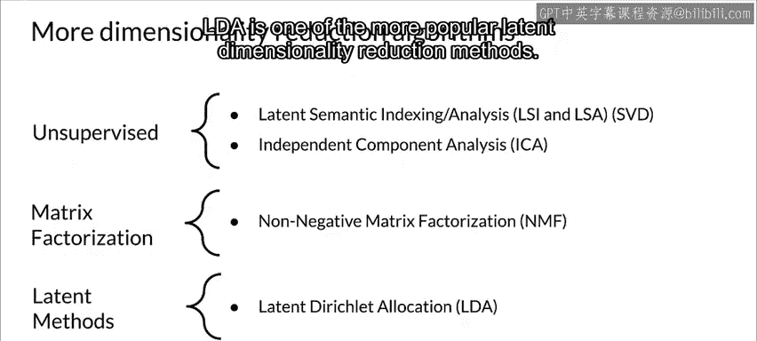
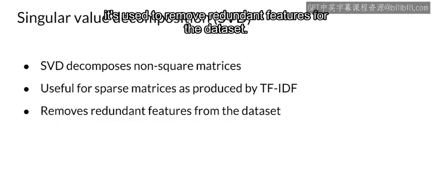
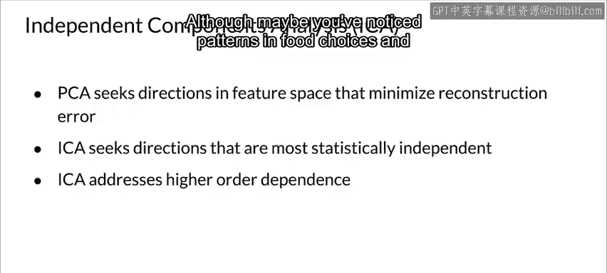
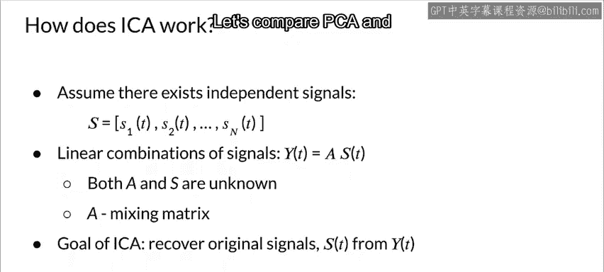
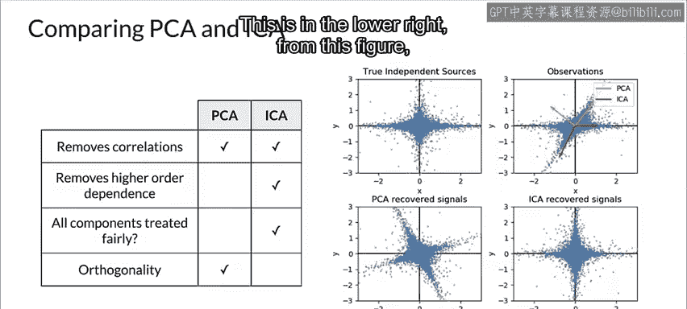

# 吴恩达《机器学习工程师的生产实践（MLOps）Machine Learning Engineering for Production》中英字幕 - P95：17_其他技术.zh_en - GPT中英字幕课程资源 - BV1pi4y167g5

In addition to the techniques we've already discussed。

 there are several more algorithmic approaches to do dimensionality reduction。

 Let's look at some of those。 Now。 Some techniques are focused on particular kinds of problems。

For example， staying with unsupervised approaches， there are techniques such as single value decomposition or SVD and independent component analysis or ICA。

In matrix factorization techniques， you could use non negative matrix factorization。 And finally。

 latent Durslay allocation or LDA is one of the more popular latent dimensionality reduction methods。

Let's discuss single value decomposition or SVD。Marices can be seen as linear transformations in space。

 PC A， which we discussed previously， relies on eigen decomposition。

 which can only be done for square matrices。 Of course， you don't always have square matrices。

In T F I DF， for example， a high frequency of terms may not really be fruitful in some cases。

Rare words contribute more in general， the importance of words increases if the number of occurrences of these words within the same document also increases。

 On the other hand， the importance will be decreased for words which occur frequently in the corpus。

The challenge is that the resulting matrix is very sparse and not square。

To decompose these types of matrices， which can't be decomposed by eigen decomposition。

 we can use techniques such as singular value decomposition or SVD。

SVD decomposes our original data set into its constituents。

 resulting in a reduction of dimensionality。 It's used to remove redundant features for the data set。

 Inent component analysis or ICA is another algorithm and is based on information theory。

It's also one of the most widely used dimensionality reduction techniques。

PCs and ICA's significant difference is that PCA looks for uncorrelated factors。

 while ICA looks for independent factors。If two factors are uncorrelated。

 it means that there is no linear relation between them。If theyre independent。

 it means that they are not dependent on other variables。 For example。

 a person's age is independent of what that person eats or how much television he or she watches。

 probably。Although maybe you've noticed patterns and food choices and TV watching among different age groups。

 anyway， I digress。

Independent component analysis separates a multivariate signal into additive components that are maximally independent。

Often ICA is not used for reducing dimensionality， but for separating superimposed signals。

Since the ICA model does not include a noise term for the model to be correct。

 whitening must be applied。This can be done in various ways， including using one of the PCA variants。

ICA further assumes that there exists independent signals S， and a linear combination of signals Y。

The goal of ICA is to recover the original signals S from Y。

ICA assumes that the given variables are linear mixtures of some unknown latent variables。

It also assumes that these latent variables are mutually independent， in other words。

 theyre not dependent on other variables， and hence they are called the independent components of the observed data。

Let's compare PCA and ICA visually to get a better understanding of how they're different。

 Both are statistical transformations， that is PCA uses information extracted from second order statistics。

 while ICA goes up to higher order statistics。

Both are used in various fields like blind source separation， feature extraction。

 and also in neuroscience。ICA is an algorithm that finds directions in the feature space corresponding to projections which are highly non Gaussian。

Unlike PC A， these directions need not be orthogonal in the original feature space。

 but they are orthogonal in the whitened feature space in which all directions correspond to the same variance。

PCA， on the other hand， finds orthogonal directions in the raw feature space that correspond to directions accounting for maximum variance。

Let's look at a simulation of two independent sources using a highly non Gaussian process on the left。

Next， let's apply a mixing scheme to create observations。In this raw observation space。

 directions identified by PCA are represented by orange vectors。

Then let's represent the signal in the PCA space after whitening by the variance corresponding to the PCA vectors。

Running ICA corresponds to finding a rotation in this space to identify the directions which are the most non Gaussian。

 This is in the lower right。

From this figure you can see that PCA removes correlations but not higher order dependence on the contrary ICA removes correlations along with higher order dependence。

When it comes to the importance of components， PCA considers some of them to be more important than others。

 ICA， on the other hand， considers all components to be equally important。

Now let's discuss a dimensionality reduction technique called non negative matrix factorization or NMF。

NMF expresses samples as a combination of interpretable parts。For example。

 it represents documents as combinations of topics and images in terms of commonly occurring visual patterns。

NMF， like PCA， is a dimensionality reduction technique。 In contrast to PCA， however。

 NMF models are interpretable。This means N MF models are easier to understand and much easier for us to explain to others。

 N MF can't be applied to every data set。 However， it requires the sample features to be non negative。

 so the values must be greater than or equal to 0。 It has been observed that when carefully constrained。

 N MF can produce a parts based representation of the dataset set， resulting in interpretable models。

This example displays 16 sparse components found by NMF from the images in the Olivevetti Fs data set on the right。

 compared with the PCA eigenfaces on the left。