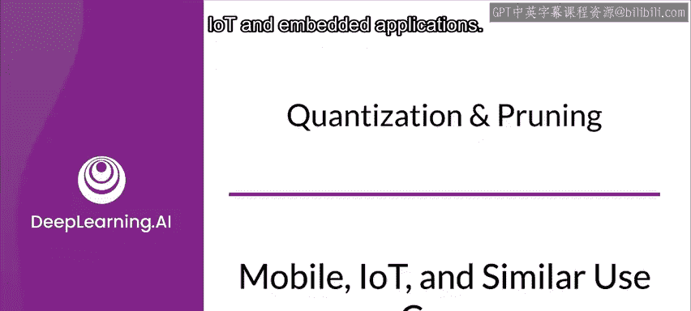
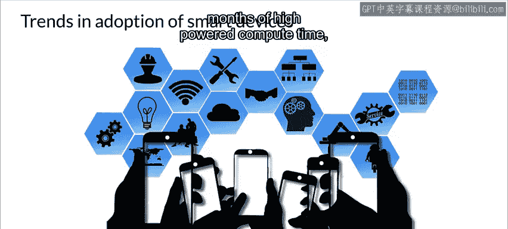
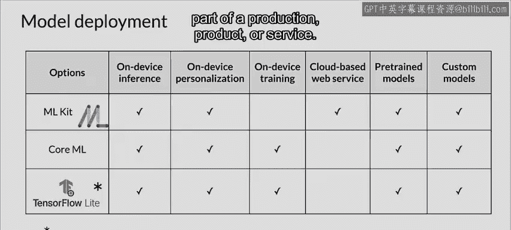

# 吴恩达《机器学习工程师的生产实践（MLOps）Machine Learning Engineering for Production》中英字幕 - P96：18_移动物联网等使用案例.zh_en - GPT中英字幕课程资源 - BV1pi4y167g5

Model optimization is another area of focus where you can further optimize performance and resource requirements。

The goal is to create models that are as efficient and accurate as possible and to achieve the highest performance at the least cost。

 Let's look at some advanced techniques for that。 Now。

 let's start by looking at some of the issues around mobile， Io and embedded applications。

 Machine learning is increasingly becoming part of more and more devices and products。

 This includes the rapid growth of mobile and Iot applications， including devices。

 which are situated everywhere from farmers fields to train tracks。

Businesses are using the data which these devices generate to train machine learning models to improve their business processes。

 products and services。Even digital advertisers spend more on mobile than desktop。

There are already billions of mobile and edge computing devices。

 and that number will continue to grow rapidly in the next decade。MackKinsey predicts that by 2025。

 the overall economic impact of Iot and Mobi could reach trillions of dollars。

 surpassing many sectors like automation of knowledge， work or cloud technology。

So as these devices become more and more ubiquitous and powerful， many of the machine learning tasks。

 which you think of as requiring months of high powered compute time。

 will become part of more and more fairly common devices。 Now。

 let's look at some of the reasons those trends occur in the first place。

Traditionally， you can think of deploying machine learning models in the cloud。

 This requires a server to run inference and return the results。

But with the advance of machine learning research for applications on lower powered devices。

 this processing can be offloaded to a device and run locally。

 This enables more opportunities for including machine learning as part of a device's core functionality。

 Moreover， the hardware cost for these devices continues to fall。

 which enables lower price points and higher volumes。😊。

A key aspect of on device machine learning is that in most cases it ensures greater compliance with privacy regulations by keeping user data on the device。

How should you deploy your models so that they can be used to generate real value If you host them on a server。

 the mobile or Io device needs to be connected so that it can make a network request。

Another option is to embed the model on a mobile device directly。In your case。

 can you always rely on the device to have a network connection Also。

 is your model small enough and fast enough to perform inference on the device， Additionally。

 mobile devices offer limited processing capabilities。

 which might affect which types of models you can embed in them。Furthermore。

 does the device have all the access it needs to the data that it needs。

 or does it need things like historical data that are only available on a server？

Suppose you're trying to build an app that applies different effects to photos。

In a scenario where the model is being hosted on a server。

 the app needs to first send the photo to the server。

 and then the server feeds the picture through a model to apply the desired effect。

 and a few seconds later， it sends the modified image back to the app。

Using a server for inference has the advantage that it keeps the mobile app simple。

 The server encapsulates all of the model complexity。

 This means that you can update the model or add new features any time you want。

To deploy the improved model， you update the model on the server。

 That means that you probably don't have to update the app itself unless you need to change the request that the app sends。

One big drawback is that timely inference is a strong requirement in this setting。

 in case of on device inference， you load the trade model into the app。

Since the model runs in the app， you don't need to send a request over the internet and wait for a reply。

 Instead， the prediction happens fast and you don't need a network connection。

 There is an increasing demand for sophisticated AI enabled services like image and speech recognition。

 Natural language processing， Viual search and personalized recommendation。At the same time。

 data sets are growing。 Networks are becoming more complex。 Pricy is increasingly becoming an issue。

 and latency requirements are tightening to meet user expectations。

All of these trends influence the choice of where to generate predictions from your trained models。

 which in turn affects the architecture and complexity of the models that you train。

Now let's take a look at some of the options available today to deploy models to mobile apps。

ML kitt for Firebase offers ready to use APIs， and you can also deploy your own Tensorflowlow light models if you don't find a base API that covers your use case。

It targets mobile platforms and uses Tensorflow Light， the Google Cloud Vision API。

 and Android neuralural networkss API to provide on device machine learning such as facial recognition。

 barcode scanning and object detection among others。MLKt gives you both on device and cloud APIs。

 meaning you can also use the APIs when there's no network connection。

The cloud based APIs make use of the Google Cloud platform with ML L kitt。

 you can upload models through the Firebase console and let the service take care of hosting and serving the models to your app's users。

Another advantage is that since ML kit is available through Firebase。

 it's possible to take advantage of the broader Firebase platform with core ML。

 you can build your model or use a pretrain model to use your model。

 you first need to create a model using third party frameworks。

 Then you convert your model to the core ML model format。Supported frameworks include psyit learn。

 Caris， cafe and X G boost。 There are also some pre train models ready for use。

TensorFlow Light was developed by Google and has APIs for many programming languages， including Java。

 C++， Python， Swift， and objectiveject C。It's optimized for on device applications and provides an interpreter tuned for on device machine learning。

Custom models are converted to Tensorflow light format and their sizes optimized to increase efficiency。

 Tensorflowlow light also supports optimizing models for IoT and embedded applications for devices with as little as 20 k of memory。

TensorFlow light models can be trained and evaluated in TFX pipelines。

 which is important when the mod will become part of a production， product or service。

