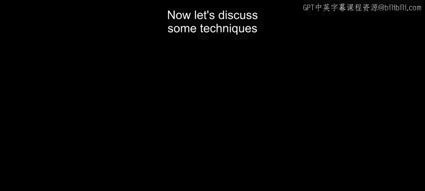
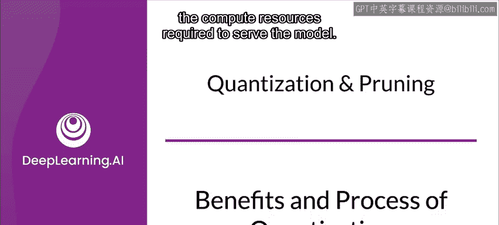
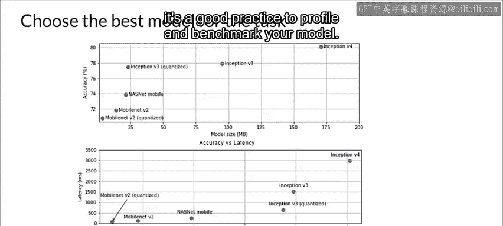

# 吴恩达《机器学习工程师的生产实践（MLOps）Machine Learning Engineering for Production》中英字幕 - P97：19_量化的好处和流程.zh_en - GPT中英字幕课程资源 - BV1pi4y167g5

Now let's discuss some techniques for optimizing your models。

 especially for deployment scenarios such as Mo and IoT。

 where the capabilities of the device are extremely limited compared to running on a server or in the cloud。

However， before doing so， let's clarify that these techniques can benefit any model。

 regardless of where it is deployed since they reduce the compute resources required to serve the model。

Quantization involves transforming a model into an equivalent representation that uses parameters and computations at a lower precision。

 This improves the model's execution， performance and efficiency。

 but it can often result in lower model accuracy。 Let's use an analogy to understand this better。

Think of an image。 As you might know， a picture is a grid of pixels。

 where each pixel has a certain number of bits。Now。

 if you try reducing the continuous color spectrum of real life to discrete colors。

 you are quantizing or approximating the image。In this animation。

 you can see that a black and white image could be represented with one bit per pixel。

 while a typical picture with color has 24 bits per pixel。Quantization， in essence。

 lessens or reduces the number of bits needed to represent information。However。

 you may notice that as you reduce the number of pixels beyond a certain point。

 depending on the image， it may get harder to recognize what that image is。

Neural network models can take up a lot of disk space。 for example， AlexNe。

 which requires around 200 mebys of disk space。Nearly all of that size is taken up with the weights for the neural connection。

 since there are often many millions of these in a single model。

 because they are all slightly different floating point numbers。

 Sple compression like zipping doesn't compress them well unless we make models less dense。

 Most straightforward motivation for quantization is to shrink file sizes。For mobile apps。

 especially， it's often impractical to store a 200 MBbyte model on the phone just to run a single app。

 So compressing higher precision models is necessary。

 Another reason to quantize is to reduce the computational resources that you need to do inference calculations by running them entirely with low precision inputs and outputs。

 This is a lot more difficult since it requires changes everywhere you do calculations。

 but it offers potential rewards。 doing this will help you run your models faster and use less power。

 which is especially important on mobile devices。 It also opens the door to a lot of embedded systems that can't run floating point efficiently。

 enabling many applications in the Io world。Now， let's take a look at what quantization means。

 Molenets are a family of architectures that achieve a state of the art trade off between on device latency and image net classification accuracy。

 A recent publication demonstrated how integer only quantization could further improve the trade off on common hardware。

The authors of the paper benchmarked the mobile net architecture with varying depth multipliers and resolutions on image net on three types of quaualcomm coals。

 This plot is for the Snapdragon 8，35 chip。You can see that for any given level of accuracy。

 latency time is lower for the 8 B version of the model。Arithmetic with lower bit depth is faster。

 assuming the hardware supports it。Even though floating point computation is no longer slower than integer on modern CPUs。

 operations with 32 B floating point will almost always be slower than say 8 B integers in moving from 32 B to 8 bits。

 We usually get speed ups of 4x reduction in memory。

 lighter deployment models mean they hug less storage space and are easier to share over smaller bandwidths and easier to update lower bit depths also mean we can squeeze more data into the same caches and registers。

 This makes it possible to build applications with better caching capabilities that reduce power usage and run faster。

 Flo point arithmetic is hard， which is why it may not always be supported on microcontrollers and on some ultra low powered embedded devices such as drones。

 watches or Io devices。 integer support。 on the other hand， is always readily available。

 neural networks consist of。s， the connections between the nodes。

 a weight parameter associated with each connection and a bias term。

When it comes to quantizing these networks， it is these weight parameters and activation node computations that we're trying to quantize。

Quantization squeezes a small range of floating point values into a fixed number of information buckets。

 as you can see in this diagram。This process is lossy in nature。

 but the weights and activations of a particular layer often tend to lie in a small range。

 which can be estimated beforehand。This means we don't need the ability to store a range in the same data type。

 allowing us to concentrate our precious fewer bits within a smaller range。

 say negative 3 to positive 3。As you might imagine。

 it will be crucial to accurately know this smaller range。 So if done right。

 quantization causes only a small loss of precision。

 which usually doesn't change the output significantly。 Now。

 let's see what parts of a model are affected after applying quantization。

 One of them could be static parameters like the weights of layers。

 and others could be dynamic ones like activations inside side networks。

 You could also have transformations like adding modifying or removing operations。

 coalescing different operations and so on。In some cases， transformations may need extra data。

You'll see how this is the case in one of the techniques of quantization where some unlabeled data is used to determine scaling parameters。

 Opims can often result in changes in model accuracy。

 which must be considered during the application development process。

The accuracy changes depend on the individual model and data being optimized and are difficult to predict ahead of time。

 General， models that are optimized for size and latency will lose some amount of accuracy。

 Depend on your application， This may or may not impact your users's experience In rare cases。

 certain models may actually gain some accuracy as a result of the optimization process in terms of interpretability。

 there are some effects which may be imposed on the model after quantization。

 This means that it's hard to evaluate whether transforming a layer is going in the right or wrong direction。

 Mo and embedded devices have limited computational resources。

 So it's important to keep your application resource efficient。Depending on the task。

 you will need to make a trade off between model accuracy and model complexity。

If your task requires high accuracy， then you may need a large and complex model for tasks that require less precision it's better to use a smaller。

 less complex model because they not only use less dis space in memory。

 but they are also generally faster and more energy efficient For example。

 these graphs show accuracy and latency trade offs for some common image classification models。

 One example of models optimized for mobile devices are mobile nets。

Which are optimized for mobile vision applications。

So once you have selected a candidate model that is right for your task。

 it's a good practice to profile and benchmark your model。

