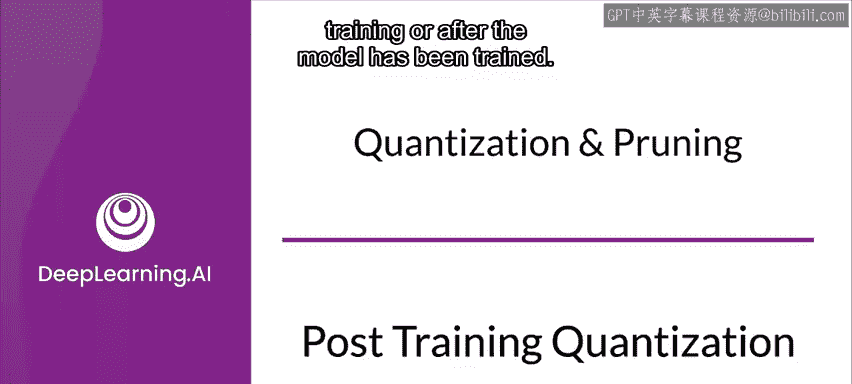
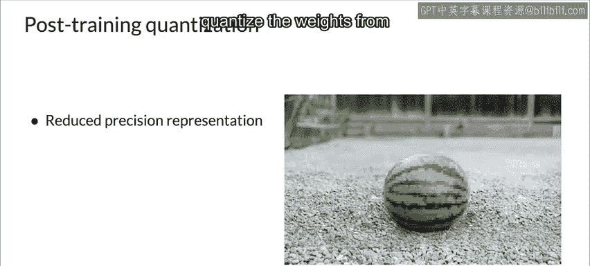
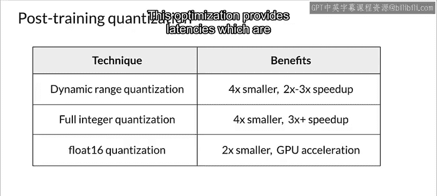
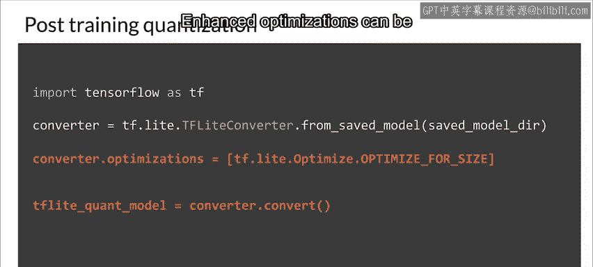
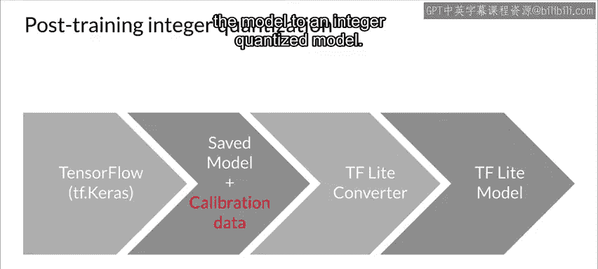
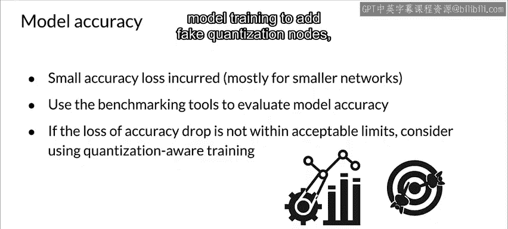

# 吴恩达《机器学习工程师的生产实践（MLOps）Machine Learning Engineering for Production》中英字幕 - P98：20_后训练量化.zh_en - GPT中英字幕课程资源 - BV1pi4y167g5

You can do quantization during training or after the model has been trained。

 let's look first at post training quantization。

Post training quantization is a conversion technique that can reduce model size while also improving CPU and hardware accelerator latency with little degradation in model accuracy。

 you can quantize an already trained Tensorflow model when you convert it to Tensorflow light format using the Tensorflow light converter。

 It's easy to use since it's integrated into the TF light converter directly。

What post training quantization basically does is to convert or more precisely quantize the weights from floating point numbers to integers in an efficient way。

By doing this， you can gain up to three times lower latency without taking a major hit on accuracy。

With the default optimization strategy， the converter will do its best to apply post training quantization。

 trying to optimize the model for both size and latency。 This is recommended。

 though you can always customize this behavior。 There are several post training quantization options to choose from。

 This is a summary of the choices and the benefits they provide。

If you are looking for a decent speed up like two to three times faster while being two times smaller。

 you can consider dynamic range quantization。 On the other hand。

 if you want to squeeze out even more performance from your model。

 then full integer quantization or float 16 quantization may result in faster performance。

Flot 16 is especially useful when you plan to use a GPU。

With dynamic range quantization during inference， the weights are converted from 8 B to floating point。

 and the activations are computed using floating point kernels。

This conversion is done once and cacheed to reduce latency。

This optimization provides latencies which are close to fully fixed point inference。

 Post training quantization takes only two lines of code。

Let's begin by importing Tensorflow and defining a converter with TF light。

Then you set the converter to optimize the model for size using the optimize for size option。

You then apply the converter to your model。 The other available optimization modes include optimize for latency。

 which reduces a latency of your model， while default mode basically tries to optimize it for both speed and storage。

Enhanced optimizations can be applied by providing a representative data set using dynamic range quantization。

 You can reduce the model size and or latency。 But this comes with a limitation as it requires inference to be done with floating point numbers。

This may not always be ideal， since some hardware accelerators only support integer operations。

 for example， edge TpUs。So the optimization toolkit also supports post training in quantization。

This enables users to take an already trained floating point model and fully quantize it to use only eight bit signed integers。

 which enables fixed point hardware accelerators to run these models。

When targeting greater CPU improvements or fixed point accelerators， this is often a better option。

Post training integer quantization works by gathering calibration data。

 which it does by running inferences on a small set of inputs。

 so as to determine the right scaling parameters needed to convert the model to an integer quantized model。

 Post training quantization can result in a loss of accuracy， particularly for smaller networks。

 but it is often fairly negligible， on the plus side。

 this will speed up execution of the heaviest computations by using lower precision and the most sensitive computations with higher precision。

 Thus typically resulting in little or no final loss of accuracy。

Pre trained， fully quantized models are also available for specific networks in the Tensorflow light model repository。

 It's important to check the accuracy of the quantized model to verify that any degradation and accuracy is within acceptable limits。

 Tensorflow light includes a tool to evaluate model accuracy，Alternatively。

 if the loss of accuracy is too great。 Consider using quantization aware training。 However。

 doing so requires notifications during model training to add fake quantization nodes。

 while post training quantization techniques are fairly simple。

