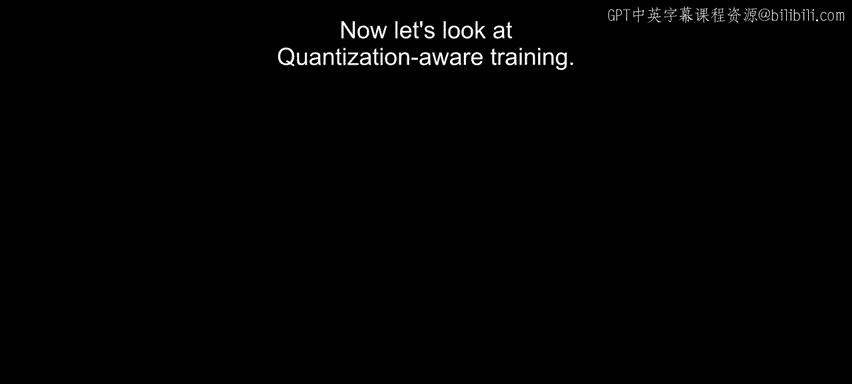
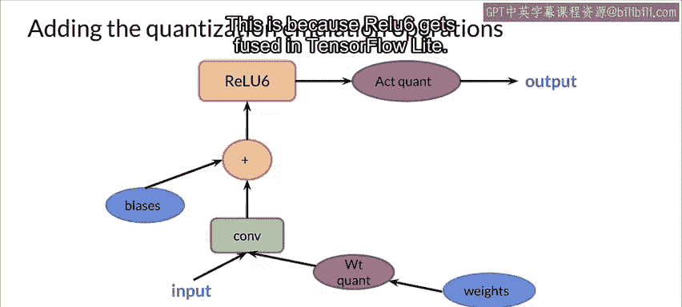
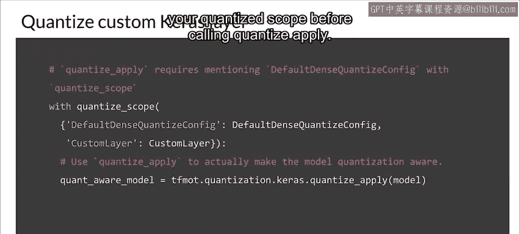
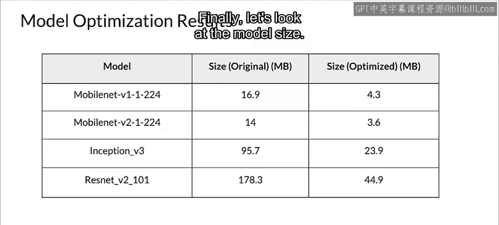

# 吴恩达《机器学习工程师的生产实践（MLOps）Machine Learning Engineering for Production》中英字幕 - P99：21_量化感知训练.zh_en - GPT中英字幕课程资源 - BV1pi4y167g5

Now， let's look at quantization aware training。 The simplest approach to quantize a neural network is to first train it in full precision and then simply quantize the weights to fixed point。

This is post training quantization。By contrast， quantization aware training applies quantization to the model while it is being trained。

The core idea is that quantization aware training simulates。

Low precision inference time computation in the forward path of the training process。

By inserting fake quantization nodes， the rounding effects of quantization are as simulated in the forward pass。

 as it would normally occur in actual inference。The goal is to fine tune the weights to adjust for the precision loss。

 So if fake quantization nodes are included in the model graph at the points where quantization is expected to occur。

 for example， at convolutions。Then in the forward pass。

 the float values will be rounded to the specified number of levels to simulate the effects of quantization。

 This introduces the quantization error as noise during training and as part of the overall loss。

 which the optimization algorithm tries to minimize。Here。

 the model learns parameters that are more robust to quantization。Next。

 let's see the process of quantizing a model during training。In quantization Aware training。

 you first build a model like you usually would and make it quantization aware using the TensorFlow model optimization toolkits APIs。

Finally， you train this model with the quantization emulation operations to get our integer only quantized model。

Let's look at this simplified graph showing basic operations in a neural network。

 The next step is to add quantization emulation operations。

 The quantization emulation operations need to be placed in the training graphs such that they are consistent with the way that the quantized graph will be computed。

 The weight quant and activation quant ops introduce losses in the forward pass of the model to simulate actual quantization loss during inference。

Note how there is no quant operation between convolution and Raylu 6。

 This is because Raylus get fused in Tensorflow light。

 The quantization Aware training API makes it easy to train with quantization awareness for an entire model or only parts of it and then export it for deployment with Tensorflow light。

 So to make the whole model aware of quantization， we apply TFmot quantization。

 Carris quantantize model to the model。

The API is also quite flexible and capable of handling far more complicated use cases。For example。

 it allows you to control quantization precisely within a layer。

 createate custom quantization algorithms and handle any custom layers that you may have written。

 You can selectively quantize layers of a model to explore the trade off between accuracy。

 speed and model size。For example， try quantizing the later layers instead of the first layers and always remember to avoid quantizing critical layers like the attention mechanism in transformer architectures。

 For example， if you happen to have activations or other operations that aren't yet supported by the quantization aware framework。

 you can use a quantization configuration to solve this。For example。

 in this code snippet calls a custom config like default dense quantize config to quantize a custom layer。

And finally， let's include your custom config in your quant scope before calling quantize apply。

Here are some results showing the loss of accuracy on a few models。

This should give you a feel for what to expect in your own models。

 Let's look at the latency for a few models。 Remember that lower numbers are better in this case。

And finally， let's look at the model size。 again， lower numbers are better。

