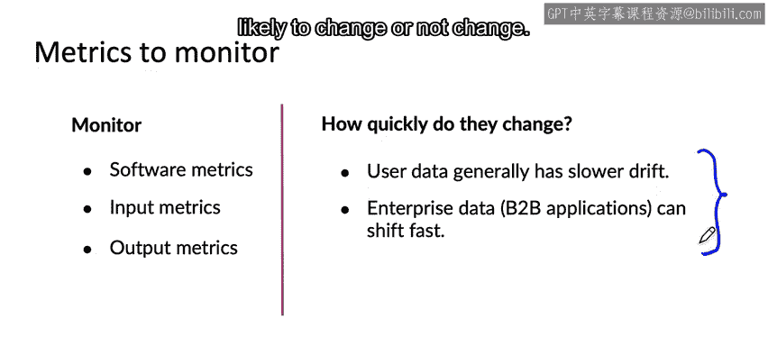

# 吴恩达《机器学习工程师的生产实践（MLOps）Machine Learning Engineering for Production》中英字幕 - P9：8_流水线监控.zh_en - GPT中英字幕课程资源 - BV1pi4y167g5

Many AI systems are not just a single machine learning model running a prediction service。

 but instead involves a pipeline of multiple steps。

 So what are machine learning pipelines and how do you build monitoring systems for that Let's learn about that in this video。

😊，Let's continue with our speech recognition example You've seen how a speech recognition system may take us input audio and output a transcript the way that speech recognition is typically implemented on mobile apps is not like this。

 but instead is a slightly more complex pipeline where the audio is fed to a module called a VD。我诶。

Voice， activity detection。Mo you。Whose job it is to see if anyone is speaking and only if the VAD module。

 the voice activity detection module thinks someone is speaking does it then bother to pass the audio on to a speech recognition system whose job it is to then generate the transcript and the reason we use a voice activity detection or VAD module is because if say your speech recognition system runs in the cloud。

 you don't want to stream more bandwidth than you have to to your cloud server and so the voice activity detection module looks at the long stream of audio on your cell phone and clips or shortens the audio to just the part where someone is talking and streams only that to the cloud server to perform the speech recognition So this is an example of a machine learning pipeline where there is one step。

Usually done by a learning algorithm as well to decide if someone is talking or not。

 and then a second step， also done by a learning algorithm to generate the text transcript when you have two learning algorithms。

 one that's learned to detect someone's talking and one that's learned to trans speech。

 when you have two such modules working together changes to the first module may affect the performance of the second module as well。

 for example， let's say that because of the way a new cellphone's microphone works。

 the VAD module ends up clipping the audio differently。

 maybe it leaves more silence at the start end or less silence at the start end and thus if the VADs output changes that will cause the speech recognition system's input to change and that could cause degraded performance of the speech recognition system let's look at an example involving user profile。

Maybe have user data such as clickstreamam data showing what users are clicking on and this can be used to build a user profile that tries to capture key attributes or key characteristics of a user For example。

 I once built user profiles that would try to estimate many attributes of users including whether or not the user seem to own a car because this would help us decide if it was worth trying to offer car insurance office to that user and so whether the user owns a car could be yes or no or unknown。

Or maybe other finer gras than these and the typical way that the user profile is built is with a learning algorithm to try to predict if this user owns a car。

 this type of user profile which can have a very long list of predicted attributes can then be fed to a recommend a system and not a learning algorithm that then takes its understanding of the user to try to generate product recommendations。

Now， if something about the clickstream data changes， maybe this input distribution changes。

 then maybe over time， if we lose our ability to figure out if a user owns a car。

 then the percentage of the unknown tag here may go up。And because the user profile's output changes。

The input to the recommended system now changes， and this might affect the quality of the product recommendations。

 when you have machine learning pipelines， these cascading effects in a pipeline can be complex to keep track of。

 but if the percentage of unknown labels does go up， this could be something。

That you would want to be alerted to so that you can update the recommended system if needed。

 to make sure you continue to generate high quality product recommendations So when building these complex machine learning pipelines which can have machine learningbased components or not- machine learningbased components throughout the pipeline。

 I find it useful to brainstorm metrics to monitor that can detect changes including concept drift or datad or both and multiple stages of the pipeline So metrics to monitor include software metrics for perhaps each of the components in the pipeline or perhaps for the overall pipeline as a whole。

 as well as input metrics and potentially output metrics for each of the components of the pipeline and by brainstorming metrics associated with individual components of the pipeline as well this could help you spot problems such as the voice activity detection system outputing。

Ler or shorter audio closeds over time or the user profile system suddenly having more unknown attributes for whether the user owns a car and thereby alert you to changes in the data that may require you to take action to maintain the model but the principle that you saw in the lost video of brainstorm all the things that could go wrong including things that could go wrong with individual components of the pipeline and design metrics to track those that principle still applies only now you're looking at multiple components in the pipeline Finally。

 how quickly does data change the rate at which data changes is very problem dependent for example。

 let's see a built to face recognition system then the rate at which people's appearances changes usually isn't that fast you know people's hairstyles and clothing does change with fashion changes and as cameras get better。

We've been getting higher and higher resolution pictures of people over time， but for the most part。

 people's appearances don't change that much， but there are sometimes things that can change very quickly as well。

 such as if a factory gets a new batch of material for how they make cell phones and so all the cell phones start to change in appearance so some applications will have data that changes over the timescale of months or even years and some applications will have data that could suddenly change in a matter of minutes。

Speaking in very broad generalities， I find that on average user data generally changes relatively slowly。

 If you run a consumer facing business with a very large number of users。

 then it is quite rare for millions of users to all suddenly change their behavior or at the same time and so user data if you have a large number of users will usually change relatively slowly。

 There are few exceptions of course， CoVd-19 being one of them where a shock to society actually cause a lot of people's behavior that all change at the same time and if you look at web search traffic。

 you will see trends， maybe a holiday or a new movie and people start searching for something new that just became popular So there are exceptions but on average。

 if you have a very large group of users there are only a few forces they can simultaneously change the behavior of a lot of people or at the same time In contrast。

 if you work on a。EB or business to business application。

 I find that enterprise data or business data can shift quite quickly because a factory making cell phones may suddenly decide to use a new coating for the cell phones and suddenly the entire dataset set changes because the cell phone suddenly all look different。

 But if you're providing a machine learning system to a company。

 then sometimes if the CEO of that company decides to change the way that business operates all of that data can shift very quickly。

 I know that these two bullets are mepe in generalities and there are certain exceptions to both of these。

 but maybe this would give you a way of thinking about how quickly your data is likely to change or not change。

 So that's it， congratulations on making it to the end of this first week's videos。

I hope you also take a look at the practice quizzes which will let you practice all of these concepts and make sure you deeply understand them and if you want。

 you can also take a look at this week's optional programming exercise which will let you deploy a machine learning model on your own computer。

😊，And I also look forward to seeing you in next week's videos where we'll dive together much more deeply into the modeling part of the full cycle of machine learning project。

 I look forward to seeing you next week。😊。