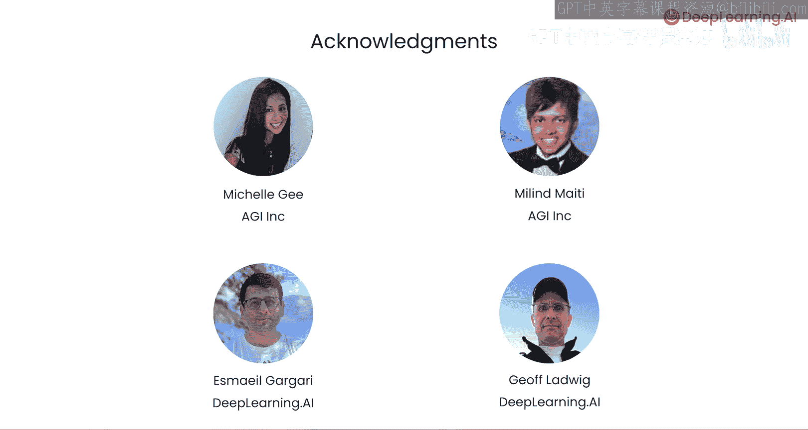

# 吴恩达《构建AI浏览器智能体｜Building AI Browser Agents》中英字幕 - P1：1.intro.zh_en - GPT中英字幕课程资源 - BV1pg5BzcEEr

Welcome toBuilding AI browser Age Vos in partnership with Asia Inc。

AI browser or AI web agents can log into websites， for forms。

 click through web pages or even place an online order for you。

Your AI web agent can use both visual information， that is screenshots and structural information。

 such as the HTML or the Doin object model or DOm representation of a web page to reason and take actions。

If you open a page on the website and take a look at the code underlying that webage。

 you see how large the action space can be for the agent at each step。😊。

Since these agents can run long sequences of actions automatically。

 can error can have unintended consequences like paying the around flight or ordering random products。

Or if the agent mis visa a single field， say a product name。

 it can head down the wrong path entirely， and these errors can compound quickly。

In this course you learn about these problems and several approaches to tackle them I'm delighted to introduce the instructors D Gg and Namgog。

 who are the cofounders of AGI Inc Div Naman and their team have built multion。

 which is a W agent platform thats based on the approach that they published in the agent Q paper。

Thanks， Andrew。To address the challenges， you mentioned， we have introduced agent Q。

Asian Q commands Monteello research on MCTS with a self critic mechanism and an iterative front tuning using direct preference optimization or DPU。

😊，During the search process of agent care， different branches or sequence of actions are explored。

 and their outcomes are evaluated， The simulations combined with their feedback are used to create preference periodss。

 additional note of the surgery， the DPO algorithm is then used to find language language policy model by learning from this high level preferences。

😊，This helps favor actions that lead to better outcomes or are ranked higher by the AI feedback。

In this course you will build several bads you will build a simple Bagin that analyzes deep learning AI website and list all the courses on a specific topic then you will extend this to taking actions like clicking on a course or sumrisising it and even signing up for a batch newsletter Next。

 you will dive deep into MCTS that is an integral part of our agent Q method and solve a grid problem of finding the optimal path you will then explore a variant of agent queue plus MCTS that takes a course title and searches the web and navigates the result until it finds the right course you will visualize and analyze different three paths the agent takes until it accomplishes the goal。

 Many people have worth ci trade this course I'd like to thank Michel G and Mil My from HI Inc from Tvaar AI Ash Gagari and Jeff Lawig have also cond in this course The first lesson will be an introduction to AI agents。

Y that sounds great now let's of you rather than your web page get started。😊。

